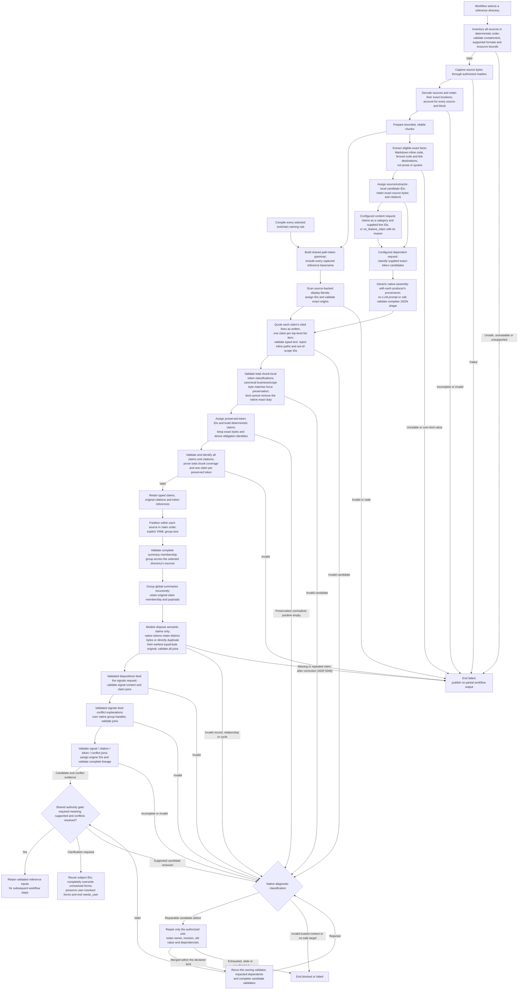

High-level flow for turning selected reference material into supported workflow inputs.
Extraction uses the configured content/classification split of
[ADR 0016](../decisions/0016-configured-json-response-composition.md).

Citation checks prove source location; semantic interpretation requires
validation and user review. Scanning yields byte spans, not file authority.
Candidates remain execution-local; permitted clarification state survives reruns.

Contracts and implementation evidence: [Design §16](../design.md#16-reference-ingestion-and-normalization)
and [F0100 §§3.6–3.9](../features/F0100-SpecWorkflow.md#39-reference-reconciliation-boundary),
as amended by [ADR 0022](../decisions/0022-native-reference-phase-handoffs.md),
[ADR 0024](../decisions/0024-native-exact-token-authority.md),
[ADR 0036](../decisions/0036-source-quoted-claims.md) and
[ADR 0038](../decisions/0038-record-claims-and-scenario-coverage.md).
Scripted verification does not establish live completion or semantic quality.
