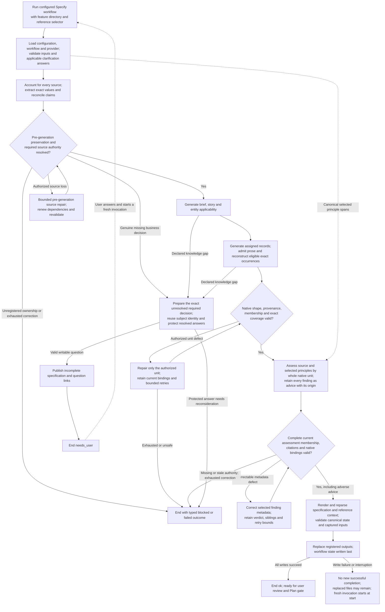

High-level execution flow for the Specify workflow, including the accepted
[ADR 0023](../decisions/0023-advisory-post-generation-review.md) review policy.
The governing design remains proposed; live quality evidence is tracked in FIX06.

- Feature and source selectors are relative to their configured roots. The supplied
  definition declares `id: spec-generation`; its filename does not choose identity.
- Model review proves no semantic truth. Positive and adverse findings complete
  the same bound advisory assessment. Neither triggers content repair, upstream
  rebuilding, a clarification or a mandatory Plan obligation by itself.
- Source-repair authorization, packet preparation and merge reject once generation
  starts, even if a workflow routes directly to those operations.
- Source repair retains its original required review purpose. Generation-ready
  references still need that validation; active repair obligations block generation.
- Native validation and current authority remain mandatory. A real defect uses
  its owning deterministic validator and typed outcome.
- Open Spec questions prevent Plan; open Spec or Plan questions prevent Tasks.
  Plan independently validates current required project policy.

[Specify](../contracts/17-specify.md), [repair](../contracts/22-repair.md) and
[publication](../contracts/25-publication.md) own the detailed
contracts. Model protocol correction retains the original request and schema;
separate authorized native repairs receive fresh bound requests.
