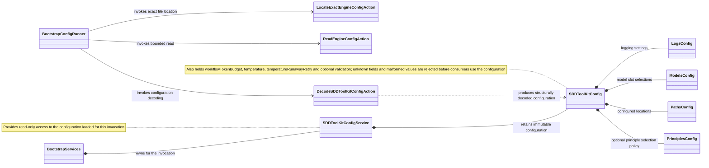

Main responsibilities and relationships for project configuration.

[F0001](../features/F0001-SDDToolKitConfigService.md) owns the invocation's
immutable `.sddtoolkit.json` input. Dedicated consumers validate logging,
model and path policy.
