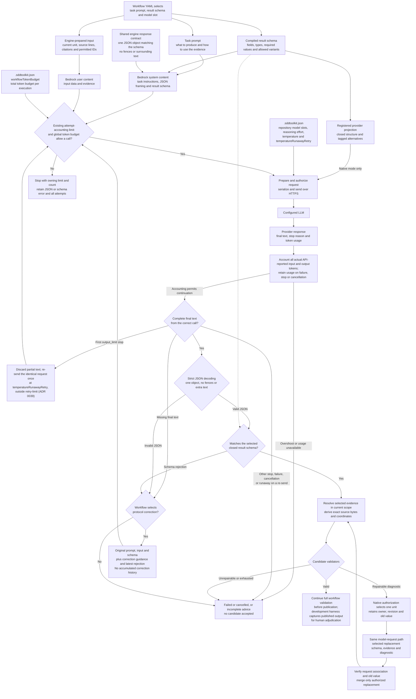

# Model prompt and response flow

Shared model-request path, shown with the production Bedrock adapter. Workflow
resources supply task instructions/schema; serialization emits universal JSON
framing once per call.

Under [ADR 0030](../decisions/0030-engine-owned-model-request.md) (not yet implemented),
protocol correction becomes a stage of the `request-model` step, bounded by its declared
`retry-limit`, rather than a YAML-selected step. The flow below is otherwise unchanged.

The Specify E2E cases select native JSON Schema mode (`json: true`).

Owners: [response contract](../decisions/0006-minimal-model-response.md),
[workflow request ownership](../decisions/0012-workflow-owned-model-request.md),
[universal framing](../decisions/0014-universal-response-format-guidance.md),
[protocol correction](../contracts/22-repair.md#226-unparseable-output).
Shape validation yields a candidate; source location and model review do not
prove semantic support or authorize publication.
