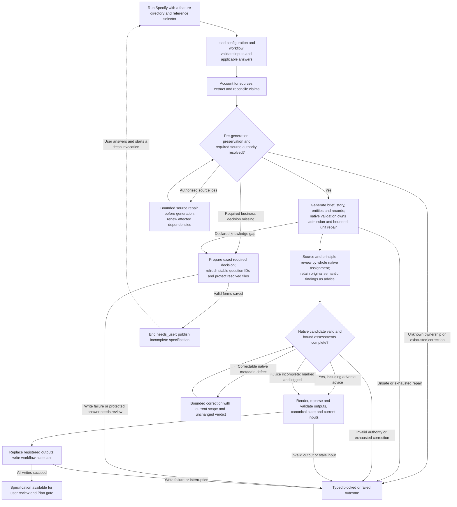

# Specification workflow overview

The supplied definition uses `spec-generation`. This view includes the accepted
[ADR 0023](../decisions/0023-advisory-post-generation-review.md) amendment; the
overall governing design remains proposed.

- Semantic review is advisory, including principle findings. It supplies no
  automatic content repair, upstream rebuild, question or mandatory Plan obligation.
  Incomplete review is still published, marked and logged
  ([ADR 0040](../decisions/0040-incomplete-review-published-marked-logged.md)).
- Native requiredness, provenance, exact coverage, citations, current authority
  and publication gates remain mandatory. Source repair rejects once generation
  starts, including direct use through a custom workflow.
- Clarifications persist across invocations; fresh invocations start at `start`.
  Failed publication may leave replaced files without recording new completion.
- Open Spec questions stop Plan; open Spec or Plan questions stop Tasks. Plan
  independently validates required current policy.
- Failed, blocked, cancelled and completed remain distinct outcomes.

See the [Specify contract](../contracts/17-specify.md),
[workflow definition](../workflows/spec.workflow.yaml),
[publication decision](../decisions/0009-atomic-workflow-execution.md) and
[detailed specification flow](10-spec-workflow.md).
