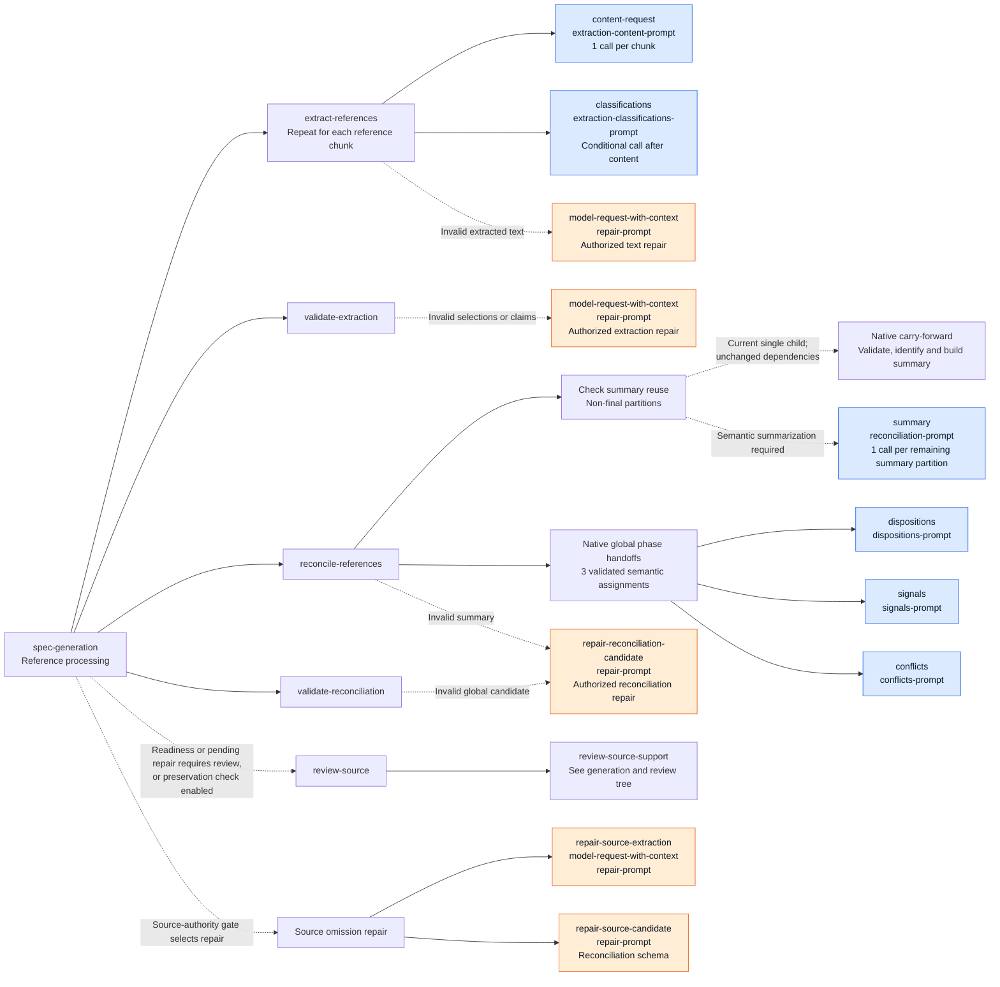
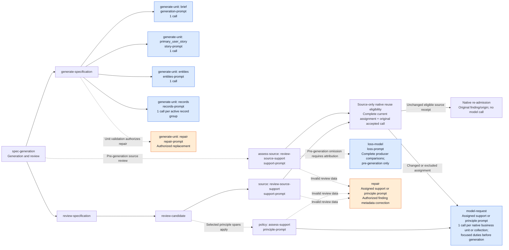
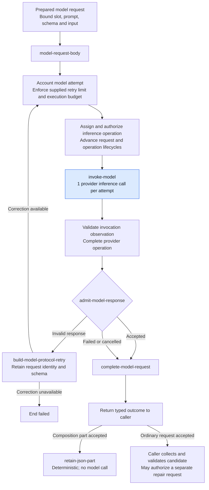

# Spec model call tree

These diagrams describe the current [Spec workflow YAML](../workflows/spec.workflow.yaml),
whose workflow ID is `spec-generation`. They document its configured calls, not
new design authority or evidence of a successful live run. The governing design
remains **Proposed design**; see [§17](../contracts/17-specify.md) and
[§12](../contracts/12-model-boundary.md).

In the first two diagrams, arrows mean **contains or calls**, not execution
order or parallel execution. Dashed arrows mark conditional branches. Blue nodes
are model requests using `spec_generation`; orange nodes use `repair`.
Deterministic preparation, validation, assembly and publication are collapsed.
Every model node uses the shared request path in the third diagram.

## Reference processing

The workflow extracts all reference chunks, rebuilds and validates extraction,
then reconciles summary partitions and validates each global phase before its
descendant is requested. Composition assembly
is deterministic and adds no model call.

Global calls execute in this order: **dispositions → validate → signals → validate
→ conflicts → validate**. The next call receives native accepted facts rather than
unchecked response JSON. Repairs retire affected descendants and request pending
assignments again. Canonical accepted group occurrences feed authoring; there is
no independent presentation-role request or positive-role conversion. Authored
values select complete current groups while drafting, and native code admits the
occurrences without judging semantic support. Changed upstream groups retire
affected authored associations and dependent review/attribution evidence.
Conflicts select accepted group handles. Native code constructs token
projections and reciprocal relationships. Summary partitions finish before the
global phase handoffs. The YAML sets
reconciliation `group-size: 8`; the resulting partition count depends on the
extracted claims and hierarchy.

A source repair retains its original required readiness/preservation purpose in
the native retry scope. Its pending review runs even if repaired references are
generation-ready and optional preservation is disabled. Generation initialization
rejects active repair obligations; post-generation advice cannot settle them.

Empty token collections and classifications forced by `no_feature_claim` are
constructed natively; positive token-only extraction still needs semantic
classification. Summary coverage uses the union of statement selections, permitting
overlap. Exact duplicates normalize only after all statements validate; retained
semantic response order precedes native token claim order. Raw repair occurrences
remain unchanged. A non-final, nonempty partition with one current validated child
and unchanged membership, evidence and text dependencies carries that child forward
without a model call. Explicit workflow actions recheck eligibility and use the
same summary validation, identity allocation and construction path. Stale or altered
children fail; original provider and repair provenance remain on the child in
history. Final global semantic phases are unchanged. See
[ADR 0022](../decisions/0022-native-reference-phase-handoffs.md).
Summary and signal `assignment.claim_ids` contain only eligible semantic claims;
the full token/citation evidence remains visible. Conflict explanations receive
native group handles without a separate claim-selection assignment.

The [Hello World configuration](../../test/e2e/wf-001-hello-world/.sddtoolkit.json)
sets `validation.sourcePreservationCheck: false`. This skips optional source
preservation review when source readiness passes. A source-readiness block still
routes through source review and the authority gate.

## Specification generation and review

Native generation initialization requires complete current references and a
nonempty retained group catalogue. Initial brief, story and entity-basis values
select nonempty unique canonical `signal_ids` alongside content; initial questions
select their distinct question-eligible groups. Native admission derives required
`source_group_ids`, complete claim unions and exact lineage. Records retain one
native-bound group and return content only. No role-classifier call or mandatory
role-prebinding gate remains. Invalid or stale native authority blocks without
fabricating a user information gap. Post-generation source and principle reviews
retain semantic findings as advice under
[ADR 0023](../decisions/0023-advisory-post-generation-review.md); they do not prove
semantic support or authorize content repair.

Record-group assignments enumerate complete active reconciled groups; one group
may produce several specification records or none. Empty output advances the native
cursor but cannot bypass aggregate coverage, required families or review completion. Review subjects come
from the shared required-authority ledger. Empty principle selection requires no
principle model call. Pre-generation source repair can rebuild reconciliation;
native generation validation can repair its authorized unit. Once generation has
started, source-omission authorization, packet construction and merge reject with
a typed phase error. A custom YAML route cannot reopen consumed source authority.
Post-generation semantic findings cause no localization, source rebuilding,
generated-content repair, mandatory Plan obligation or clarification.

Phase 6 retains only clean admitted source assignments with unchanged complete
packet, native requirements/applicability, sources, schema, guidance and model
settings in the same execution. A receipt retains its complete native assignment.
The pure reuse operation consumes a finite unchanged prefix, stopping at the first
assignment that needs a model call. Source and policy loops share one assessment
body; localization remains pre-generation and source-only, and policy has no
reuse transition.
Sibling or broad-context changes require new review. Policy review, omissions and
corrected assignments are reassessed. Historical receipts never satisfy authority;
the ordinary collector re-admits them against the current revision and full native
validation still runs. Actual original origins and retry identities survive; no
request, checkpoint or persisted cache is created. See
[§22.4](../contracts/22-repair.md#224-repair-request-and-response).

Source and principle reviews use the same native business ownership: one brief
assignment with its three field findings, one story, one entities decision, one
complete record with all its fields, and separate acceptance-criteria,
functional-requirements and scenario collections. Reference duties retain their
own subjects. Exact complete membership is checked before append, wire order is
normalized to native ledger order, and every finding retains its purpose and
evidence validation. A record pass cannot replace a field finding. Protocol
correction retains the complete assignment; native finding repair changes only
its authorized invalid metadata. Batched findings share the accepted call origin.
Post-generation omissions retain their detail without producer localization.
Pre-generation source-preservation duties and repairs remain authoritative. These
request-count changes do not establish semantic improvement.

The `model-request-with-context` subgraph retains the workflow-selected context
for extraction repairs and specification authoring. Generation and native unit
repair use one shared `generation-context` resource. It explains
ordered text fragments and literal insertion; the selected schema still defines
the response shape. Story purpose comes from the shared native requirement descriptions.
Brief and story packets contain source evidence without sibling drafts; entities
receive the brief, and record requests receive the brief and entity decision.
Authoring purposes include resolved bound requirements; other eligible meanings
remain context and full source text stays available. Exact-reference bookkeeping
is native: raw prose is recognized against current eligible occurrence scope;
the model cannot select exact-copy nodes or extend its fixed source selection.
Native repairs use the repair prompt and their authorized purpose/task. Corrections
retain the active context, prompt and dynamic input.

Source review assesses the selected feature/record field or native signal while
retaining original-source evidence. Before generation, producer localization
carries the fixed finding and reconstruction evidence under its separate
assignment. Native ID
eligibility narrows initial, composition and repair schemas at the shared result
schema owner; protocol corrections retain the same selected schema. Membership
restriction does not replace semantic judgment or native evidence validation.

The mechanical coverage blocker, authority gates, clarification forms, rendering
and publication are deterministic in this YAML and do not add model requests.

## Shared model-request execution

This diagram uses arrows for **execution order**. `model-request`,
`model-request-with-context` and `composition-request` prepare
a request before entering `model-request-body`. The extraction content step prepares its request
directly and enters through `composition-request-body`.

Authorization, lifecycle or accounting failures terminate through their declared
outcomes; those terminal branches are collapsed above. Failed, cancelled and
invalid outcomes remain distinct. Model-assisted review is candidate evidence,
not deterministic semantic proof.

The call counts shown in the trees exclude protocol retries, authorized repairs,
pre-generation localization and repeated work after pre-generation source repair.
There is no fixed total for the workflow. The configured `spec_generation` and `repair` slots select
models; a slot name does not imply a single call.
