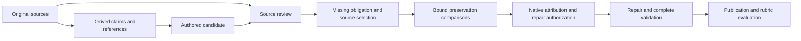

# FIX03 — Critical review of Spec workflow reliability

**Reviewed:** 11 October 2026, Australia/Melbourne.

**Initial review source revision:** `607f853555beb19a2fb7509dc15ac07737d53a56`.

**Status:** Phases 0, 1 and 3 are complete at their offline exits: preparation,
mechanical safety, observability and connected recovery checks. The 14 October
implementation request approves Phase 2's source-only invalid-content finding;
its coordinated implementation and verification record appears below. Phase 4's bounded AC
transport/lifecycle implementation and offline verification are complete; its
semantic exit remains pending the Phase 11 live comparison. Phase 6's execution-local
source-review retention is implemented; its verification record and live qualification
boundary are below. Phase 5's coordinated replacement is implemented and verified
offline. The controlled representation diagnostic and current-authoring
qualification have received all **50 approved AWS responses**; their live semantic
exit is not complete. The authoring observations include omitted entities,
misassigned record meaning and unsupported behavior. Completion and schema validity
have not established a reliable replacement.
Phases 7–11 remain proposed and incomplete.
The latest [07:50:47 run](#24-latest-live-run-11-october-075047-utc)
blocked before authoring after four explicit false unsupported role decisions.
Both harness reports retained its native outcome and fractional evaluator settings.
The earlier [07:03:52 run](#23-post-phase-4-live-run-11-october-070352-utc)
exercised batching, localization and two candidate repairs, then exhausted the
workflow token budget; its inconsistent field judgments remain separate evidence.
No run establishes improved published-output quality.
The [Phase 1 reporting follow-up](#23-post-phase-4-live-run-11-october-070352-utc)
is complete offline and its normal blocked-report persistence was exercised
live; injected report-write and sync failures remain offline-only evidence.

**Critical rereview:** the findings justify bounded investigations, but this is
not an implementation-ready redesign. The final review confirms the retained
results and distinguishes existing reuse from proposed simplification, batching
from removing review duties, and structural verification from semantic acceptance.
The next bounded deliverable and its exit criteria are in §7. External research
in §9.1 informs experiments; it does not establish the cause of these failures.

**Reliability priority:** reducing unnecessary workflow complexity is part of the
remedy, not optional cleanup after reliability improves. This update brings the
responsibility and simplification work forward (§§6.3–7), while preserving the
distinction between observed complexity and an unproven cause of a semantic error.

This review checks the supplied architectural critique against the current code,
retained live evidence and the subsequent source-review qualification. The review
does not accept the overall **Proposed design**, authorize experiments or declare
unfinished implementation or semantic acceptance complete. The user-requested
Phase 1 implementation amends only the focused contracts and ADR listed in its
delivery record.
[FIX01](FIX01.md) remains the active reliability backlog. Section 7 owns the rollout
sequence for this review's recommendations; link its phases to the existing backlog
items rather than copying their implementation status. Neither document overrides
accepted contracts.

The governing baseline is [design §§1, 3, 4, 30 and 31](../design/design.md),
particularly model-candidate authority, deterministic state transitions, atomic
repair, current evidence and publication. Focused boundaries are §§6, 12, 17,
21–25, 27 and 28 and the accepted ADRs linked below. Proposed simplification does
not relax those invariants.

## 1. Conclusion

The supplied critique is substantially supported, but it combines three different
problems that need different remedies:

1. **Unreliable semantic judgments:** source review sometimes accepts incomplete
   content or invents the obligation that downstream repair is asked to restore.
2. **Incomplete or expensive recovery:** fresh clarification answers cannot yet
   complete the intended acceptance path; some representation defects cannot be
   repaired; a completed-candidate omission repair starts the applicable semantic
   review sequence again.
3. **Generic execution and authoring concerns:** the reviewed baseline allowed
   indirect failure masking, corrected by [Phase 1](#phase-1-delivery-record).
   The workflow still exposes a large amount of request-lifecycle and
   temporary-value bookkeeping.

These are not all prompt defects. Nor does their existence justify removing native
validation. The deterministic boundaries provide real protection: they reject
unauthorized changes, preserve exact source occurrences and prevent publication
without the required evidence. Their weakness is that **mechanically admitted
semantic evidence can still be wrong**, while useful recovery is not complete.

The strongest immediate quality finding is upstream of the latest attribution
improvement. The 76-call comparison supplied a correct missing obligation; the
30-call panel required the source reviewer to discover it. The latter failed its
frozen rubric and exposed definite interpretation errors, but some expectations
also assume field-coverage duties that the assigned purpose does not establish.
It neither demonstrates a same-task regression caused by citation guidance nor
measures complete production source-review traversal.

Complexity is a credible contributor to cost, maintenance burden and additional
failure opportunities. It should be addressed alongside semantic correctness,
rather than leaving the current workflow intact and adding more prompts, reviews
and recovery branches around each failure. Unclear ownership, repeated semantic
decisions and avoidable handoffs make useful completion depend on more fallible
judgments and make failures harder to attribute.

The retained evidence does not establish that complexity alone caused the
incorrect judgments, or that a particular simpler workflow will perform better.
That uncertainty calls for a bounded simplification comparison, not indefinite
deferral. Remove work shown to be redundant; test changes to semantic boundaries
against the same source-fidelity, recovery and publication criteria. Native
authority, validation and explicit outcomes remain necessary safeguards.

## 2. Evidence corrections and limits

### 2.1 The two latest panels test different responsibilities

| Measurement | Citation-completeness comparison | Actual source-review qualification |
| --- | --- | --- |
| Live calls | 76: 38 baseline, 38 candidate | 30: 15 assignments, two repetitions |
| Model's responsibility | Assess a supplied obligation against an assigned producer collection | Discover a defect from original sources and candidate content; formulate its missing obligation |
| Correct obligation supplied as premise | Yes | No |
| Main result | Complete citations **36/38 → 38/38**; correct collection verdicts **38/38 in both arms** | **15/26** faithful omission handoffs; **2/2** supported controls; **0/2** genuine-information-gap controls |
| Native admission | **26/26** assembled decisions in each arm | **30/30** responses |
| Actual tokens | 111,236 total | 46,152 total |
| Proves repair/publication/rubric quality | No | No |

Sources: [citation results](../test/calibration/source-loss-attribution/bound-preservation/citation-completeness/results.md),
[handoff results](../test/calibration/source-loss-attribution/bound-preservation/citation-completeness/handoff-results.md),
and their retained scorecards and provider receipts. The attachment's statement
that citation completeness is only offline preparation is now outdated.

Both panels used Bedrock GPT-OSS-20B, low reasoning, temperature zero and native
schema. Protocol validity was measured after the existing approved prefix
normalization. Each had two repetitions on mostly known cases; semantic assessment
was unblinded and model-assisted. Neither is deterministic proof, a population
failure rate, or whole-workflow E2E evidence.

Against its frozen rubric, the 30-call panel has **seven false `supported` results** on omission trials and
**four wrong or inadequate omission formulations**. Both gap-control responses also
returned false omissions. All were structurally admissible. Correct finding kind
was 21/30; identifying `candidate_omission` is therefore not sufficient either.

The units matter. Citation testing covered **13 cases and 19 collections**, with
two arms and two repetitions. Its citation improvement is one case corrected in
both repetitions, not two independent cases. Twelve cases were known regressions
and one was new. The reviewer panel covered **13 omission cases and two control
cases**, each twice; six omission cases passed both repetitions, three passed one
and four passed neither. These repetitions do not establish model-independent
reliability. The field-responsibility qualification in §3.2 limits interpretation
of the scores without changing the frozen result.

No downstream loss calls were sent from that panel. It retained 21 untrusted
omission assignments, including the two false gap findings. The other nine
responses produced no omission assignment. Diagnostic origins are authentic replay
origins, not fabricated production-ledger acceptance.

### 2.2 Previously reviewed nine-report baseline

These nine reports are live executions of the same Hello World case. None
reached publication checking or actual-output semantic grading: those fields are
`not_run`, with no published specification or evaluation in the report.

| Start, UTC | Ledger attempts | Actual tokens | Reported terminal failure |
| --- | ---: | ---: | --- |
| [2026-10-10 03:24:03](../zig-out/e2e-spec/2026-10-10T03-24-03Z-2a2774d40362927ff90dc560ad009d3a/report.json) | 44 | 77,818 | Invalid loss evidence |
| [2026-10-10 07:43:50](../zig-out/e2e-spec/2026-10-10T07-43-50Z-a0b420a0a10277fc75f6b67779afab35/report.json) | 27 | 46,589 | Unsafe omission authorization |
| [2026-10-10 07:55:12](../zig-out/e2e-spec/2026-10-10T07-55-12Z-f3a1cca5cb586534ebedb3716242185e/report.json) | 27 | 46,460 | Unsafe omission authorization |
| [2026-10-10 09:11:22](../zig-out/e2e-spec/2026-10-10T09-11-22Z-e32308c28e92ef6e1c5834b4261382de/report.json) | 46 | 86,529 | Unsafe omission authorization |
| [2026-10-10 09:23:49](../zig-out/e2e-spec/2026-10-10T09-23-49Z-e9bfcc15cbc0e0218fabf4c59ca0ff48/report.json) | 53 | 100,175 | `WorkflowTokenBudgetExceeded` |
| [2026-10-10 10:14:47](../zig-out/e2e-spec/2026-10-10T10-14-47Z-33d6aabe2c0ac71ec7651671e2060162/report.json) | 46 | 87,567 | Unsafe omission authorization |
| [2026-10-10 20:48:24](../zig-out/e2e-spec/2026-10-10T20-48-24Z-aeb69f532b84b4db60ac56b61af71fb0/report.json) | 46 | 90,178 | `RetryLimitExhausted`; retained `missing_final_text` |
| [2026-10-10 21:36:24](../zig-out/e2e-spec/2026-10-10T21-36-24Z-b719cf9e6dbcf47e655fb60b658eec70/report.json) | 50 (49 sent) | 93,335 | `workflow_blocked`, `LOG_SERIALIZATION_FAILURE` before attempt 50 was sent |
| [2026-10-11 02:43:55](../zig-out/e2e-spec/2026-10-11T02-43-55Z-ee20c06eea86559fb98a8b9db70bb3e9/report.json) | 8 (all sent) | 25,979 | `workflow_failed`; call 8 brief generation stopped at `output_limit` |

Total: **347 ledger attempts: 346 with exact provider usage and one `not_sent`**;
**654,630 accounted tokens**. Attempt counts and summed usage match each report.
In the eighth report, attempt 50 has `accounting: not_sent` and `usage: null`;
the last projected exchange is correctly call 49. Calling all 339 entries in the
original eight-run set physical model calls was an error in the initial review.
These runs span six base revisions and nine distinct captured source hashes.
They are development observations across different builds, not nine controlled
repetitions of the current code.

The eighth report's logging failure occurred before dispatch: event 929 records
rejection at the request-call step, so there is no attempt-50 model answer to
diagnose. Its generic category did not identify the failed branch. Phase 1 isolated
the absent single-response origin of an authorized assembled repair and corrected
the shared lineage contract; its [delivery record](#phase-1-delivery-record) retains
the reproduction, diagnostics and offline evidence.

The ninth report is the first retained live run of that Phase 1 implementation.
Call 8 returned HTTP 200 with `finish_reason: length`, malformed brief JSON and
repeated trailing whitespace. It used **1,096 input + 16,384 output = 17,480
tokens**. The 16,384 allowance came from the configured `spec_generation` slot;
the workflow's 100,000-token cumulative budget was not exhausted. The captured
[request](../zig-out/e2e-spec/2026-10-11T02-43-55Z-ee20c06eea86559fb98a8b9db70bb3e9/evidence/generation/call-000008/request.json)
confirms low reasoning, temperature zero and native schema; the
[raw response](../zig-out/e2e-spec/2026-10-11T02-43-55Z-ee20c06eea86559fb98a8b9db70bb3e9/evidence/generation/call-000008/response.json)
retains the stopped output and usage. This is a completion failure, not an
observed Phase 1 runner or capture rejection.

The configuration, evaluation inputs and all 35 mapped source files match the
preceding run, but execution ended earlier, before correction or repair. This
does not demonstrate semantic or cost improvement, nor identify the cause of the
model's repetition. The [Phase 1 live assessment](#phase-1-live-assessment)
distinguishes exercised behavior from paths not reached. The frozen Phase 0
eight-run baseline remains unchanged; this ninth run is subsequent evidence.

### 2.3 Post-Phase 4 live run: 11 October 07:03:52 UTC

Run `2026-10-11T07-03-52Z-1b37c292a96b5055e6cf7d3f3b85e5dc` has empty
`report.json` and `report.md`. This assessment uses its retained
[events](../zig-out/e2e-spec/2026-10-11T07-03-52Z-1b37c292a96b5055e6cf7d3f3b85e5dc/events.jsonl),
48 raw provider responses, request packets and finalized production log. It does
not reconstruct or overwrite a missing report. The captured build base is
`aadc7505c695a3c75a6dafedf7c7a4b43f1d26f7`, source SHA-256
`3992c6e96bcb71491989b1561e6604fba64afd804d2f8193dc2089d4a52875a0`.
The relevant support, prompt, schema and report-serialization files match the
executed build capture.

**Terminal failure:** event 899 records `WorkflowTokenBudgetExceeded` at call 48.
The 48 responses total **92,686 input + 7,342 output = 100,028 tokens**, exceeding
the configured 100,000-token workflow budget by 28. Before call 48 the total was
97,421; its 2,431 input + 176 output brought the total over budget. All 48 provider
responses ended normally with `finish_reason: stop`; the largest output was 449
tokens. This was cumulative workflow exhaustion, not a 16,384-token output-limit
stop, a protocol retry or a rejected batch membership. Call 48's raw response is
retained, while its normalized model-output projection is intentionally absent
with `text: budget_stop`. Production logging records `run.failed` and its segment
trailer. No specification, successful state or rubric evaluation was published.

| Calls | Observed behavior | Assessment |
| --- | --- | --- |
| 8–11 | Brief, story, entity decision and records completed. | The workflow passed the point where the immediately preceding run stopped. Earlier authoring defects still exist: the entity basis is only `Hello, World!`, and some fragments concatenate without separation. |
| 19 | One AC record request returned all three Given/When/Then findings as `supported`. Events 414/416 admitted the response and collected the findings. | Phase 4's complete membership, per-field evidence and real shared origin worked in a live call. This does not establish semantic correctness. |
| 20–21 | FR1 review identified the omitted successful-startup obligation; both loss comparisons found it preserved upstream. | The assigned FR text from call 11 describes display and UTC output conditional on startup but does not require startup to succeed. This is a source-grounded candidate omission; native attribution selected candidate-local repair. |
| 26 | Replaced only FR1 text to include successful startup, greeting and UTC output; event 538 advanced candidate revision 5→6. | A useful candidate repair was applied. Source review then restarted. Full-candidate publication acceptance had not yet completed. |
| 34–35 | The second AC batch marked Given as a startup-success omission, with When and Then supported. Localization again found preservation upstream. | The real source obligation was attributed to the wrong field purpose. Accurate upstream preservation cannot validate that field-level diagnosis. |
| 41 | Replaced Given with `The application must start successfully.`; event 790 advanced revision 6→7. | The repair was mechanically authorized and narrow, but placed the required result into the precondition. This is apparent semantic harm under the supplied field contract. |
| 42–48 | Source review restarted again; the seventh review of this pass crossed the token budget. | The workflow stopped before publication, policy assessment and actual-output rubric grading. |

The trace's `first_observed_defect` points to event 512, when the complete review
retained its diagnostic. The earlier call 20 finding had already triggered
localization at event 434. The aggregate diagnostic's timestamp must not be
mistaken for the point where the missing behavior was authored or first detected.

**The key semantic evidence is an unchanged request with a changed verdict.**
Calls [19](../zig-out/e2e-spec/2026-10-11T07-03-52Z-1b37c292a96b5055e6cf7d3f3b85e5dc/evidence/generation/call-000019/context.json)
and [34](../zig-out/e2e-spec/2026-10-11T07-03-52Z-1b37c292a96b5055e6cf7d3f3b85e5dc/evidence/generation/call-000034/context.json)
had byte-identical 13,846-byte provider requests, SHA-256
`e576391c1d41f58d4489800211db6c467aa74385e2190faa44dd987fb7d3cc16`.
Their Given was `The application is not yet started`. Its explicit task describes
the starting situation before the trigger, without assuming the result being
tested. Both requests included the same sibling fields and evidence. The first
review accepted it; the second required successful startup in Given. Neither
missing sibling context nor the intervening FR repair changed this request.
Successful startup is a genuine source obligation, but that does not justify
requiring it in a pre-trigger field. Whether the AC's overall outcome coverage is
adequate is a separate collection/Then assessment. The scoped review and repair
must preserve that distinction.

| Work | Physical calls | Actual input + output tokens |
| --- | ---: | ---: |
| Extraction/reconciliation | 7 | 9,614 |
| Authoring | 4 | 5,479 |
| Source review | 33 | 73,436 |
| Loss comparison | 2 | 4,356 |
| Candidate repair | 2 | 7,143 |
| Total | 48 | 100,028 |

The two completed AC batches each used one request for three findings. However,
source review still consumed 73.4% of all tokens, with two complete review passes
and part of a third. This supports measuring the existing Phase 6 reuse proposal,
including identical supplied contexts, but request equality alone does not waive
its current-dependency, origin and invalidation requirements. Increasing the
budget would allow more work; it would not establish that the second diagnosis
or repair was correct.

**Separate report defect at this run:** [the harness saver](../test/harness/e2e/report.zig#L20)
serialized `Report` with the engine's integer-only
[canonical JSON encoder](../src/domain/canonical_json.zig#L47) before writing
either reserved output file. Evaluator configuration legitimately contains an
optional floating-point temperature; the current Bedrock selection resolves it
to **0.1**, even when the captured evaluation settings contain `temperature: null`
([configuration owner](../test/harness/configuration.zig#L50)). That value raises
`InvalidCanonicalJson`. The save occurred outside the execution-error handler
([CLI](../test/harness/e2e/cli.zig#L45)), so it could suppress both final reports.
The relevant captured source matched the reviewed baseline and the configured
evaluator was Bedrock. This code-level cause explains the empty files; the uncaptured
terminal stderr is not evidence of an observed exception string. Before the
follow-up, report persistence tests omitted `evaluation_configuration`, leaving
this path uncovered. The required fix was to correct serialization at the harness
boundary and test valid fractional configuration on failed and completed runs,
preserving the native-state integer-only contract and the original workflow failure.
Report finalization also needed its own observable failure handling.

**Reporting follow-up — complete (offline):** E2E reports now use the same standard
typed JSON serialization as the other harness reports, retaining fractional
configuration, thresholds and scores. The adjacent `inputs.json` capture uses
that representation too; a fractional rubric threshold must not fail before
workflow execution. Native integer-only canonical state serialization is unchanged.
Both report views are rendered before file writes, and their intermediate JSON,
Markdown and nested evaluator Markdown buffers are released. Exclusive file
reservation, permissions and sync behavior remain intact.

The CLI's shared final-reporting path catches report persistence errors separately,
retains the original workflow status/rejection/diagnostics, emits its existing
terminal result plus a distinct finalization error and incomplete-file notice, and
returns command failure when saving failed. It does not retry model calls or
report writes. Offline regressions cover failed reports with temperature `0.1`,
completed reports with fractional nested configuration/threshold/score, typed
readback, owned-buffer cleanup, JSON/Markdown write failures, a sync failure and
failure to write the separate stderr diagnostic without hiding the stdout result.

Verification on 11 October 2026:

- `zig build test-integration --summary all -j2`: **100/100 tests, 6/6 steps passed**.
- `zig build verify --summary all -j2`: **1,504/1,504 tests, 142/142 steps passed**,
  including architecture, lint, standalone harness checks and clean packaging smoke.
- `git diff --check`: passed.

The old run's empty report files remain historical evidence and are not reconstructed.
No live call or E2E run was made for this follow-up. This change repairs observability,
not the reviewer's semantic judgments or generated output quality.

**Implications for rollout:** retain Phase 4's offline completion and record its
live mechanical exercise, but do not mark its semantic gate passed. Carry this
exact verdict reversal and subsequent repair into the prospective Phase 11
comparison; assess correct field responsibility and repair harm separately from
complete membership and correct upstream attribution. The reporting gap is fixed
and verified offline; retain that distinction during subsequent live qualification.
Phase 5's role-gate experiment does not fix the observed downstream Given diagnosis.
The independent Phase 2 taxonomy and
Phase 6 reuse proposals retain their own authority and evidence gates.

The [immediately preceding 04:39 run](../zig-out/e2e-spec/2026-10-11T04-39-13Z-533671a00b4e7f4b23d75ffa0abc291d/report.json)
stopped at brief call 8 after 25,979 tokens. The 07:03:52 run progressed through
review and repair, but still produced no usable output. Its low-reasoning
GPT-OSS-20B requests use temperature **0.1**, versus **0** in that preceding run;
code and prompts also changed. This is not a controlled comparison proving that
batching or temperature caused either the improved completion or the incorrect
judgment. No new live run was executed for this documentation review, and the
frozen calibration panels remain unexecuted.

### 2.4 Latest live run: 11 October 07:50:47 UTC

Run `2026-10-11T07-50-47Z-7c05a7d38e4f86264d45ec27a08a4959` retained a valid
[JSON report](../zig-out/e2e-spec/2026-10-11T07-50-47Z-7c05a7d38e4f86264d45ec27a08a4959/report.json),
[Markdown report](../zig-out/e2e-spec/2026-10-11T07-50-47Z-7c05a7d38e4f86264d45ec27a08a4959/report.md)
and complete build capture. Its base revision is
`e9466229f13e9090fef7031db8f83ed513c22a49`, source SHA-256
`dc3ecfff7f9997dafd429641a4abce6f8b1a043d5540f172f6851178c0a72387`.
The captured reporting implementation, role admission, role purposes, source
binding and generation initialization match the inspected current code.

**Terminal result:** `workflow_blocked`, at event **213**,
`g8-generate-initialize-specification`. The model responsible is physical **call 6**,
request 6 / attempt 1 / `inference`,
`g25-g8-validate-request-roles-prepare`; call 7 is only the last exchange.
The report retains that distinction through `candidate_model_call` and the event's
`candidate_source`. There is no recorded provider, JSON/schema, capture or report
failure. No clarification, specification, successful state or rubric grade was
published.

All seven responses ended with `finish_reason: stop`. Native attempt usage and
raw provider totals agree: **7,646 input + 947 output = 8,593 tokens**, within the
**100,000-token workflow budget**. Actual requests use Bedrock
`openai.gpt-oss-20b-1:0` in `ap-southeast-2`, low reasoning, temperature **0.1**,
native schema and a **16,384** output allowance. The separately configured
**150,000-token evaluator budget** was not used because no output reached grading.
Lower token use than the 48-call run reflects earlier blocking, not useful savings.

| Boundary | Retained evidence | Assessment |
| --- | --- | --- |
| Calls 1–5: extraction, summary, dispositions and signals | All three obligations survive in business signal 1: successful startup, greeting on startup and UTC date/time output. The greeting's exact token is retained separately. | There is no demonstrated upstream obligation loss explaining the block. A compound claim and adjacent fragment concatenation are presentation variance, not proof that the behavior disappeared. |
| Call 6: authoring roles | `description` and `primary_goal` select signal 1; `title`, `primary_user_story`, `entity_basis` and `records` are explicitly `unsupported`. | The response contains all six required decisions. Completeness admission works, but the four negative decisions are inconsistent with the supplied role purposes and source-backed behavior. |
| Call 7: conflicts | Returns an empty conflict collection and is admitted. | It does not cause the missing-role diagnostic. |
| Event 213: generation initialization | Native coverage reports the four missing role assignments and blocks authoring. | Correct enforcement of the current R10 gate; no semantic retry or repair was performed. |

**Why this is a semantic false block:** the
[call 6 packet](../zig-out/e2e-spec/2026-10-11T07-50-47Z-7c05a7d38e4f86264d45ec27a08a4959/evidence/generation/call-000006/context.json)
explicitly permits deriving a title without a supplied title, using the source's
system as the story actor without a prewritten narrative, and deciding entity
applicability without an explicit declaration of absence. Required application
behavior and its startup trigger support applicable records; every record family
need not be present. This is a case-level assessment against the supplied purposes,
not native semantic proof or a new rule requiring every role to be positive.
The structured response supplies no explanation for its unsupported decisions.
[Role admission](../src/domain/reference_reconciliation_validation.zig#L572)
correctly converts only supported selections into bindings;
[coverage](../src/domain/specification_source_binding.zig#L181) and
[initialization](../src/domain/specification_session.zig#L37) then enforce those
bindings. Weakening either check would hide the false-negative judgment.

**Cross-run limit:** call 1's request is byte-identical to the 07:03:52 run:
11,399 bytes, SHA-256
`fc3e87a02aaa33e5e33bf2ebcd43b7884c06d2c37e3d72a5cb060110d49041d3`.
That run extracted three separate business claims; this run extracted one claim
with three fragments. All three behavioral obligations remain represented.
The role purposes and governing admission/binding code are unchanged, but the
later role request's claim/citation representation differs. The earlier role
response supported all six purposes. This supports investigating sensitivity to
meaning-equivalent representation; it does not prove grouping caused the false
negatives or that the reporting fix changed model behavior. The
`Hello World Application` heading is not itself a behavioral requirement and is
not counted as a missing obligation.

The immediately preceding
[07:42:49 report](../zig-out/e2e-spec/2026-10-11T07-42-49Z-f175464cdecd52a67240fef474b7a3a0/report.json)
also retained the same four missing roles after seven calls and **8,434 tokens**.
These are two observed instances of this failure class, not a frozen controlled
comparison or a semantic promotion result.

**Reporting assessment:** both final reports preserve the blocked workflow,
originating role call, exact token usage and evaluator temperature **0.1**. The
latest captured saver and CLI match the completed follow-up. This exercises report
persistence on a real blocked run; it does not exercise a live write/sync failure,
completed publication or nested rubric-score serialization. Those paths retain
their offline tests. Reporting improved; useful output did not.

**Implications for next work:** add these captured false unsupported decisions
to §5.2/Phase 5's prospective investigation. Establish role support and representation
controls before any replacement binding proposal or live dispatch. The current
complete-decision contract is implemented; its semantic negatives remain fallible.
Keep the authority amendment and qualification requirements for replacing the
gate. Phase 6's offline eligibility audit remains relevant to the earlier repeated
review failure, but review reuse cannot address this pre-authoring block. This run
did not reach Phase 2 source review, Phase 3 localization/recovery or Phase 4 AC
batching and adds no qualification of those changes. No live test was launched
for this document review; the prepared comparisons remain unexecuted.

## 3. Semantic diagnosis: the highest-priority quality gap

### 3.1 Attribution is conditional on the reviewer's premise

The current causal chain is:



[Source-review decoding](../src/domain/specification_support_model.zig#L83)
binds a closed finding to the assigned subject. However,
[obligation admission](../src/domain/specification_support_evidence.zig#L226)
checks required, nonempty valid text; it cannot determine entailment, retain a
missing condition by itself, or prove that the alleged behavior is actually absent.

This assumption is explicit in
[preservation comparison](../src/domain/source_omission_comparison.zig#L73):
`source_premise` resolves to `preserved`, and `deficient_subject` resolves to `lost`.
The model assesses intermediate collections. Native code binds current evidence
and derives a boundary; it does not independently re-establish those endpoints.

That is a coherent conditional algorithm, not deterministic semantic proof. A
false premise can lead to a structurally valid attribution of the wrong defect.
The [calibration fixture](../src/test_fixtures/source_loss_calibration.zig#L231)
explicitly describes its fixed admitted omission as an experimental premise.
Therefore its successful attribution tests cannot qualify source-review discovery.

**Recommendation:** make faithful defect discovery and the actual handoff a
release condition. Retain actual reviewer values unchanged when testing downstream
attribution; never substitute an oracle obligation after a bad review. Measure
false support, false omissions, condition/strength loss, source support, attribution
and successful repair separately. Native code should continue to own assignment,
identity and authorization, while meaning remains an explicitly fallible semantic
judgment.

### 3.2 Benchmark responsibility is not fully aligned with assigned review scope

[The shared description purpose](../src/domain/required_authority_description.zig#L105)
is “A description of intended user-visible behavior.”
[Review evidence requirements](../src/domain/specification_support_evidence.zig#L100)
permit an eligible subset for feature/record subjects. The packet also presents
current candidate associations alongside the full original sources.

These specify what may support a finding, but do not fully distinguish:

- Grounding behavior already present in the subject.
- Checking completeness for that subject's assigned purpose.
- Checking collection-wide obligations that need not be repeated in every field.

The distinction matters. The panel contains **13 description assignments, one
story and one signal**, with no record-field or collection assignments. Synthetic
[fixture preparation](../src/test_fixtures/source_loss_calibration.zig#L214)
constructs a brief with no specification and supplies mocked supported judgments
for preceding review entries. Captured cases retain fuller candidate state, but
this remains an isolated assignment panel. It does not exercise the full traversal
or prove which defects later collection checks would catch.

| Case class | What the test expects | Responsibility certainty |
| --- | --- | --- |
| Loan candidate | Eligibility/reservation conditions on the renewal behavior already asserted | Strong: the conditions qualify the represented behavior. |
| Inherited extraction | Pump shutdown/recovery in a description about recording | The safety duty is in the source; ownership by this particular description is not established by its generic purpose. |
| Wrong role | Cancellation-triggered notification in a description of opening hours | Notification ownership needs clarification. Alleging that already-described hours are absent is still a separate finding defect. |
| Unresolved producers | Cooling/backup-alarm duties in a display/recording description | Source obligations are clear; responsibility of the isolated field is not. |
| Dual Ready | Inspector display as well as payer display | Distinct source occurrences matter; field versus collection responsibility needs an explicit expectation. |
| Captured story / smoke / gap control | Preserve the trigger; do not invent source duties from candidate text | Definite errors remain independently of the broad coverage question. |

**Assessment:** the frozen panel failed, but its eleven failed omission trials are
not eleven independently established violations of the production field contract.
[§17.3](../design/contracts/17-specify.md#L135) already distinguishes field review
from collection coverage, and the prompt says to assess only the assigned purpose.
Making every field repeat every source duty would violate that distinction.
Conversely, selected claim IDs cannot establish that omitted original meaning is
irrelevant. Reuse existing field, collection and source-preservation owners to
resolve this responsibility; do not invent another ownership registry.

Phase 0's completed deliverable is an **offline responsibility and necessity audit**:
for each case record its actual subject and purpose, the original duty, expected
finding and why that duty belongs to that field or collection. Include paired
field and collection cases and identify which assessments provide distinct
evidence versus repeat the same judgment. Use the resulting map to select one
bounded simplification under §6.3, rather than defaulting to another prompt edit.
The completed map and selected Phase 2 candidate are recorded in §7. Preserve the
original failed scores; agree and freeze new experimental scope before dispatch.
If the assessments are necessary and only their presentation is unclear,
a shared input change remains appropriate. Neither a prompt patch nor deleting
checks can resolve an ill-specified responsibility.

### 3.3 Some failures are definite misinterpretations despite clear instructions

The [current source-review prompt](../design/workflows/spec/support.prompt.md)
already requires original-source support, preservation of conditions and obligation
strength, and separation of candidate defects from missing user decisions.

Nevertheless, [actual responses](../test/calibration/source-loss-attribution/bound-preservation/citation-completeness/handoff-results.md#per-case-assessment)
include:

- A captured-story omission that drops the original startup trigger.
- A smoke/exit review that invents a duty to display a reading from candidate text;
  the original sources require alarm/exit behavior instead.
- Both gap-control responses turning an explicitly unselected release policy into a source
  requirement to unlock automatically after maintenance.

These cannot all be dismissed as citation or scope ambiguity. Nor does the record
establish the model's internal cause. Repeating the same general instruction,
changing a modal word, adding retries or increasing reasoning is not a demonstrated
remedy. Explicit source/candidate roles and field purposes are testable input
improvements, not guarantees.

### 3.4 Candidate additions need an explicit contract review

An additional possible gap concerns a known unsupported **addition**, as distinct
from missing source meaning. The wire contract offers `candidate_omission`,
source-gap findings and `inconclusive`.
[The native defect owner](../src/domain/required_authority.zig#L434) separately
represents missing content, non-preservation and inconclusive review, but does not
establish a clear source-review response for “sources are sufficient; this candidate
assertion is invented; no original obligation is missing.”

The prompt reserves negative source findings for genuinely missing user decisions,
and `inconclusive` for unresolved interpretation. Requiring a `missing_obligation`
for a pure invention risks encouraging the model to manufacture one. This is a
**contract-design question requiring representative tests**, not proof that this
gap caused the recorded outputs or permission to add another local response kind.
Existing invalid-result handling can fail closed. The concern is faithful
classification and useful recovery, not proof that arbitrary additions are accepted.

Review omission, unsupported addition, contradiction, source gap and uncertain
interpretation together at the existing support/required-authority boundary. If
the existing meanings cannot represent them without misleading evidence, amend
the shared contract, schema, admission, persistence, correction and repair routing
together. Do not send pure additions to loss attribution or fabricate a missing
source requirement to fit its schema.

The existing gap control mixes an unselected release decision with an invented
candidate unlock behavior. It does not isolate pure gap from pure addition. Add
separate controls for each and one mixed case, with the expected precedence
resolved under the existing shared authority rules. Do not infer a new tag or
recovery permission from this mixed example alone. A taxonomy amendment is larger
than a prompt edit: its consumers include source/principle review, required-authority
reconciliation, state readback, corrections and repair selection.

## 4. Confirmed recovery limitations

### 4.1 Fresh clarification answers have no complete production acceptance path

The attachment correctly identifies an existing gap already tracked by
[FIX01 R2](FIX01.md#r2--original-meaning-and-answer-supported-recovery).

- [Workflow preparation](../design/workflows/spec.workflow.yaml#L237) captures and
  validates forms but has no authentication/answer-acceptance operation.
- [Refresh](../src/domain/clarification_refresh.zig#L31) rejects every fresh
  submitted answer other than `.none` with `AuthenticationRequired`, including
  parsed defer/cancel responses. Unsubmitted open draft text is different.
- [Specification provenance](../src/domain/specification_provenance.zig#L82) and
  [source-review evidence](../src/domain/specification_support_evidence.zig#L140)
  reject response-ID support. The generation context and
  [passive literal origins](../src/domain/passive_literals.zig#L16) remain
  reference/source-only.

Recorded historical answers are **not all broken**. Existing
[tests](../src/clarification_inputs_test.zig#L77) preserve previously recorded
responses and closed file bytes. Their fixtures construct recorded authority;
they do not prove acceptance of a newly answered form through production.

There is also no complete resolution path for an existing open question when new
source authority removes the need. [Resolved-needs construction](../src/actions/clarification/build_resolved_clarification_needs.zig)
returns an empty set, while refresh retains prior absent subjects and an open
record still yields `needs_user`. Absence from a new need list cannot safely be
treated as evidence of resolution.

**Required change:** implement the existing
[§17.4–17.5 answer lifecycle](../design/contracts/17-specify.md#174-specification-clarification-behavior)
through authenticated current-revision acceptance, response publication, current
applicability, answer-backed generation/review/provenance and fresh readback.
Settle any missing concrete authentication contract first. Preserve protected forms,
stale-answer checks and explicit defer/cancel outcomes. Do not delete fail-closed
checks, infer authentication from file closure or fabricate reference citations.

**Feasibility:** substantial cross-cutting work, but aligned with existing intended
behavior and acceptance criterion 19. It is independent of no-clarification model
failures. Fresh invocations still start at `start`; this is not saved-run resumption.

Two design prerequisites prevent treating this as simply adding an authentication
action:

1. **Trusted authority:** [H-011](../design/features/F0100-SpecWorkflow.md#L224)
   still requires selection of the trusted authentication source. Parsed actor
   and evidence IDs are not authentication. Current
   [authority identities](../src/domain/authority_identity.zig#L3),
   [generation context/readiness](../src/domain/specification_provenance.zig#L9)
   and reference-bound seeds do not provide applicable-answer authority or
   answer-only generation. Define one typed current-answer authority through
   readiness, binding, provenance, review, literal lineage and readback; do not
   merely relax the response-ID rejection.
2. **Publication boundary:** §17.4 requires accepted responses to be published
   before reference refresh, while [§6](../design/contracts/06-pipeline-nodes.md#L100)
   requires ordinary `workflow_publication` to terminate execution. Specify how
   the clarification-persistence exception satisfies both: a separately completed
   acceptance invocation or a narrowly authorized nonterminal persistence effect
   needs an explicit decision. Do not add a successor to ordinary publication or
   introduce saved execution recovery.

Source-authority resolution also needs to commit before regeneration under
[§24.2](../design/contracts/24-workflow-state.md#L69). It is independent of fresh
answer authentication, but shares this persistence-boundary prerequisite. Do not
defer closing an existing open question until final publication after generation.
Completion therefore needs a contract slice before the positive workflow slice.
This track blocks clarification-dependent cases, not cases with no clarification.

### 4.2 Completed-candidate omission repair restarts applicable semantic review

[Omission merge](../src/actions/specification/merge_specification_omission_repair.zig#L8)
invalidates support review and authority projections. The
[workflow](../design/workflows/spec.workflow.yaml#L829) reassembles, checks coverage,
then enters `review-candidate`; [initialization](../src/actions/specification/initialize_specification_review.zig)
starts current review admission from the first requirement. Before Phase 6,
[subject collection](../src/domain/specification_support.zig) reassessed every
applicable source assignment.

Phase 6 now re-admits only demonstrably unchanged clean source assignments,
then reassesses changed assignments and their dependent collections. Principle subjects follow only if
source authority resolves and applicable principles exist; “every principle call
always reruns” would overstate this behavior. New judgments on unchanged fields
may introduce disagreements, but the code path alone does not prove how often
that occurs or how much review can safely be reused.

**Implemented bounded retention:** [the native receipt owner](../src/domain/specification_review_retention.zig)
retains original findings and actual origins through existing immutable owners;
[the explicit workflow operation](../src/application/specification_support_workflow.zig)
reconstructs and revalidates complete current bindings. A collection's dependencies can include
siblings, source associations, principles and answers; equal field text or subject
ID is insufficient. Run affected semantic assessments and the complete native
coverage/authority/publication gates. The focused task amends
[§22.4](../design/contracts/22-repair.md#224-repair-request-and-response) and
[§12.6](../design/contracts/12-model-boundary.md#126-semantic-review); current
review and authority projections are still invalidated on candidate repair.

**Feasibility correction:** current dependencies substantially limit potential
reuse. [Every principle assignment](../src/domain/specification_review_subject.zig#L59)
intentionally includes the complete business candidate; any candidate edit changes
that supplied context. Source collection and entity subjects also include broad
business context. No unchanged-dependency claim can be made from unchanged field
text alone.

The collector remains an append-only ordinal prefix, and
[persisted review](../src/domain/specification_state.zig#L23) stores a global
candidate revision, not a per-subject dependency witness and ordinary review-origin
set. [Stored validation](../src/domain/specification_support.zig#L453) reconstructs
ordinary review origins as null. Do not promise broad semantic-call savings or
assume a ready-made reusable review cache exists.

The [07:03:52 run](#23-post-phase-4-live-run-11-october-070352-utc) supplied
measurable eligibility: seven complete source-request pairs were identical after
the first FR repair, including one whole three-field AC assignment. Their repeated
dispatches used 14,147 tokens. Four more captured repeats used 7,626 tokens during
the next partial pass. These are observed repeated costs, not promised savings:
retaining an earlier judgment can change the subsequent repair trajectory.
Runtime reuse additionally checks native metadata, complete original sources,
producer identity, applicability and the accepted request witness, which provider
request bytes alone cannot establish. Mixed retained/new findings receive full
current native admission and preserve original scope and repair occurrences.
Narrowing principle context or persisting reusable receipts is separate, larger
work; neither follows automatically from a source-review reuse result.

### 4.3 Exact-copy recovery is deliberately narrower than correct displayed text

[Coverage](../src/domain/specification_coverage.zig#L73) requires a typed
exact-copy occurrence, not an equal substring.
[Native coverage repair](../src/domain/specification_coverage_repair.zig#L90)
requires explicit claim membership and equality of the **whole projected field**
with the literal. Other cases can yield `no_independent_supported_target`, routed
to blocked before later semantic review.

Thus prose containing the right literal as ordinary text may be unrepairable at
this gate. Proper prose plus an existing typed exact-copy fragment is already
supported. The restriction is expressly authorized by
[§22](../design/contracts/22-repair.md#L673); it is a recovery limitation, not an
accidental validator bug.

An extension needs approved occurrence/target authorization, ambiguity rejection,
exact lineage, unchanged surrounding bytes and current dependencies. Equal text
from different source occurrences must remain distinguishable. Do not add native
substring guessing, model-selected provenance or unrestricted semantic insertion.
Correct attribution alone cannot widen repair permissions.

## 5. Semantic workload and early gates

### 5.1 Review granularity has measurable cost; its extra benefit is unqualified

[Authority construction](../src/domain/specification_authority.zig#L64) creates
eight feature subjects, every scalar record field, individual relationships, and
every signal, conflict and preserved token. An acceptance criterion alone creates
three field subjects, in addition to collection review.

[Source-review packets](../src/domain/specification_support.zig#L134) include the
full captured original-source corpus and claim/citation/token catalogue for each
assigned subject. Additional reconstruction fields are conditional; it would be
incorrect to say every packet contains every possible context projection.
[Principle review](../src/domain/principle_assessment.zig#L64) adds business-subject
assessments when selected policy chunks exist and source review has resolved.

Record-field assignments already retain the
[selected record's sibling fields](../src/domain/specification_review_subject.zig#L44).
Their possible relational errors cannot be attributed to absent siblings without
evidence. The latest historical executed handoff panel contains no record-field/
collection cases and does not establish that batching those subjects would improve
them. The later unexecuted Phase 3 and Phase 4 preparations add these subjects but
provide no new live result.

In the 44-call run from §2.2:

| Work | Calls | Tokens | Share of total tokens |
| --- | ---: | ---: | ---: |
| Source review | 20 | 37,285 | 47.91% |
| Loss attribution | 3 | 10,334 | 13.28% |
| Drafting/redrafting | 8 | 11,159 | 14.34% |
| Extraction/reconciliation | 12 | 17,226 | 22.14% |
| Upstream extraction repair | 1 | 1,814 | 2.33% |

Review plus attribution consumed **61.19%**. This is actual token workload for one
failed run, not successful-output cost or proof that any specific review is useless.
Each serial required semantic decision is another opportunity to block, but calls
share data/model behavior and cannot be treated as independent probabilities.

**Recommendation:** first clarify review ownership, then compare coherent
record/section review with the current field-level assignment. Preserve separately
attributable defects, complete collections, exact evidence bindings and narrow
repair targets. Keep policy and source fidelity distinct responsibilities. Batching
can itself cause interference; fewer calls is an experimental objective, not an
acceptance argument.

**Feasibility boundary:** repeated source material or similar wording does not
prove duplicated responsibility. Grounding a field, retaining its conditions and
covering the whole collection can require distinct findings. Separate two proposals:
batching those existing findings into one call, and changing which findings are
required. The latter changes authority granularity; the former still changes the
request lifecycle. At the audit baseline,
[the collector](../src/domain/specification_support.zig) admitted the next single
ordinal and paused on one pending localization;
[the response](../src/domain/specification_support_model.zig) carried one finding.
The task-selected Phase 4 candidate batches one AC record's three existing field
findings, retaining separate native IDs, evidence and repair targets. It does not
replace them with one record-level pass. Neither proposal is a prompt-only change.
Define complete/partial response
admission, per-defect localization, correction, origins, persistence and repair
identity before implementation. A record-level pass must not silently fill several
unassessed field findings. Amend the focused-review contract in §17 where needed.

### 5.2 Complete role decisions improved mechanics, not demonstrated reliability

The six roles are title, description, goal, story, entity basis and records.
[Missing-role detection](../src/domain/specification_source_binding.zig#L179)
and [session admission](../src/domain/specification_session.zig#L37) block authoring
if any role lacks eligible support. Entity basis remains required when entity
records will ultimately be unnecessary. Existing
[omission repair](../src/domain/specification_coverage_repair.zig#L210) does not
authorize unsupported-role or unsupported-summary owners.

The [retained comparison](../test/calibration/authoring-roles/README.md#L174)
recorded 24 baseline calls and 24 complete-contract calls:

- Wrong-basis pairs improved **39 → 0**.
- Required-role omissions were **35/124 → 38/117** admitted/scorable premises.
- Candidate responses included **38 explicit false unsupported decisions**.
- Candidate admission was 22/24; seven required premises were unscored because of
  two protocol rejections. Baseline false-unsupported count is unavailable because
  its sparse response had no explicit negative branch.
- Actual tokens increased **33,184 → 43,762**. The declared semantic promotion
  criterion was not met; this diagnostic criterion is not an engine gate.

Do not compare those differing denominators as a controlled percentage-point
regression or call the native completeness contract unimplemented. The contract
distinguishes omission from an explicit negative decision; it cannot make the
negative decision correct. The observed false negatives expose false-blocking risk
at this early gate; they do not prove that removing it improves whole workflows.

The [latest production run](#24-latest-live-run-11-october-075047-utc) adds four
explicit false unsupported decisions before authoring, despite retained behavioral
support and the shared purpose definitions. Its first extraction request matches
the 07:03:52 request, but its derived representation and later role request differ.
Use this as a new captured failure for prospective role qualification; it does not
prove a particular representation caused the block or qualify removal of the gate.

**Recommendation:** experimentally compare the current gate with authoring from
supported source obligations without a separate mandatory presentation-role
classifier. This requires a shared authority amendment: define the replacement
binding and evidence contract through authoring, review, repair and persistence.
Do not remove R10 in one caller, force every role to `supported`, copy every claim
into every field, or permit unsupported invention to achieve completion.

#### 5.2.1 Phase 5 replacement contract — implemented candidate, qualification pending

The user's 11 October follow-up authorizes this shared replacement and its named
contract amendments. The coordinated local cutover removes the independent role
producer; §17, §22, §24 and ADRs 0020/0022 now describe authored associations.
Local implementation is a candidate awaiting semantic qualification. Neither
removing the gate nor passing offline mechanics demonstrates better authored
meaning or whole-workflow quality. The frozen 22-call retired-gate diagnostic and
28-call current-authoring panel are separate measurements; their received outputs
must not become a paired improvement estimate. Detailed verification and remaining qualification are
recorded in the Phase 5 delivery record.

**Decision:** couple source selection with the existing authoring assignments.
Remove the independent presentation-role classifier; retain model-owned semantic
selection, native occurrence admission and full source/required-output review.
Keep the existing brief, story, entity-applicability and per-group record
responsibilities. A larger catalogue is availability, not support. Do not force
positive roles, attach all claims to every field or add six replacement classifiers.

**Closed initial response and fixed repair response.** Reuse existing
`BusinessValue`, content families, clarification reasons and inconclusive outcome:

- An initial attributed value is `{signal_ids: nonempty unique group handles,
  value: BusinessValue}`. Brief requires title, description and primary-goal
  values; story requires its value; entities requires the existing disposition
  and a selected, explained basis. Joint support may select several groups. The
  model does not return a support-claim list, citations or provenance. Existing
  `exact_copy.claim_id` occurrence selection remains permitted.
- A record task receives exactly one native-bound group. Its response remains the
  existing content-only `records` array; every returned record inherits that
  group's complete ordered selection. It cannot return group handles, select
  another group or create a cross-group record.
- A clarification retains the existing missing/ambiguous/conflicting reason,
  record-kind requirement and question, with the question using the initial
  selected-group value shape. Native admission resolves only those selected
  groups for question evidence and the existing citation/clarification projection.
  A displayed source catalogue never becomes its default scope. Asking about a
  genuine gap does not authorize a positive mapping of an open question into the
  finished specification. Native shape/evidence checks are not proof that user
  information is actually missing; the question remains an untrusted semantic
  proposal subject to the existing clarification authority checks.
- The existing explicit inconclusive result needs no fabricated positive selection.
  An empty retained-group catalogue blocks native generation readiness before
  authoring; content, question and record dispatch use that same current catalogue
  with their mechanical branch restrictions. There is no separate completion
  node. It cannot default to an empty success, unsupported verdict or invented
  human gap.
- Protocol correction retains the same selected initial schema, immutable catalogue,
  origin ancestry and existing allowance. Value-only and authorized insertion
  repairs retain content-only wire responses and their fixed native association;
  they cannot echo or select new group IDs. There is no dual initial-response
  reader or fallback to the removed classifier.

**One canonical association.** Embed `source_group_ids` in each authored
`AttributedValue` and shared-provenance `RecordProposal`; a record retains exactly
one group. Keep these fields out of general `Selection`/`Provenance`, which also
serve source-only and loss diagnostics. There is no parallel state-level binding
registry. Selected group occurrences, bound to the captured reference state, are
the association selection authority. Native `inspectAttributed`/`inspectRecord`
resolve them in canonical catalogue order, preserve each complete group's member
order, reject repeated handles and deduplicate legitimate overlaps into explicit
`S`. The existing provenance resolver then derives `E` from actual exact segments
in the complete owning field/record, `L = stableUnique(S + E)` and citations.
Canonical `provenance.claim_ids` and citations are checked native projections,
not independent association authorities. Source-only review evidence retains its
claim/citation projections without a model-selected group association.
Reject missing, foreign, ineligible, mixed-inactive or stale group associations.
Equal bytes at distinct source occurrences do not substitute for occurrence IDs.
Readback recomputes these projections and rejects inconsistent stored selections;
it never repairs corrupt stored authority by replacing it with a fresh union.
The question uses this same authored association, while fixed content-only repair
preserves the complete association natively. This does not turn nonempty group
selection into a universal new `S` floor outside initial authoring or retire
separately authorized exact-only/evidence cases.

**Eligibility and empty record output.** Use current retained whole-group
eligibility, not a new native judgment about which category deserves a record.
Keep original evidence visible and context meanings distinct. Catalogue membership
does not assert positive content eligibility: reuse the existing coverage
prohibition on positively mapping `open_question` claims when projecting/admitting
positive authored associations. Question evidence may select those retained groups
under its explicitly question-scoped rule. Readiness must not interpret an
open-question group as either a supported field or an established user gap.
Do not silently extend that prohibition to every design, technical or validation
claim, which the current contract may map or retain as context. An offered group
need not become a record: the existing record array admits zero records for a
complete group, and the finite native cursor advances to the next assigned group.
There is no model `no_records` verdict, renewed retry allowance or dropped
assignment. After all groups, existing aggregate required AC/FR families, entity
membership, business-claim mapping, exact-token coverage and full semantic review
still apply. Empty output supplies no positive record coverage. A business
obligation may survive in another admitted field or record; attached IDs alone do
not establish that its meaning survived. This rule neither forces context-only
records nor makes an empty/incomplete assembled specification publishable.

**Pre-generation preservation and missing authority.** Reuse
`source_preservation.project`'s original-source assignments over complete relevant
producer collections. Before content exists, no feature field has an admitted
association; remove the role-based expected-provenance fallback rather than
inventing one from the offered catalogue. Optional preservation retains its
existing policy, original-source scope and permitted verdicts. Native readiness
requires current complete reconciled evidence and a nonempty retained catalogue;
missing/stale authority remains engine-owned rejection/rework, not a user fact.
Existing source-review discovery continues to assess original obligations,
including meanings absent from extraction or the selected authored associations.
This change does not resolve Phase 2's finding taxonomy or Phase 7's answer
persistence/authentication decisions.

**Mutation ownership and recovery.** Value-only repair preserves `source_group_ids`,
explicit `S`, the existing effective evidence bounds, siblings, old value,
revision, dependency snapshots and retry identity. A missing obligation not present
in those fixed associations cannot be repaired by silently adding groups to prose.
Changed association membership requires a separately authorized authored-unit
rebuild with dependent invalidation; where that permission does not exist, expose
an unresolved association-repair outcome and block. This replacement adds no
association-membership repair permission. Do not reroute it to extraction,
signal grouping or the removed role producer, and do not loop or replenish an
allowance. Record insertion still requires one explicitly bound current accepted
group's complete ordered selection. Replace claim-list matching with occurrence-based
resolution: equal claim membership cannot select an occurrence or authorize an
insertion. If the required occurrence is unavailable or ambiguous, block. Genuine
upstream loss retains the existing evidenced upstream repair path. Changed sources/groups retire dependent catalogues, authored
associations, review/attribution evidence and descendants with actual origins.

The coordinated cutover covers these existing owners:

| Boundary | Required change |
| --- | --- |
| Reconciliation | Remove role request/decisions/positive-role conversion from `reference_reconciliation_stage`, `reference_role_assignment` and `reference_reconciliation_validation`; retain dispositions, groups, conflicts and genuine producer origins. |
| Authoring/admission/correction | `specification_session`, `specification_generation` and `specification_source_binding` share the selected initial response, native association conversion and fixed repair boundary. |
| Review/attribution | `specification_support_evidence`, subject projection and `source_omission_binding`/`source_omission_comparison` resolve admitted associations and original producer inputs. Remove the superseded role-assignment/`unsupported_role` boundary without broadening repair permission. Policy review remains independent. |
| Repair/invalidation | Existing candidate repair and dependency owners preserve fixed associations or reject unsupported membership changes; complete dependent and full-candidate validation still follows every authorized mutation. |
| Persistence/readback | Store canonical associations with content and recompute them from the captured groups. Remove persisted presentation roles and bump the enclosing shared specification-state schema for both completed and clarification-pending states. `reference_snapshot` has no independent version tag; its changed closed shape is covered by that enclosing cutover. Bump the canonical specification content version if its serialized shape changes. Reject previous versions/fields; no migration, alias or dual reader. Clarification-pending state still records incomplete authority, never fabricated completed content or saved execution. |
| Calibration/fixtures | Use the same current closed response decoder, occurrence admission and conversion. Historical captures keep their original contract and scores. Assessment labels never enter model input or workflow authority. |

Amend [§17.3](../design/contracts/17-specify.md#173-llm-work),
[ADR 0020](../design/decisions/0020-derived-exact-reference-lineage.md#authored-association-amendment-approved-11-october-2026),
[ADR 0022](../design/decisions/0022-native-reference-phase-handoffs.md),
[§22](../design/contracts/22-repair.md) and
[§24.1](../design/contracts/24-workflow-state.md#241-workflow-state) together with
implementation. The follow-up authorizes this bounded coordinated replacement;
no separate user decision is needed for routine schema/type/version choices within
it. It does not authorize new user-answer acceptance, general membership repair,
retry policy or removal of publication safeguards.

**Rejected alternatives:** gate-only deletion leaves no field association;
forced positives and whole-catalogue bindings invent support; native category
classification would move semantic authority into the engine; six independent
classifiers increase fallible handoffs; a new empty-output verdict duplicates the
existing record-array contract; compatibility readers create parallel authority.

**Qualification boundary:** the prepared retained-gate representation diagnostic
measures representation sensitivity, not this replacement. Offline tests must
cover selected/shared groups, joint support, overlap, invalid/stale/mixed groups,
question scopes, exact lineage, empty per-group output with aggregate failures,
fixed repair, mutation invalidation, full completed/pending readback and negative
version admission. A separately frozen replacement comparison must assess actual
authored meanings against original sources, genuine insufficiency, unsupported
additions, selections, admission, recovery and complete call/token cost. No current
measurement justifies a semantic improvement or production-adoption claim.

### 5.3 Model selection is a measurement option, not a semantic guarantee

Authoring, source/principle review and loss attribution share `spec_generation`;
candidate repairs use `repair`. Those slots may resolve to the same or different
models. “All semantic calls use the same slot” is incorrect.

[FIX02](FIX02.md) proposes independent assessment configuration without additional
judge calls. That is relevant for testing model/task suitability and reducing
configuration coupling. It needs the stated
[ADR 0021](../design/decisions/0021-optional-source-preservation-review.md) amendment.
A different model, more reasoning or an additional judge does not resolve unclear
coverage ownership or prove correctness. Measure it independently of prompt and
workflow changes; retain unsupported/uncertain results and all costs.

### 5.4 Summary hierarchy needs measurement, not repetition of completed fixes

[Reconciliation input](../src/domain/reference_model_input.zig#L62) keeps original
claims and cited source text authoritative; summaries remain supporting context.
Its shared packet retains original claims, citations and tokens alongside the
summaries. Extra paraphrases can add helpful organization or misleading context;
their net effect needs downstream measurement.

[Validated single-child reuse and duplicate normalization](../src/domain/reference_reconciliation_validation.zig#L482)
are already implemented, with the [workflow reuse branch](../design/workflows/spec.workflow.yaml#L464)
and regression tests. Reuse checks current history and evidence; normalization
requires equal member sets and equivalent typed content, preserving occurrence
lineage. These must not be presented as missing work or replaced with text-based
deduplication.

The remaining question is the hierarchy's incremental quality and workload benefit
where a semantic transformation still occurs. In the 44-call run, its model
summaries used two calls and 2,302 tokens, **2.96%** of the total; this was not the
dominant cost. Any experiment reducing hierarchy must preserve large-source
handling, complete evidence and the accepted reference contracts.

## 6. Generic engine and workflow authoring

### 6.1 High-confidence indirect failure-preservation gap

The following source trace describes the reviewed baseline. Phase 1 reproduced
and fixed this gap; its implementation and verification are recorded in the
[delivery record](#phase-1-delivery-record).

The attachment's suspected path was supported by source tracing:

1. [Transition validation](../src/actions/workflow/compile_workflow_graphs.zig#L300)
   rejects direct `failed → end.ok`, but a step target need only exist.
2. [Compiled validation](../src/actions/workflow/validate_compiled_workflow_graphs.zig#L32)
   and [data flow](../src/domain/workflow_data_flow.zig#L41) track graph contracts,
   keys and composition state, without outstanding-failure/discharge facts.
3. [Request completion](../src/application/model_request_completion_workflow.zig#L28)
   can return an admitted `.failed` after a failed request closure.
4. [Core noop](../src/composition/core_workflow_operations.zig#L63) returns `.ok`
   with an empty delta.
5. [Engine traversal](../src/application/workflow_engine_orchestrator.zig#L27)
   follows the latest admitted outcome. The
   [finalizer](../src/composition/feature_logging_runtime.zig#L79) adds a logging
   veto but does not preserve an earlier unresolved operation failure.

The concrete candidate reproduction is to change the existing
[request-completion fixture](../src/model_request_workflow_test.zig#L3422): change
**only `close-request`'s** `failed: end.failed` to `failed: finish`, with:

```yaml
finish: {use: core.noop, on: {ok: end.ok}}
```

The existing provider-failure fixture supplies a reachable admitted failure, and
the added noop produces no conflicting keys. The tests at line 4494 cover the
direct forbidden terminal edge, not this indirect path.

**Evidence level:** reproduced offline during Phase 1. The mutated graph compiled
and returned `.ok` after a nonretryable provider failure and admitted failed
request closure. A generic failed observer followed by an unrelated no-op also
compiled. The owner regressions now live in
[model_request_workflow_test.zig](../src/model_request_workflow_test.zig) and
[workflow_outcome_flow.zig](../src/domain/workflow_outcome_flow.zig); the temporary
reproduction patch is superseded. The shipped Spec graph routes this request
failure correctly. This is
not the explanation for its recorded failed E2E runs.

The apparent consequence is false workflow success, zero CLI exit and potentially
`run_completed` telemetry. It is **not demonstrated artifact publication**:
[publication binding](../src/application/workflow_output_binding.zig#L38),
[output preparation](../src/actions/specification/prepare_specification_output.zig#L17)
and [publication-terminal checks](../src/domain/workflow_compilation.zig#L125)
remain separate gates.

This conflicts with [F0005's transitive failure-preservation requirement](../design/features/F0005-WorkflowDefinitionRegistryService.md#L715).
Reproduce it first, then define shared typed unresolved-outcome and authorized
recovery-discharge semantics where current contracts are insufficient. Existing
[repair permits and progress](../src/domain/workflow_retry.zig#L178) already bind
authorization, merge and validated resolution/recurrence. Reuse those facts; do
not create a parallel repair authority or let one successful repair clear unrelated
failures. Determine the smallest shared extension after the reproduction and a
catalogue of legitimate recovery transitions, not a new general ledger by default.

That inventory must include request-lifecycle recovery as well as semantic repair.
[Protocol correction](../src/application/model_protocol_retry_workflow.zig#L19)
retires a rejected attempt and builds the next request from current bound evidence.
Distinguish recoverable attempt observations and any authorized transport retry
from a terminally closed failed request. A repair-permit-only solution would miss
these existing lifecycle rules; a successful unrelated operation resolves neither.

Enforce unresolved prohibiting outcomes **before invoking protected effects**.
[Publication invokes the writer](../src/application/workflow_output_binding.zig#L36)
before its candidate returns to runner admission; a post-delta or terminal-only
latch can be too late. Thread the contract through registered operations, compilation,
runner pre-invocation authorization and termination. The runner already invokes
[beforePublication](../src/application/workflow_pipeline_runner.zig#L395) before
the publication operation; its current finalizer checks logging. Extend the
appropriate existing authorization/finalization owners rather than adding a
parallel publication gate. Keep cleanup and recovery explicit in the graph;
never special-case noop or the Spec workflow.

A permanent “any non-ok means failure” latch is also wrong:
[§6](../design/contracts/06-pipeline-nodes.md#L91) permits explicit repair of
invalid candidates and diagnostic-authorized recovery. Runner rejection is already
terminal and distinct from an admitted operation outcome. Tests must cover both
indirect masking and successful authorized recovery, across unrelated operations.

### 6.2 Authoring complexity is real, but partly follows accepted architecture

The current [Spec definition](../design/workflows/spec.workflow.yaml) contains:

| Measure | Count |
| --- | ---: |
| Lines | 1,184 |
| Root steps | 29 |
| Local subgraphs | **32 / 32 allowed** |
| Authored operation entries | 207 |
| Authored subgraph calls | 79 |
| Expanded operation entries | **803 / 1,024 allowed** |
| Ordinary model-request expansion | 15 operations |

Expansion counts each branch's operation leaves once, not loop/retry executions or
model calls. [Limits](../src/domain/workflow_definition.zig#L9) leave 221 expanded
operation positions but no additional local subgraph slot.

The central lifecycle is **already shared**: normal, contextual and composition
requests reuse [model-request-body](../design/workflows/spec.workflow.yaml#L1032).
The preparation wrappers have different declared inputs. The 803 expanded
operations therefore do not represent 803 independently maintained copies, and
adding another request abstraction is not an established remedy.

Request preparation, accounting, authorization, provider/request lifecycle,
observation, closure and retry are separately wired. This creates maintenance
burden, but [ADR 0005](../design/decisions/0005-workflow-defined-operations.md),
[ADR 0012](../design/decisions/0012-workflow-owned-model-request.md) and
[ADR 0013](../design/decisions/0013-workflow-input-reuse.md) intentionally require
visible topology and already provide reusable compiler-expanded subgraphs.

**Recommendation:** address repeated wiring as reliability work now, using the
existing compiler/subgraph facilities where adequate. Inventory repeated sequences
and their variations; identify a remaining equivalent sequence before proposing
consolidation. A finding that further consolidation is unjustified is valid.
Consolidate proven duplication at its existing owner and retain expanded-step
diagnostics. This reduces opportunities for inconsistent lifecycle wiring; it
does not by itself reduce runtime model calls.
A hidden request operation that invokes other actions or owns a retry loop would
contradict current boundaries and needs an explicit architectural decision.
Raising limits alone does not simplify the definition; adding a parallel runtime
is not an acceptable shortcut.

Refactoring nesting can legitimately change identities:
[expanded step IDs](../src/domain/workflow_subgraphs.zig#L116) encode the call
path, and [model operation bindings](../src/domain/llm_provider_binding.zig#L6)
include that step. Prove equivalent behavior with a reviewed old/new location
mapping, preserved per-use request/retry isolation and current lineage. Refresh
affected fixtures and captures; do not relabel historical receipts, reuse stale
evidence or add identity aliases to force byte-identical IDs across versions.

At joins, [data-flow admission](../src/domain/workflow_data_flow.zig#L68) compares
the entire key vector and composition state, including unconsumed temporary keys.
This is strict convergence, not automatically a bug. A liveness/scoping proposal
must preserve declared invalidation, exactly-once production, authority and value
lifetimes in both compiler and runner. Ignoring extra keys locally is unsafe.

### 6.3 Make simplification an explicit reliability deliverable

The objective is **fewer unnecessary semantic decisions, handoffs and independently
maintained rules**, while retaining the evidence needed for correct output and
authorized recovery. A shorter prompt, smaller YAML file or lower call count is
not sufficient on its own. Single responsibility does not require one model call
per scalar field, nor does it permit hiding several operations inside an action.

Use the responsibility audit in §3.2 to record each existing assessment or gate,
its unique purpose, evidence, consumers and consequence of removal. This is
development analysis over existing contracts, not a new runtime authority
registry. Prioritize the following candidates using the observed false blocks,
repeated work and maintenance burden:

| Target | Proposed reduction and expected reliability benefit | Required boundary |
| --- | --- | --- |
| Field versus collection review (§§3.2, 5.1) | Establish distinct responsibilities and identify actual duplication before comparing coherent record/section assessment. Fewer redundant judgments may reduce contradictory findings and repair loops. | Separate batching existing findings from changing required findings. Apply the complete lifecycle contract in §5.1; preserve source/policy separation and test interference. |
| Re-review after repair (§4.2) | Retain admitted assessments whose complete dependencies are unchanged within the execution. Avoid asking the model to decide the same question again merely because another field changed. | First prove actual reuse eligibility. Reassess affected dependencies and run full native validation; no field-text-only cache, cross-run resume or assumed principle-review reuse. |
| Mandatory presentation-role classifier (§5.2) | Compare supported-obligation authoring with a replacement binding contract that avoids an extra fallible role gate. This targets the observed false unsupported decisions before authoring. | Amend shared authority before replacement. Preserve source support, required output and missing-authority handling throughout generation, review, repair and persistence. Removing R10 alone is not the proposal. |
| Model-facing bookkeeping | Keep scope, membership, IDs, currentness and repair permissions native-owned wherever already deterministically established. Remove redundant model reconstruction or duplicate representations at the shared projection owner. | Retain the evidence and semantic choices the model actually needs. Preserve proven native-scope improvements; do not remove useful context or invent keyword-based semantic classification. |
| Request-lifecycle wiring (§6.2) | Identify duplication remaining beyond the shared model-request body; consolidate only equivalent sequences. | Preserve current compiler/runner boundaries, explicit outcomes, accounting and capture, with the identity rules in §6.2. Smaller authored graphs do not establish fewer semantic calls. |

The generic engine already executes registered contracts through compiled
transitions. Keep simplification there generic; Spec supplies its typed subjects,
evidence and domain rules. Existing subgraphs are **definition-local**, not an
external cross-workflow library. Reuse current facilities first; a shared library
or new compiler construct needs a separate justified decision, not speculative
infrastructure for later workflows.

For each selected change, identify the work actually removed, the surviving owner
of every obligation, and any new machinery it requires. Reject a purported
simplification that merely relocates complexity into a hidden action, duplicates
authority, adds a parallel recovery path or suppresses a necessary check. Remove
superseded paths when the replacement is accepted. Summary reuse and duplicate
normalization in §5.4 are already complete and are not new deliverables.

## 7. Phased rollout

**Phase 0 is complete; start subsequent work from its delivery record below.**
Phase numbers group bounded deliverables; they do not
require one serial rewrite. Mechanical safety, clarification decisions and
structural simplification can proceed independently. Select one semantic change
at a time and take it through the applicable Phase 11 checks as soon as its own
prerequisites are met; do not wait for every proposed redesign before testing
useful completion. Mechanical-only work does not inherit an unrelated live panel.

This plan authorizes neither implementation nor live calls. Existing contracts
remain in force until explicitly amended where required. Each implementation
slice must cover its producers, consumers, correction, repair, invalidation,
persistence, fixtures and documentation; remove superseded production paths in
that slice, not in a deferred cleanup project. Use existing shared owners and the
repository's applicable verification commands, including full verification and
clean packaged execution when affected.

Keep **implemented**, **offline verified**, **live qualified** and **E2E accepted**
separate. A failed semantic gate does not undo completed mechanics or justify
marking the phase fully complete. Conditional proposals can conclude with an
evidenced **retain current design** decision; deferred work retains its reason and
dependency and is not complete. Already-implemented safeguards are not new tasks.

| Phase | Deliverable | Dependency / scheduling |
| --- | --- | --- |
| 0 | Baseline, responsibility map and selected first change — **complete** | Offline preparation verified; delivery record below |
| 1 | Failure preservation and actionable capture failures | Start alongside Phase 0 using its captured baseline |
| 2 | Clear source-review scope and faithful finding contract | Phase 0; only applicable authority decisions are prerequisites |
| 3 | Connected attribution and authorized recovery — **offline complete** | Actual handoff prepared; Phase 11 supplies live acceptance; repeat checks after relevant changes |
| 4 | Coherent review with complete coverage | Phase 0 selection and relevant Phase 2 scope decisions; conditional |
| 5 | Replacement of the presentation-role gate | Phase 0 selection and approved replacement authority; conditional |
| 6 | Retention of unaffected review evidence | Phase 0 dependency measurement and approved retention contract; conditional |
| 7 | Complete clarification resolution and answer acceptance | Independent lane; persistence/authentication decisions gate their respective slices |
| 8 | Simpler declarative authoring and justified scoping | Phase 0 wiring inventory; can run alongside semantic work |
| 9 | Independent assessment-model configuration | FIX02/ADR 0021 decision; evaluate separately from other semantic changes |
| 10 | Remaining summary-hierarchy usefulness | Phase 0 baseline; lower priority than observed review/repair failures |
| 11 | Live qualification, whole-output acceptance and adoption | Per selected candidate after applicable offline and safety prerequisites |

### Phase 0 — Freeze the baseline and resolve responsibility

**Status: complete — 11 October 2026.** Offline preparation only; no production
implementation or live qualification is claimed.

**Scope:** §§2–3 and 6.3. Use retained evidence and the existing subject catalogue;
do not launch a new run or introduce a runtime ownership registry.

- Retain exact source revision, configuration, request/response origins, attempt
  accounting and historical scores. Record the production complete-assignment
  loss path separately from isolated diagnostic comparisons.
- Map each field, record, collection and source-preservation duty to its current
  owner, evidence and consumers. Include duties lost before extraction or role
  selection; distinguish repeated context from repeated semantic responsibility.
- Add paired field/collection expectations and separate omission, unsupported
  addition, contradiction, genuine gap, uncertainty and mixed controls. Resolve
  expected scope without overwriting the failed historical rubric.
- Inventory actual review-reuse eligibility and remaining wiring duplication.
  Identify required decisions for later phases; select the smallest supported
  semantic change in Phase 2, 4, 5 or 6 rather than automatically adding a prompt.
- Define development versus held-out qualification cases, independent assessment,
  expected terminal classes and prospective §8 criteria. Inventory outdated
  evaluator specimens for Phase 11; freeze live settings and call bounds only
  when the selected comparison is concrete.

**Exit:** a finite responsibility/necessity map, recommendation dispositions,
one selected first candidate with its owner and required authority decisions,
and a reviewable evidence plan. If no redundancy is established, say so and target
the demonstrated interpretation defect. This is preparation, not semantic proof.

#### Phase 0 delivery record — 11 October 2026

This record implements the offline preparation above. It is a development audit,
not a new runtime ownership registry, accepted design amendment or semantic pass.
The [baseline inventory](FIX03-phase0-baseline.json) binds the inspected source,
configuration and historical evidence by SHA256 without copying candidate bodies.
Later phases use this record and §8; they must not create parallel criteria or
reinterpret historical outcomes as successful qualification.

**Baseline:** preparation inspected clean revision
`8def8017a394c4dd0a23fbcf270b235c581dbc6f`; the opening source revision remains the
historical review baseline. The inventory pins 87 focused code/configuration/
contract/case/specimen files, including every asset declared by the two existing
workflow/evaluation cases, both diagnostic panels, and all eight retained E2E reports, input
and build bundles, events and complete generation-evidence trees. It also retains
actual request settings, request/attempt origins in the pinned artifacts and
first-defect locations. File-tree hashing is specified in the inventory.

- The citation plan's **112** unique artifact pins and the handoff plan's **36**
  pins match their retained bytes. The handoff scorecard's **199** unique evidence
  pins also match. Actual requests match frozen requests in **76/76 + 30/30**
  exchanges. Replay origins, model-text hashes and provider-body hashes retain
  their different meanings; none becomes a production-ledger origin.
- Both panels used AWS Bedrock `openai.gpt-oss-20b-1:0`, `ap-southeast-2`, low
  reasoning, temperature 0, native schema and 16,384 output allowance; `top_p` and
  seed were absent. Citation accounting remains **111,236** actual tokens;
  source-review accounting remains **46,152**. All 106 allowances are consumed.
- Historical results remain **36/38 → 38/38** complete citations and **15/26**
  faithful actual omission handoffs, with **2/2** supported controls and **0/2**
  mixed gap controls. The latter panel has no record-field, collection or full
  production traversal. Scope qualifications below do not change its failed rubric.
- Eight production reports contain **339 attempts**, **338 exact-usage sends**,
  **one not-sent attempt**, and **628,651 tokens** across five Git bases/eight source
  digests. Their build captures are complete and match report identities. All have
  publication checking and semantic grading `not_run`. No completed-spec quality
  improvement is established. Each captured case disables source-preservation
  review; the last capture failure is before dispatch, not a model response.
- Frozen plans retain their preparation-era status strings. Completion/failure is
  established by their pinned scorecards, journals and results; this preparation
  neither overwrites those plans nor refreshes spent approvals.

**Finite responsibility and necessity map.** The source catalogue contains eight
feature subjects, every existing record scalar/relationship, and every signal,
conflict and preserved token. Optional preservation adds one subject per original
source. Native cardinality is finite and derived from current captured inputs;
there is no fixture-specific scenario or new authority catalogue.

| Assessment / duty | Scope and existing owner | Necessity, consumers and consequence of removal |
| --- | --- | --- |
| Feature title, description, goal and primary story | [Shared purposes](../src/domain/required_authority_description.zig#L104), [native subjects](../src/domain/specification_authority.zig#L64) and [resolved projection](../src/domain/specification_review_subject.zig#L44). Ground the assigned meaning; retain conditions/strength belonging to represented behavior. Title/goal/story may be derived, not prewritten. | Distinct field grounding. Does not require every field to repeat every unrelated source duty. Findings feed shared authority; removal loses that field's assessment. |
| Record scalar or relationship | [Closed field purposes](../src/domain/required_authority_description.zig#L21) and [native record lens](../src/domain/specification_authority.zig#L31). Assess the selected field within its record family and siblings. | Given establishes the situation, When the trigger, Then the consequence. Conditions distributed across these fields are legitimate. No separate whole-record finding currently exists; deleting fields would remove evidence, not merely batch calls. |
| Acceptance-criterion collection | [Membership](../src/domain/specification_authority.zig#L43) and [collection projection](../src/domain/specification_review_subject.zig#L35). Selected AC records must supply required pass/fail flows. | Distinct collection completeness. Surrounding context cannot substitute for missing selected records. Native family floors only prove structural presence. |
| Functional-requirement collection | Same native membership owner; [behavior purpose](../src/domain/required_authority_description.zig#L12). Preserve assigned required behavior across selected FR records. | Finds duties absent from existing fields. It is not interchangeable with grounding one present FR field. |
| Scenario collection | [Exactly AC + edge-case + user-visible-outcome records](../src/domain/specification_authority.zig#L50); source-required triggers, outcomes and exact copy. | Overlaps AC content but asks a different completeness question. No proven duplicate duty; no dedicated BR/assumption/non-goal/prohibition collection exists. |
| Entity applicability | [Shared decision/basis purpose](../src/domain/required_authority_description.zig#L111), [native applicability rule](../src/domain/specification_support.zig#L93). Assess needed business entities and explanation, not display literals alone. | Determines entity-record eligibility. `not_applicable` leaves other behavior in force. Removal requires a replacement decision/binding contract. |
| Original-source preservation | [Enumerate every original source, including zero-claim sources](../src/domain/source_preservation.zig#L7). Assess meaning surviving extraction/reconciliation, including uncertainty. | Separate opt-in preauthoring assessment, not whole-output completeness. The current default/captured cases skip it. Unextracted duties still belong to original-source acceptance; claim IDs cannot define them away. |
| Signal, conflict and preserved-token use | [Native subject seeds](../src/domain/specification_authority.zig#L93), [shared meanings](../src/domain/required_authority_description.zig#L116), [evidence eligibility](../src/domain/specification_support_evidence.zig#L12). | Checks derived meaning, genuine conflict and required token use. Correct bytes or a false conflict label do not prove these semantic judgments. |
| Authoring-role readiness | [Six registered roles and source bindings](../src/domain/specification_source_binding.zig#L166). Native complete decision admission/R10; semantic role support stays fallible. | Unsupported mandatory roles block authoring at [session initialization](../src/domain/specification_session.zig#L37). Preauthoring review is entered only through declared readiness/preservation branches, not automatically for that role gap. Replacing the classifier needs replacement bindings; deleting the gate loses authority. Never-extracted or unbound source duties remain acceptance obligations. |
| Native claim/token accounting | [Coverage](../src/domain/specification_coverage.zig#L44) and occurrence validation account existing claims, mappings and exact literals. | Essential mechanical gate. Passing it proves neither unextracted coverage nor arbitrary prose entailment; it cannot replace semantic review. |
| Principle compatibility | [Separate policy selection/assessment](../src/domain/principle_assessment.zig#L64) after [source resolution](../src/domain/specification_review.zig#L23). | Checks applicable policy, not source truth. Removal loses distinct policy evidence; full candidate context prevents assuming broad reuse. |
| Loss attribution and repair | [Native complete assignment](../src/domain/specification_support.zig#L185) over [bound comparisons](../src/domain/source_omission_comparison.zig#L69). Assess an unchanged reviewer obligation, then derive eligibility. | Source-present/candidate-absent endpoints are the reviewer's premise. Correct downstream mechanics cannot make a false premise true or grant otherwise unauthorized repair. |
| Readback/publication | [State validation](../src/domain/specification_state.zig#L130) and [output preparation](../src/actions/specification/prepare_specification_output.zig#L17). | Revalidate current coverage, bindings, reviews and authority before writes. Removing review duties changes this contract, not merely prompt size. |

**Original-source boundary:** no existing claim ledger certifies obligations never
extracted or bound. Optional preservation checks source-to-reference survival;
the completed-output acceptance check in §8 must independently check original
sources against the whole output. Individual field findings cannot be relabelled
as that complete-output proof. This remains a qualification gap, not an excuse
to enable an unrequested runtime policy or broaden every field's task.

**Necessity and dependency inventory.** No redundant semantic finding or removable
call is established. Potential retention requires equality of the complete current
assignment, original evidence, purpose/schema/model, ordinal, dependencies and
origin bindings, not stable field bytes alone:

| Assignment | Supplied dependencies and static reuse possibility |
| --- | --- |
| Focused source feature field | Selected text/provenance plus full sources and claim/citation/token catalogue; an unrelated feature edit may leave the packet unchanged. |
| Source record field | Also the entire selected sibling record; a sibling edit changes the packet. |
| Source signal | Selected signal/exact value plus shared evidence; an unrelated candidate edit may leave the packet unchanged. |
| Source collections/entity applicability; conflict/token fallback | Complete candidate/business context; candidate edits change their packets. |
| Principle findings | Complete business candidate and selected policy evidence; candidate edits change their packets. |
| Source preservation | Original source and extraction/reconciliation context; upstream edits change producer evidence. |

These are static possibilities, not measured saved calls. [The ordinal-prefix
collector](../src/domain/specification_support.zig#L284), [global stored candidate
revision](../src/domain/specification_state.zig#L23), [stored origin handling](../src/domain/specification_support.zig#L450)
and [omission invalidation](../src/actions/specification/merge_specification_omission_repair.zig#L8)
do not implement mixed retained/new receipt admission. No successful completed-
candidate repair in the retained evidence demonstrates useful reuse.

- Raw and resolved selected record-field content are both presented by
  [the record subject](../src/domain/specification_review_subject.zig#L50).
  [Canonical projection](../src/domain/specification_projection.zig#L94) can resolve
  siblings natively. This is a concrete representation simplification candidate;
  siblings are necessary and must remain. Evaluate it as a separate factor after
  the first scope comparison, rather than silently bundling packet changes.
- Field provenance and positive supported provenance are not universally
  equivalent: effective exact-segment and record-wide lineage can differ.
  Consolidation requires occurrence/association evidence; neither is disposable
  merely because both contain claim IDs.
- Native response provenance, invariant empty answer IDs and loss-owner joins
  are already engine-owned. Keep those completed safeguards; do not count them
  as new removals.
- Source counting confirms **1,184 lines / 29 root steps / 32 local subgraphs /
  207 authored operations / 79 subgraph calls / 803 expanded leaves**. Ordinary
  requests expand to 15 operations. [The shared request body](../design/workflows/spec.workflow.yaml#L1032)
  already centralizes lifecycle wiring; context/schema/composition wrappers have
  different inputs. No further equivalent sequence is established. These static
  counts are neither compilation evidence nor semantic-call counts.

**Selected first candidate: Phase 2 — shared source-review scope presentation.**
Make existing field-versus-collection responsibilities and original-source-versus-
candidate roles explicit through the current descriptive/packet owners. Preserve
the native subject catalogue, required findings, response schema, model settings,
call count and all coverage/repair/publication gates. Do not add a runtime semantic
ownership classifier or let current candidate associations exclude original loss.
This is one presentation comparison; raw/resolved representation cleanup, taxonomy,
batching, role replacement, retention and model changes remain separate factors.

The lifecycle inspection route is [shared purposes](../src/domain/required_authority_description.zig),
[source assignment](../src/domain/specification_support.zig#L118),
[canonical subject](../src/domain/specification_review_subject.zig),
[authoring bindings](../src/domain/specification_source_binding.zig),
[policy presentation](../src/domain/principle_assessment.zig#L82),
[loss handoff](../src/domain/specification_support.zig#L213),
[correction](../src/domain/specification_support_repair.zig#L89),
[existing repair](../src/domain/specification_coverage_repair.zig#L309) and
[readback](../src/domain/specification_state.zig#L130). A presentation-only change
does not imply a persisted-schema change or a new recovery permission.

| Recommendation / required decision | Phase 0 disposition |
| --- | --- |
| Phase 2 existing field/collection scope | **Selected.** §17.3 already distinguishes those duties. Clarifying them requires no new requiredness policy. Assigning an unrelated duty to a previously narrower field would require an explicit shared amendment. |
| Phase 2 addition/contradiction/gap/mixed taxonomy | **Decision pending.** Demonstrate representability before changing tags, precedence or repair. A pure addition has no missing source obligation; do not manufacture one. This is not bundled into the first candidate. |
| Phase 4 batching or granularity change | **Deferred during Phase 0; retain current findings.** Distinct duties remain necessary. The subsequent explicit Phase 4 task selects transport batching of one AC record's three existing findings, with the focused-review lifecycle amendment below. Per-finding origins, complete admission, correction, localization and persistence remain required; removing duties is not selected. |
| Phase 5 presentation-role replacement | **Deferred at Phase 0.** The later authorized §5.2.1 amendment implements the coordinated replacement candidate; semantic qualification remains pending. |
| Phase 6 review retention | **Task-authorized bounded implementation.** Measured within-run repeat eligibility led to exact request/dependency witnesses and mixed native re-admission. No persisted cache or narrower policy context is authorized. Live usefulness remains a Phase 11 gate. |
| Phase 1 indirect failure/capture diagnosis | **Complete.** The indirect path was reproduced and the capture cause isolated offline. Shared failure preservation, legitimate recovery, capture diagnostics and full verification are recorded in the [Phase 1 delivery record](#phase-1-delivery-record). |
| Phase 7 clarification | **Deferred independent lane.** H-011 authentication and accepted-response persistence decisions precede fresh-answer authority. Exclude answer-backed success claims from this first panel. |
| Phases 8–10 topology/model/hierarchy | **Unselected for this candidate.** Retain existing shared wiring/summary safeguards; any proposed model experiment remains separate under FIX02/ADR 0021. |

**Retained-assignment scope crosswalk.** All fifteen actual assignments are
development evidence. Thirteen select `candidate_field.description`, with purpose
“A description of intended user-visible behavior”; the two exceptions identify
their native purpose below. Their exact text, original sources and findings stay
in the pinned [handoff plan](../test/calibration/source-loss-attribution/bound-preservation/citation-completeness/handoff.preparation.json)
and [failed scorecard](../test/calibration/source-loss-attribution/bound-preservation/citation-completeness/handoff-scorecard.json).
These prospective local/collection expectations resolve the preparation scope;
they do not relabel or rerun the historical panel. A paired collection means a
new native FR or AC/scenario assignment, not passing a fictitious collection to
the original description request.

| Actual case ID / subject | Original duty and prospective local expectation | Paired completeness owner / missing meaning |
| --- | --- | --- |
| `captured-description` / description | Startup displays the exact greeting; date/time is UTC. Claimed display of a JSON object is not the greeting. Expect candidate omission grounded in the actual startup/display requirement. | FR and AC/scenario collections must retain both display behaviors; exact value and trigger remain distinct obligations. |
| `loan-candidate` / description | Renewal asserts a seven-day extension but drops borrower eligibility and no-reservation conditions. Expect candidate omission of those conditions on the represented behavior. | FR and AC/scenario collections must retain conditions with the renewal request and result. |
| `extraction-inherited` / description | Recording each measurement is source-backed; that local recording statement can be supported without repeating unrelated pump safety/display behavior. | FR/scenario completeness must detect missing shutdown below minimum until recovery and level display. Source-preservation separately detects pre-extraction loss; no nonexistent claim ID is required. |
| `fan-direct-signal` / signal 1; “Source meaning preserved by signal 1.” | Door closure alone wrongly permits restart; operator readiness is also required, and the open-door off restriction must survive. Expect candidate omission in the signal's represented source meaning. | Source preservation and downstream FR/scenario flows retain the complete condition/restart restriction; the signal is not a description assignment. |
| `joint-two-sources` / description | Requested parcel release omits identity verification and payment confirmation. Expect candidate omission; joint original support is legitimate. | FR/scenario coverage retains both prerequisites; no mandatory one-claim/one-source grouping. |
| `wrong-role-assignment` / description | Opening-hours display is source-backed. Expect local support of that represented behavior, not a demand to repeat cancellation notification or a magic `must` word. | FR/scenario collection with hours alone omits cancellation-triggered patient notification; notification is a separate source duty. |
| `unresolved-multiple-producers` / description | Showing/recording temperature is source-backed. Expect local support of those represented behaviors. | FR/scenario completeness detects eight-hour cooling during power loss and alarm on backup failure; distinct source duties remain required even when unbound. |
| `parking-candidate` / description | Attempting payment cannot end the session: payment must settle, and failed payment leaves it active. Expect candidate omission of these conditions on the asserted session-ending behavior. | Complete parking flows must retain success and failure paths. |
| `captured-story` / primary story; shared actor/action/result narrative purpose | Startup story must express display of the exact greeting, successful startup and UTC output. Expect an actual missing/misrepresented greeting obligation with the startup trigger retained; merely prefixing the literal is not automatically an adequate story. | FR/AC/scenario duties remain distinct. Judge modal meaning and content, not exact narrative wording or presence of a specific modal token. |
| `sterile-door` / description | Unlocking at any time loses the source's prohibition while pressurized. Expect candidate omission/non-preservation of that explicit restriction. | FR/scenario coverage retains negation and pressure condition. Unlike the pure-contradiction probe, the candidate does not also preserve the source restriction. |
| `voucher-release` / description | Cleared payment alone drops manager approval. Expect candidate omission of approval on release; do not allege the already-preserved payment is missing. | Collection retains approval and payment together, potentially across jointly supporting members. |
| `dual-ready` / description | Successful payer display correctly uses its own occurrence. Expect local support for that payer behavior; equal inspector text does not expand this field's ownership. | FR/scenario completeness must separately include inspection approval and display to the inspector from the other original occurrence. |
| `smoke-exit-compound` / description | Sources require alarm/exit behavior, not a smoke-reading display. The invented display cannot pass as grounded or become a missing source display duty. Exact pure-addition classification is a separate unresolved taxonomy decision. | FR/scenario omission must target the real smoke alarm and continuing unlocked-exit restriction. The calibration-log obligation remains a distinct whole-output duty, not another duty of every description. |
| `handoff-supported` / description | Keeping the door locked during maintenance is fully grounded. Expect supported and no loss assignment. | A collection preserving that complete duty passes; surrounding context invents no new release duty. |
| `handoff-source-gap` / description | Maintenance locking survives; release policy is undecided while candidate invents automatic unlocking. This is a mixed gap/addition case. Never return source-grounded must-unlock. | Shared mixed-finding precedence/repair representation needs a decision. Exclude a forced new wire label from the first presentation panel; keep the frozen historical failed gap score unchanged. |

**Prospective expectation cards.** These are preparation/scoring data, not inputs
to a running workflow, mocked proof or dispatched requests. Each card defines the
original duty and the native subject to use. Preserve the old 30-call scores; all
its cases are development evidence. Do not retune on the reserved qualification
cards; if used to tune, move them to development and select new qualification cards.

| Card / set | Original duty and candidate variants | Field / collection expectation and owning duty |
| --- | --- | --- |
| D1 clinic hours/notification — development | Original: display opening hours; notify the patient when an appointment is cancelled. Description correctly states hours. FR/scenario collections initially contain hours only; variant adds a separate cancellation/notification flow. | Description may pass its represented hours duty. The incomplete FR/scenario collections omit notification; complete variants pass. Never require the description to repeat every duty. Historical wrong-role description scores remain unchanged. |
| D2 loan renewal — development | Original: an eligible borrower requests renewal, no reservation exists, due date extends seven days. AC Given has eligibility/no reservation, When has request, Then has extension; variant removes no-reservation from Given. | Complete Given/When/Then and AC/scenario collections preserve the flow. Then need not repeat Given. Altered Given and complete-flow assessments must detect condition loss. |
| D3 captured startup/greeting and smoke/exit — development | Replay actual startup-bearing sources and actual recorded candidates; smoke sources require alarm/exit behavior, not display of a reading. | Omission obligations retain the startup trigger. Candidate display assertions cannot become source display duties. Exact wording is unrestricted; source occurrences remain distinct. |
| D4 inherited/unbound duty — development | Use retained pump shutdown/until-recovery and cooling/backup-alarm sources; a recording/display field alone does not claim those separate behaviors. | Local field responsibility is frozen separately from FR/scenario and original-source preservation responsibility. Required whole-output obligations cannot disappear because extraction or role binding omitted them. |
| D5 equal literals/joint support — development | Retain payer/inspector `Ready` occurrences with different triggers/actors, and verification-plus-payment from two sources. | Matching text from one occurrence cannot satisfy the other. Joint members may support one complete flow; no forced per-claim judgment or exact source-count rule. |
| D6 derived title/goal and grounded control — development | Use complete source-backed behavior with no prewritten title/goal, and the existing supported handoff control. | A valid derived name/benefit can pass; never infer a source gap from absent specification-shaped source fields. Grounded controls acquire no invented omission. |
| D7 source/candidate separation — development | Supported lock duty; variants (a) retain it and add unsupported visitor tracking, (b) also assert unlocking under the forbidden pressure condition, (c) genuinely conflicting original locked/unlocked instructions. | Distinguish pure addition, candidate contradiction and source conflict. Only (c) establishes conflicting original authority. Existing finding/repair representability for (a)/(b) needs a separate shared decision; no fabricated obligation or automatic loss route. |
| D8 gap/uncertainty/mixed — development | Required maintenance release with policy explicitly undecided and no candidate choice; unresolved source entailment without an identifiable missing user choice; historical mixed gap plus invented automatic unlock. | Pure gap needs its actual user decision; uncertainty cannot invent a question. Mixed precedence stays explicitly unresolved until the shared decision. These are separate controls, not one mislabeled gap specimen. |
| Q1 parcel receipt/manual identification — reserved qualification | Original: confirm delivery and issue sender receipt; unreadable labels require manual identification. Correct receipt description; collection variants omit/include manual-identification flow. | Same field/collection distinction as D1 in an unrelated domain. Complete collections preserve both duties. No live output exists for this card. |
| Q2 reagent quarantine — reserved qualification | Original: above-limit temperature requires quarantining the batch until supervisor clearance. AC distributes the condition, trigger and continuing result; variant drops the clearance restriction. | Joint AC and collections pass only with the continuing restriction. Selected Then expresses the consequence using its siblings; removing the restriction is real loss. No live output exists. |
| Q3 consent-gated report — reserved qualification | Original: release a report only after subject consent; revocation before release prevents delivery. Complete versus missing-revocation candidate variants. | Distinguish a correct release field from incomplete FR/scenario coverage; preserve negation and the before-release condition. No live output exists. |

Taxonomy cards D7/D8 are decision probes, not prematurely fixed wire enums or
dispatch-ready acceptance fixtures. The first comparison can exercise supported
and candidate-omission cases under the current contract; taxonomy changes require
their separate agreement and frozen expectations. Definite trigger loss and
source/candidate reversal remain defects irrespective of those open decisions.

**Evidence plan and advancement.** §8 remains the sole detailed acceptance owner.
Before Phase 2 dispatch, materialize these native field/record/collection subjects
through the existing builders, review the agreed scope, freeze baseline/candidate
requests with only the selected presentation factor changed, settings, repetitions,
call bound and actual-token stop, then obtain bounded approval. Keep calibration
receipts diagnostic; do not reuse them as production authority.

1. Offline: verify consistent purpose/subject/evidence presentation across initial,
   correction, existing repair and readback paths. Include foreign/stale evidence,
   occurrences, unrelated domains and distributed AC conditions. Mock findings
   prove mechanics only; Phase 3 verifies the connected production handoff.
2. Live comparison: independently assess every assigned duty on development and
   reserved qualification cards. Preserve all outputs; mask arm labels where
   feasible and disclose model-assisted adjudication/disputes. Require correct
   agreed meanings and zero material new false findings/case regressions; assess
   finding kind, faithful obligation, explanation/citations and native admission
   independently. Improvement requires a paired benefit on observed failures,
   not merely different wording or two perfect arms. Report calls, actual tokens
   and elapsed round trips separately; no provider-latency claim without evidence.
3. Actual handoff: retain reviewer values unchanged and first assess production's
   complete comparison assignment. Isolated diagnostic collections qualify neither
   production splitting nor authorized/effective repair. Separately qualify repair,
   invalidation/revalidation and harm before a recovery-improvement claim.
4. Whole workflow: the existing greeting and loan cases are known development
   cases. Prepare a new explicit case from the reserved domains before held-out
   E2E qualification; do not register a fixed/default scenario. Authority-sufficient
   cases expect completed publication; genuine missing-decision cases expect a
   clarification pause; uncertain or unrepaired failures expect non-success.
   Incomplete clarification output is not completed-specification quality.
5. Evaluation readiness: [seven whole-spec specimens](../test/integration/fixtures/wf-001-hello-world/node-vitest/calibration/README.md)
   predate UTC and have pending human calibration; even `faithful-a/b` omit current
   UTC duties. Refresh/adjudicate labels before a judge-reliability claim. Keep
   evaluator results separate from independent whole-original-source review and
   §8's every-applicable-criterion **3/4** quality gate. This does not block an
   unrelated isolated diagnostic or authorize a label rewrite in Phase 0.

No live requests, revised schema, production change or semantic acceptance is
part of this Phase 0 completion. Applicable Phase 1 safety and Phase 3 offline
readiness precede affected production qualification. Later work retains its own
implemented/offline/live/E2E status; it is not completed by this audit.

**Exit checklist — all complete:** retained baseline and accounting; finite
field/record/collection/original-source responsibility map and fifteen-case
crosswalk; concrete dependency/wiring inventory and recommendation dispositions;
one bounded first candidate with authority limits; development/reserved
qualification expectations, terminal classes, independent assessment and evaluator
readiness plan. Independent architecture/evidence reviews found no remaining
preparation blocker after correcting role-gap routing and pinning all case assets.

**Validation:** read-only checksum/accounting/link audit passed **143 unique file
pins**, **eight evidence trees**, both complete current-case asset mappings,
seven evaluator specimens and **137 document file links**. `python3 -m json.tool
fixes/FIX03-phase0-baseline.json` and `git diff --check` passed. No test suite,
historical binary rebuild or new live execution was needed for this documentation
and evidence-inventory phase. None of these checks establishes semantic quality.

### Phase 1 — Establish mechanical safety and observability

**Status:** Complete — 11 October 2026. Reproduction, shared failure preservation,
capture isolation, authorized recovery controls and full offline verification
passed, including native clean-environment packaging checks. Subsequent live
verification is partial; correction, repair and publication were not reached.

**Scope:** §§2.2 and 6.1; two independently testable fixes.

- Reproduce indirect failure masking offline using the proposed graph mutation
  and unrelated operation controls. Catalogue valid protocol correction,
  transport recovery and semantic repair before designing failure preservation.
- If reproduced, fix the shared compiler/runner/outcome contract. Reuse current
  permit and lifecycle facts and pre-publication authorization; preserve cleanup,
  authorized recovery and genuine incomplete publication. Do not add a permanent
  non-ok latch or a Spec-only exception.
- Isolate the actual pre-dispatch capture failure. Fix its owning cause and retain
  actionable diagnostics, correct sent/unsent accounting and mandatory capture.
  Test relevant lineage, snapshot, serialization and persistence failures.

**Exit:** reproduced failure cases reject before protected effects, authorized
recovery still succeeds, capture failures are attributable, and applicable offline
verification passes. A disproved hypothesis receives a documented no-change
decision. The affected production path must be mechanically safe and observable
before its live run; unrelated isolated diagnostics need only their own safeguards.

#### Phase 1 delivery record

**Failure preservation.** The offline reproduction confirmed that a failed native
request closure could pass through an unrelated successful operation and reach
`end.ok`. The same defect existed for independent prohibiting outcomes. The shared
[registered contract](../src/domain/workflow_operation.zig),
[compiled flow check](../src/domain/workflow_outcome_flow.zig) and
[runner](../src/application/workflow_pipeline_runner.zig) now preserve the exact
outcome until an existing native owner supplies its authorized disposition.
Registry admission, compilation, compiled readmission and runtime contract matching
use one closed, engine-owned association descriptor; definitions cannot supply it.

The existing envelope retains [reference-only associations](../src/domain/workflow_outcome_association.zig).
It does not copy request ledgers, repair permits or authority records. Current
sealed native evidence is projected by [one application binding](../src/application/workflow_outcome_binding.zig).
References are prepared before applying the complete delta and committed with it;
rejected deltas leave both unchanged. Generation, occurrence and full provider
operation identity distinguish replacements and attempts. A joined child repair
cannot resolve a parent's or foreign permit-bound failure. Native deferred-parent
continuation permits the existing dependent review; it does not grant resolution.
Stale prepared previews fail closed before accessing released storage.
Current-retention evidence uses the same native association traversal for
transitive carrier relationships. Only exact currently present generations and
occurrences qualify; historical replacement paths and repair endpoints cannot
supply this provenance proof.
Merge evidence instead uses the already validated native merge transition and
its exact authorized permit reference. This preserves captured authorization
after parsing without granting continuation or discharging the repair.

The compiler rejects transitive masking of independent outcomes and closed
requests. The runner additionally guards filesystem effects, model dispatch and
publication before invoking their bindings, and rejects incompatible terminals.
Pure cleanup may run while the original failure remains; arbitrary success cannot
clear it. Incomplete publication must carry every pending clarification into the
exact current prepared output; a matching `needs_user` tag alone is insufficient.
Cancellation/deadline is rechecked after potentially blocking log finalization and
before invoking the writer. Genuine clarification output remains `needs_user`,
with no completed specification authority. The amended contracts are [§6](../design/contracts/06-pipeline-nodes.md)
and [F0005](../design/features/F0005-WorkflowDefinitionRegistryService.md#execution-guards).

**Recovery inventory and retained authority:**

- Protocol correction retains the logical request, advances the native attempt
  and admits only the newly validated payload. It retains the exact rejected
  inference identity; an older correction cannot authorize a later rejected
  attempt. Its exact prepared request may
  require a count operation before inference. Missing-final-answer reclassification
  requires the existing sealed validation result; an arbitrary failure cannot
  become `invalid`. Decode/admission disposition also verifies that the produced
  sealed result belongs to the exact assessed provider operation and attempt.
- Semantic recovery uses the existing native repair authorization, exact permit,
  merge and validation transition. Diagnostic admission may dispose of exact
  unbound invalid findings; accepted required-authority reconciliation may dispose
  of exact unbound invalid/blocked findings. Neither can clear an authorized
  repair's unresolved obligation. Review continuation is restricted to the current
  packet's actual inputs, not additional request-preparation context.
  Dependent regeneration additionally requires the current native merged permit
  awaiting dependent review and exact input carriers for every pending repair key.
  A newly observed unbound invalid/blocked finding permits only semantic review
  of that exact packet scope; initial generation cannot borrow that permission.
  Packet coverage alone cannot continue a native failure. Composed requests use
  the current native base, plan, epoch and prerequisite snapshots, not arbitrary
  derived-packet identity or unrelated preparation context.
  Reconciliation collectors preserve their exact input/result relationship.
  Readiness/localization checks and authority reconciliation observe newly derived
  dispositions; they cannot treat a changed disposition as an unchanged transfer.
  A sealed native blocked-authorization result retains its rejection as `blocked`
  without removing the subject or repair key; unrelated outcome classes remain
  unchanged. Native result owners supply this disposition without repeating their
  target or eligibility policy in the runner. The shared retained-input owner
  rejects stale, foreign or missing-parent evidence before that disposition.
- Provider `policy_eligible` retry classification and an ordinal retry bound alone
  do not authorize recovery from an admitted transport failure. No accepted
  production transport-recovery discharge owner was found. The former test-only
  relabelling of that failure as `invalid` was removed; failed/cancelled transport
  remains non-success. No new transport retry or fallback was introduced.
- Native clarification routing and refresh retain their current sealed needs and
  blocked/ready decisions. Existing incomplete publication and failure finalization
  remain separate from successful whole-workflow publication.

**Capture isolation.** The retained unsent repair was assembled from validated
fields and had an exact native repair permit, but no single producing response.
Capture incorrectly required that response origin. The shared
[lineage owner](../src/domain/model_call_lineage.zig) now represents the authorized
assembled-candidate case explicitly: `repair`, its own original call and no invented
parent. Response-produced repairs and context follow-ups still require a known
origin; subsequent retries retain their actual preceding call. The same rule
governs capture admission and debugger readback. Mandatory selected capture stays
enabled. This change neither authorizes a new repair nor bypasses source snapshots.

[Capture failures](../src/domain/model_capture_failure.zig) retain one typed stage,
closed cause, direction and call origin when known. Source projection, serialization,
redaction and sink failures remain distinguishable in terminal reports, CLI output
and event codes. A later logging/finalization failure is retained separately rather
than replacing the original cause. Pre-dispatch failures remain unsent; response
capture failures retain the provider's delivery and actual usage. The affected
authority is [§27](../design/contracts/27-observability.md) and
[ADR 0019](../design/decisions/0019-single-request-debugger.md).

**Offline verification — complete:**

- `zig build test-model-request-workflow test-integration --summary all -j2`:
  **509/509 tests**, **9/9 steps** passed: 413 model-request tests and 96 offline
  integration tests.
- `zig build verify --summary all -j2`: **1,494/1,494 tests**, **142/142 steps**
  passed, including the complete registered unit suite, schema/architecture
  checks, lint, separate offline integration and native clean-environment packaging
  and no-live-network checks.
- `git diff HEAD --check` passed. The complete diff and focused contracts were
  reviewed for scope, duplicate authority, fallbacks and weakened validation.

Owner regressions cover all prohibiting tags,
transitive masking, foreign/stale native evidence, parent/child repair keys,
protocol correction with count before inference, allocation cleanup, assembled
repair capture and retries, snapshot/serialization/persistence failures, usage
accounting and retained primary diagnostics. Existing production integration cases
provide genuine repair and incomplete-publication controls. Existing generic
fixtures now use `more` for successful alternative branches and retain negative
terminal classes. Their former bypass remains a compile-rejection control; the
evidence-renewal fixture declares its one actual retry through the existing native
retry contract. Original stale-evidence and successful-renewal assertions remain.

**Offline exit checklist — all complete:** indirect masking rejects before protected
effects; exact authorized correction and repair remain executable; unrelated and
foreign obligations survive; clarification publication retains its honest terminal;
capture failures retain their cause and delivery/accounting facts; full offline
verification and clean packaging pass; affected contracts and ADR are updated.
This completes Phase 1's mechanical implementation criteria, not live qualification
of every affected path or semantic-quality improvement. Phases 2–11 retain their
separate acceptance requirements.

#### Phase 1 live assessment

The [11 October run](../zig-out/e2e-spec/2026-10-11T02-43-55Z-ee20c06eea86559fb98a8b9db70bb3e9/report.json)
executed the implemented Phase 1 build. Captured build inputs are complete and
match the report identity; the reviewed Phase 1 runner, association, lineage,
capture and request-closure sources match current bytes. The modified build base
is `8def8017a394c4dd0a23fbcf270b235c581dbc6f`, with source SHA-256
`0731744319d1e99326538884ecf010978d5a029e48990eee55fc2d5bd35be821`.

| Phase 1 responsibility | Live evidence and limitation |
| --- | --- |
| Failure preservation | Events 222–226 retained `failed` through invocation, observation, provider completion, response admission and request closure, then `end.failed`. No operation or terminal runner rejection occurred. This exercises normal failed-stop propagation, not indirect masking through unrelated success. |
| Successful mandatory capture | All eight request/response pairs reconstruct byte-for-byte; all calls retain source snapshots and descriptions. No capture or logging failure occurred. This does not exercise attribution of a capture failure. |
| Actual delivery and usage accounting | All eight attempts were sent with exact provider usage: 8,753 input + 17,226 output = 25,979 tokens. Ledger values match raw responses; no unsent or unknown-usage entry occurred. The unsent-failure path remains offline evidence. |
| Authorized correction and repair | Not exercised: no protocol correction, repair request or native repair transition occurred. In particular, the assembled-repair lineage fix that addressed the preceding run's failure remains unverified live. |
| Protected effects and honest publication | No successful completion or publication occurred. The run did not exercise protected-effect rejection, stale/foreign evidence, clarification publication or the writer barrier. Those safeguards retain their offline positive/negative tests. |

**Assessment:** observed capture, accounting and ordinary failure propagation are
consistent with Phase 1. There is no recorded Phase 1 guard or capture failure in
this run. Its earlier provider stop prevents a live conclusion about the repaired
assembled-candidate path or useful completion; publication checking and rubric
evaluation were `not_run`. Keep the Phase 1 implementation complete and its live
verification explicitly partial. Do not promote semantic quality or infer that
the implementation caused the provider's malformed response from this one run.

**Subsequent evidence:** the [post-Phase 4 run](#23-post-phase-4-live-run-11-october-070352-utc)
did execute two assembled-candidate repairs with real origins and finalized its
production failure log. Its empty harness reports exposed a separate
serialization gap for valid fractional evaluator settings. The engine failure
was retained; the final human/machine report was not. The reporting follow-up in
[§2.3](#23-post-phase-4-live-run-11-october-070352-utc) addresses this gap at the
harness owner and is complete offline; retain its separate verification and
live-evidence limits before treating end-to-end failure reporting as qualified.
The [07:50:47 run](#24-latest-live-run-11-october-075047-utc) subsequently exercised
normal report persistence on an actual blocked workflow with fractional evaluator
configuration and retained the correct originating model call. Injected reporting
failures remain offline evidence, and this run did not reach candidate repair or
publication.

### Phase 2 — Clarify source review and remove redundant input work

**Status: partially complete.** The selected presentation implementation and offline
comparison preparation are complete. The conditional finding-contract decision
below has not been approved or implemented, so **not all Phase 2 items are complete**.
Semantic qualification remains Phase 11 work; no live comparison or E2E improvement
is claimed. Phase 0 separated the taxonomy decision from the presentation candidate;
it did not remove that decision from the broader Phase 2 checklist.

**Scope:** §§3.1–3.4 and the bookkeeping item in §6.3. Shared owners are the
requirement descriptions, review projection, support finding and authority contracts.

- Express the agreed field/collection purposes and source-versus-candidate roles
  once. Keep native-established scope and evidence bindings native-owned; remove
  only proven redundant reconstruction from model-facing packets.
- Test whether existing findings represent additions, omissions, contradictions,
  genuine gaps and uncertainty faithfully. If they cannot, obtain the specific
  shared taxonomy/precedence decision before changing schemas or routing. Do not
  invent a missing obligation to classify a pure addition.
- Apply the selected change consistently to generation guidance where shared,
  source/principle consumers where affected, review, correction, persisted
  evidence and authorized recovery. Keep semantic decisions outside the engine.
- Test retained and unrelated cases for triggers, negation, conditions, obligation
  strength and invented requirements; unit tests establish packet/admission
  mechanics, not the correctness of mocked semantic labels.

**Exit:** the chosen contract and all lifecycle paths agree, positive/negative
tests pass, and a fixed-setting comparison is prepared for Phase 11. Do not bundle
a new taxonomy, batching, role removal and model change into one causal comparison.

#### Phase 2 delivery record

[The existing descriptive owner](../src/domain/required_authority_description.zig)
now presents source-only assessment scope from the validated requirement ID and
current subject. Independent fields check represented meaning and its qualifiers;
record siblings can jointly provide conditions and results; collections check
complete assigned coverage, including original duties with no surviving claim.
Original sources establish obligations; candidate assertions and derived evidence
cannot remove or invent them. The native ID distinguishes per-source preservation
from pre-authoring business checks even when both use the same subject variant.

[Source packet construction](../src/domain/specification_support.zig) supplies that
scope to initial review, correction and authorized finding/detail/evidence repair.
The Markdown prompt refers to it rather than repeating general scope instructions.
Business purposes, policy review, authoring, required findings, response schemas,
evidence eligibility, stored review shape, attribution and repair/publication gates
remain unchanged. Source reconstruction, provenance and raw/resolved representation
are retained: their removal was not proven equivalent and was excluded from this
single-factor candidate. Historical calibration requests remain frozen; obsolete
receipts are rejected as current evidence without rewriting their original results.

The existing generation suite now checks unrelated field/collection examples,
complete original sources despite missing derived claims, joint and altered AC
conditions, both native no-candidate producers, correction/repair continuity,
unchanged policy scope, and foreign or stale packet rejection. Existing closed
finding and stored-evidence negative tests remain authoritative. Mock findings
prove construction and admission only.

[The frozen comparison](../test/calibration/source-review-scope/README.md) contains
24 assignments: 15 development and 9 reserved qualification. Two arms and two
repetitions yield at most 96 prospective sends, with a 600,000 actual-token stop.
Model/provider controls are fixed; paired subjects, tasks, source occurrences,
evidence and schemas are identical. Only scope presentation and its referring
prompt differ. All 120 packet/edit/request projections and manifest hashes were
verified. The panel is unscored and unexecuted, with no live dispatch authority;
taxonomy probes stay separate. Actual reviewer handoff and useful recovery remain
Phase 3/11 qualification work.

Verification: `zig build test-specification-generation --summary all` passed
**306/306 tests, 3/3 steps**. `zig build verify --summary all -j2` passed
**1,496/1,496 tests, 142/142 steps**, including lint, architecture/contract checks,
offline integration and clean packaged-executable smoke tests. `git diff --check`
passed. The focused and full logs are `/tmp/fix03-phase2-specification-final.log`
and `/tmp/fix03-phase2-verify.log`; no live services were invoked. The complete
diff review found no new semantic classifier, alternate recovery path, weakened
admission, finding permission or historical-evidence authority.

#### Phase 2 finding-contract audit

The closed source-review contract was reviewed together with admission,
required-authority reconciliation, correction, localization, repair authorization
and stored-evidence validation. Its existing meanings have these limits:

| Source/candidate situation | Existing representation | Disposition |
| --- | --- | --- |
| Source-backed meaning fulfils the assigned purpose | `supported`, or authorized entity `not_applicable` | Retain; a native-admitted label is not semantic proof. |
| Original meaning is absent, weakened or misclassified in the candidate | `candidate_omission`, original-source support and explicit `missing_obligation` | Retain the unchanged obligation through bound comparisons; do not fabricate an obligation from candidate text. |
| Original sources genuinely leave a required decision missing, ambiguous or incompatible | `unsupported`, `ambiguous` or `conflicting`, with the required user question | Retain; missing derived claims alone do not establish a user gap. |
| Interpretation cannot establish an identifiable user decision | `inconclusive`, without a question | Retain the failure/uncertainty boundary. |
| Pure invented addition; contradiction while the original prohibition is also retained; mixed addition and genuine source gap | No established faithful finding shape covering all these cases | Decision pending under §3.4. Existing §12.8.1 already gives candidate defects precedence over clarification, but cannot supply the missing finding representation. Do not force these cases into omission or loss attribution. |

This audit does not authorize a new finding, precedence rule or recovery target.
The Phase 0-selected presentation candidate can be tested with the current
contract. Per-source preservation retains its narrower finding permissions and
does not create user questions. A taxonomy amendment remains a separate shared
lifecycle change.

#### Phase 2 completion audit and required decision

The follow-up audit checked production assignment, protocol correction,
finding/detail/evidence repair, shared generation purposes, independent principle
review, currentness checks and persisted readback. It found no additional mechanics
gap in the selected presentation change. The recorded focused and full results
above remain valid; this read-only audit did not rerun them or send live requests.

| Phase 2 item | Completion |
| --- | --- |
| Shared field/collection purposes and original-versus-candidate roles; remove proven redundant scope instructions | Complete at the existing descriptive and source-packet owners. |
| Audit finding representability | Complete; additions, retained-prohibition contradictions and mixed gap/defect cases expose a contract gap. |
| Obtain the specific decision when existing findings cannot represent those cases | **Pending.** The proposal below is reviewable, not accepted authority or implemented behavior. |
| Apply the selected presentation across affected lifecycle paths | Complete; authoring business purposes and independent policy findings remain unchanged. |
| Positive/negative packet, currentness, correction, repair and readback mechanics | Complete; mocked findings are not semantic evidence. |
| Prepare the fixed-setting presentation comparison for Phase 11 | Complete; 96 prospective sends remain unexecuted. Before dispatch, reuse the existing strict receipt owner to bind each exact arm/input/repetition and diagnostic origin. That execution preparation is Phase 11 work, not a live result. |

**Proposed smallest decision: a source-only `candidate_invalid` finding.** This
closes the non-omission representation gap without a new reviewer, issue registry,
workflow branch or semantic classifier. The proposed rules are:

1. Add one closed source finding with required `kind: "candidate_invalid"`,
   nonempty authorized `source_ids`, nonblank `detail` and nullable `authority_gap`.
   Its explanation identifies the invented or
   contradictory assertion in the native-assigned subject and how the original
   sources fail to support it. It carries no `missing_obligation`, localized loss
   or preservation comparison. A contradiction that actually removes or weakens
   an original obligation continues to use `candidate_omission`; retaining that
   obligation while also asserting its opposite needs the new invalid-content
   finding. These distinctions remain model-assisted judgments.
2. When the same subject also has a genuine original-source decision gap, retain
   the closed `authority_gap` alongside the candidate defect. When non-null,
   it contains the existing negative finding kind (`unsupported`, `ambiguous` or
   `conflicting`), `source_ids`, `detail` and `question`, under the existing evidence
   and actionable-question rules. Absence is explicit null. It is not a question
   about how to fix invented candidate content. Both parts remain in one bound
   finding with one original call origin; neither is discarded to fit one tag.
   Native admission binds both to the exact current subject and authorities,
   preserves its provenance, and validates their evidence selections separately.
3. The existing shared authority owner records the candidate defect with no
   omission-repair support. It evaluates any retained gap through its existing
   gap rules. §12.8.1 continues to prohibit clarification or successful publication
   while the candidate defect remains unresolved. A finding never becomes a
   supported candidate merely because its sources are current.
4. Grant **no new semantic repair permission**. Neither the new finding nor its
   gap can authorize loss attribution, upstream rebuilding or candidate-content
   repair. Existing bounded structural detail/evidence/question correction may
   retain the same verdict and gap kind; it cannot clear either or reassess the
   verdict. If no independently authorized producer repair exists, preserve the
   invalid result. Useful repair of an addition needs a separate target-permission
   decision, not an inferred omission target.
5. Apply the accepted amendment through the existing source schema/typed codec,
   admission, shared native evidence and authority reconciliation, correction and
   structural repair, source-preservation permissions, persisted readback, fixtures
   and calibration. Per-source preservation permits only the question-free form;
   independent principle review retains its own vocabulary and rejects this source
   shape. The changed canonical evidence requires advancing the current
   `specification-state/v12` contract with no compatibility reader. Update §§12,
   17, 22 and 24 together; the generic continuation rules remain unchanged.

Approval must settle this finding shape, mixed-result retention and fail-closed
disposition explicitly. Before implementation, include pure addition, candidate
contradiction with a retained prohibition, real omission, genuine source conflict,
pure user gap, inconclusive interpretation and mixed gap/defect cases. Native
positive/negative tests must cover forbidden omission fields, incomplete/foreign
gap evidence, source-versus-policy permissions, correction retention, stale
evidence, readback and rejected repair/publication. Keep the presentation comparison
frozen; prepare a separate taxonomy comparison with unchanged model controls.
No semantic qualification or new live calls are authorized by this proposal.
This amendment would improve the fidelity of defect reporting and prevent false
omission/gap routing; it would not itself repair invented content or establish
better publication quality. Those outcomes require their own authorized recovery
and live evidence.

Until that decision is obtained and its shared lifecycle is implemented and
verified, retain this phase's **partial** status. The requirement to obtain a
specific decision comes from Phase 2's second bullet and Phase 0's explicit pending
disposition; [AGENTS.md](../AGENTS.md#project-authority) prohibits choosing an
unapproved architecture amendment by local interpretation.

#### Shared reliability follow-up — approved 14 October 2026

The user explicitly requested implementation of the architectural recommendations
following the withdrawal of the five wording/context remediations. This authorizes
the concrete source-only finding proposal above, a shared simpler typed-text wire
contract and native assembly/repair ownership corrections. The overall design
remains Proposed. The preceding pending-decision statements are historical; the
new finding is now approved through this request. No live dispatch is authorized
by the implementation request.

The bounded implementation uses existing owners:

| Concern | Selected change | Authority and limit |
| --- | --- | --- |
| Meaningful diagnosis | Source `candidate_invalid` retains original sources and defect explanation, plus an explicit nullable source authority gap. | Shared codec, admission, required-authority reconciliation, correction and readback retain both parts. Pure additions cannot manufacture omissions or user questions. No new semantic repair permission. |
| Model text | Ordinary prose is a string; explicit composition is a closed `{fragments:[...]}` object. | One declared conversion covers extracted business/semantic text, summary/signal text and specification content/repair. Native canonical arrays, exact occurrence identities and rendering remain unchanged. Superseded bare model arrays reject. |
| Closed schema support | A nested string/object alternative with one object is distinguished by JSON type; multiple object branches require distinct tags. | Reuse the existing ADR 0006 disjoint-type profile in compilation, payload admission, projection and composition. No open objects, root scalar responses or guessed variants. |
| Assembly facts | Current required, present and unmet structural families are native projections over admitted batch witnesses. | No earlier draft text enters the model request. Empty batches remain legitimate; presence is not semantic coverage. |
| Aggregate repair ownership | Missing-entity insertion retains the admitted basis groups and current writable group in its diagnostic. | Only a single established basis group equal to the current writable group permits existing insertion. Earlier, multiple or unavailable owners block explicitly. No last-group assumption, cross-batch retarget, new association or renewed retry. |
| Persistence | Enclosing completed/pending state advances to `specification-state/v14`. | Canonical specification content remains v3; old state/finding shapes reject without compatibility readers. |

Production, protocol correction and authorized repair use the same contracts.
Native tests prove construction, shape, currentness, operation permissions,
lifetimes and byte-preserving conversion. They do not prove semantic judgment.

**Authoring-boundary investigations remain experiments.** Compare one complete
record collection with the current per-group pass first; a later alternative may
use coherent semantic units with joint source support. A source catalogue is
availability, not a semantic partition. Native code cannot infer coherent business
units from category labels or words. Neither alternative is promoted by this
implementation or by the earlier failed panels. Do not create six replacement
classifiers or a second obligation ledger.

Current authoring preparations use a fresh contract-specific directory,
`.zig-cache/authoring-associations/v14-text/`; current loss/handoff preparation uses
`.zig-cache/source-loss-citation-completeness-current-contract/`. Existing fixture
owners construct all current packets and provider requests. Historical captures, pins and scores
remain immutable and are not read as current receipts. Any renewed family control
removes entity from both required and unmet family guidance; present candidate
families are held constant. Renewed ownership controls differ only in source-purpose
wording, using the current text guidance elsewhere. These new preparations cannot
be described as repeated historical trials or grant new live-call approval.

**Qualification:** measure native admission and authored meaning independently.
Actual authoring must feed actual review, admitted diagnosis must feed authorized
repair, and the result must pass canonical rendering, publication and rubric
assessment. Track source conditions, obligation strength, unsupported additions,
false allegations, genuine gaps, exact occurrences, completion and actual tokens.
Fixed oracle obligations and MOCK predecessors remain component diagnostics only.
Live comparisons require fresh bounded approval; prior withdrawn allowances are
cancelled. Semantic improvement remains unproven until qualification.

**Implementation status: complete at the offline exit — 14 October 2026.**

- `zig build test-specification-generation --summary all -j2`: 323/323 passed,
  including pure/mixed invalid findings, actual restricted correction schemas,
  retained gap sources/questions, persisted readback and denied semantic repair.
- `zig build test-model-result-schema test-model-candidate-json test-model-payload-schema --summary all -j2`:
  200/200 passed, including nullable choice projection and unrelated text forms.
- `zig build verify --summary all -j2`: 1,495/1,495 tests and 137/137 steps passed,
  including all 97 integration tests, architecture/lint and clean-environment
  native packaging checks.
- `zig build install --summary all -j2` and `git diff --check`: passed.

The existing positive membership matrix now explicitly establishes one business
group shared by the entity basis and writable batch. Its former multi-group source
expected repair under an unrelated final token group; that was unsafe authority,
not valid behavior to preserve. Successful repair, retry exhaustion, publication
and readback assertions remain, alongside the separate token/foreign-owner
rejection tests. No live calls ran for this follow-up. Complete workflow/rubric
qualification remains outstanding; the authoring-boundary alternatives above
remain unselected experiments.

### Phase 3 — Connect diagnosis, attribution and permitted repair

**Status: complete at the offline exit — 11 October 2026.**
Live semantic qualification and whole-output acceptance remain Phase 11 work.

**Scope:** §§3.1, 4.3 and the production-handoff gaps in §8.

- Verify the compiled production path through source finding, current complete
  comparison assignment, native admission, attribution, repair authorization,
  merge, invalidation, revalidation and publication eligibility. Reuse existing
  integration tests with fake narrow ports; include uncertain/false findings,
  denied repair, failed merge and recurrence.
- Prepare actual-reviewer-to-loss qualification using unchanged reviewer values,
  not oracle obligations. Start with production's complete-assignment request;
  measure faithful discovery, attribution, permitted local/upstream repair and
  harm separately through Phase 11.
- Decide the exact-copy recovery limitation explicitly. Any extension first needs
  accepted target/occurrence permissions, unambiguous source lineage, unchanged
  surrounding content and stale/foreign/equal-text-occurrence rejection. Correct
  attribution alone must not authorize inserting a previously unselected claim.
- Only if production comparison evidence supports splitting, propose its full
  binding, accumulation, correction, origin and persistence lifecycle. Diagnostic
  aggregation is not an implementation; retain the current boundary otherwise.

**Offline exit:** connected mechanics pass and actual handoff qualification is
prepared. Phase 11 depends on this readiness, then supplies the separate live
acceptance evidence; it does not depend on its own future results. Exact-copy
extension and comparison splitting each have an explicit implement/retain/defer
disposition. Do not claim successful recovery for a path still blocked by an
unimplemented permission or unfaithful diagnosis.

#### Phase 3 delivery record

The compiled production workflow already connects source findings to complete
native comparison assignments, admission, attribution and separately authorized
repair. This phase verifies that shared path and prepares its actual semantic
handoff; it adds no parallel recovery route or production permission. Phase 2's
pending addition/contradiction taxonomy remains separate.

- **Connected mechanics:** extend the existing
  [integration fixtures](../test/integration/workflow_tests.zig) through their
  narrow fake provider port. Every loss request is checked against its complete
  current native assignment, including resolved member meaning and the unchanged
  reviewer obligation. Readmitted evidence retains distinct finding and loss-call
  origins. Successful local and upstream merges invalidate their declared
  authority and retain their repair permit until dependent review resolves it.
  Existing rejected-merge and recurrence tests remain in use.
- **Uncertainty and denial:** a complete uncertain assessment is admissible
  diagnostic evidence, not business authority or permission for upstream
  rebuilding. The reference-signal control retains its unlocalized evidence and
  `unsupported_target` denial without a repair permit or publication: a current
  candidate does not create a local repair target for a signal. The unrelated loan
  control separately exercises the existing candidate-local authorization. A located
  unsupported authoring role retains its evidence and typed denial without
  dispatching a repair. A deliberately false finding exercises an unchanged
  local merge and renewed review; native mechanics do not establish that the
  finding was semantically true.
- **Actual handoff preparation:**
  [the qualification panel](../test/calibration/source-review-handoff/README.md)
  prepares 12 native assignments, with 11 development cases and one reserved
  qualification case. Two repetitions bound future dispatch to 24 source reviews
  and at most 24 complete loss calls, with a 250,000 actual-token stop. The panel
  is unscored and has no live dispatch authority. Collection-wide omissions use
  native collection subjects rather than imposing unrelated duties on a local
  description. Faithful identified duties and complete omission coverage are
  separate scores; attribution follows the actual identified duties when a
  collection contains losses from different producers. Exact admitted reviewer
  detail, obligation and source IDs drive the downstream packet; no expected
  obligation is substituted. Closed receipt,
  stale/foreign evidence, missing/duplicate comparisons and non-omission controls
  are checked through existing native owners. Replayed receipts remain diagnostic
  and cannot mint a native operation origin or repair capability.

| Conditional proposal | Disposition and remaining boundary |
| --- | --- |
| Exact-copy recovery extension | **Retain** current whole-field equality and selected-occurrence permissions. **Defer** extension until an explicit target/occurrence policy is accepted. The existing positive reconstruction case now also rejects a literal embedded in ordinary prose, preserving surrounding content. Existing typed prose-plus-exact-copy and equal-occurrence checks remain. Attribution alone cannot authorize inserting a previously unselected claim. |
| Splitting loss comparisons | **Retain** one complete production assignment per call. **Defer** splitting until paired production evidence justifies it and the complete binding, accumulation, correction, origin, persistence and failure lifecycle is specified. Isolated diagnostic panels do not implement that lifecycle. |

Verification: `zig build test-integration --summary all -j2` passed **97/97 tests,
6/6 steps**. `zig build test-specification-generation --summary all -j2` passed
**307/307 tests, 3/3 steps** during iteration; the final rubric was then regenerated
without changing any of the 36 review
projections. `zig build verify --summary all -j2` passed **1,498/1,498 tests,
142/142 steps** against that final freeze, including generation fixtures, lint,
architecture/contract checks, offline integration and clean packaged-executable
smoke tests. `git diff --check` passed. Final logs are
`/tmp/fix03-phase3-integration.log` and `/tmp/fix03-phase3-verify.log`. No live
services were invoked.

This exit does not establish faithful diagnosis, improved attribution, successful
live recovery or E2E quality. Phase 11 must measure those outcomes separately,
including false findings and harm; paths denied by current permissions remain
denied.

The [subsequent post-Phase 4 run](#23-post-phase-4-live-run-11-october-070352-utc)
exercised two actual reviewer-to-loss handoffs, candidate-local authorization and
applied repairs. Both upstream preservation comparisons were admitted. One
reviewer's field attribution was wrong, so downstream localization also enabled
an inappropriate Given repair. This provides live mechanical coverage of the
connection, not proof of diagnosis quality or fully validated recovery.

### Phase 4 — Reduce redundant review granularity

**Status: bounded transport/lifecycle implementation complete at the offline
exit — 11 October 2026.** Required-finding granularity is retained. The full
phase's semantic gate is not complete: comparison and promotion remain Phase 11
work. No live calls were made during implementation. The subsequent E2E run
exercised batching but exposed an inconsistent field verdict and stopped before
publication; see [§2.3](#23-post-phase-4-live-run-11-october-070352-utc).

**Scope:** §5.1; conditional on Phase 0 showing distinct evidence can be retained
with less semantic work. This may be the first simplification candidate.

- Select one coherent record/section unit. Decide separately whether to batch
  existing findings or amend the required-finding granularity under §17.
- Bind complete native assignments and retain per-defect evidence, origins,
  correction/localization and narrow repair targets. Reject missing, duplicate,
  partial or misbound results; a broad pass cannot fill unassessed findings.
- Update the single shared collector/admission/persistence lifecycle and connected
  Phase 3 tests. Keep source fidelity and policy assessment separate.
- Compare current and candidate requests for joint meaning, coverage, interference,
  false findings and cost under Phase 11. Do not assume fewer calls are better.

**Exit:** either the candidate passes its mechanical and semantic gates, or the
current granularity is retained with evidence. Record the work actually removed.

#### Phase 4 selected contract and delivery scope

The explicit Phase 4 implementation request selects **one acceptance-criterion
record** as the coherent transport unit. Its existing Given, When and Then
requirements remain three distinct findings; no whole-record finding, requiredness
change, new semantic repair or verdict-reassessment permission is introduced.
The necessity map above established these distinct field responsibilities. The
candidate must retain their evidence mechanically; whether grouping their review
reduces semantic work without interference remains an empirical question.

This task authorizes the focused-review transport/lifecycle amendment recorded
together in [§17](../design/contracts/17-specify.md) and
[§22](../design/contracts/22-repair.md). It supersedes their serial-request wording
only for this complete native AC assignment, preserving independent per-field
validation, retained failures and existing narrow recovery authority. It does not
accept the overall Proposed design or resolve Phase 2's taxonomy decision.

- **Native assignment and admission:** the production builder chooses the record
  assignment only at its first Given requirement and only when all three current
  native IDs are present. The closed response is `findings`, with one
  `requirement_ordinal` and existing source `value` per member. Exact complete
  membership is checked before append; missing, duplicate, foreign, wrong-record
  and partial responses cannot contribute coverage. Canonical ledger order is
  independent of response order. Each finding retains its current purpose and
  evidence rule. The direct singleton `finding` assignment remains the paired
  baseline and the owner of narrow repair and other subjects.
- **Corrections, origins and recovery:** protocol correction requests the same
  complete record response. Native detail/evidence repair changes only its
  selected finding, preserving valid siblings and the verdict. All three original
  findings reference the same real accepted review call; no child calls or
  origins are fabricated. Multiple omissions are selected serially from the
  earliest canonical finding without preservation evidence. Each retains its
  unchanged obligation, complete loss assignment and comparison origin; neither
  a completed sibling comparison nor unrelated success clears it. Existing
  full validation, authority reconciliation, stored-evidence readback and runner
  publication guards remain in force.
- **Work changed and retained:** initial AC-field review groups three requests
  into one. It retains three semantic findings and every existing AC/scenario
  collection assessment, source-preservation subject and principle assessment.
  The proposed saving is two dispatches and repeated request context per eligible
  record, not deletion of semantic duties. Repairs, corrections and loss calls
  remain separately counted; fewer initial calls do not establish lower actual
  tokens, latency, false findings or whole-workflow cost.
- **Comparison preparation:** prepare paired singleton and record requests using
  identical current native inputs and fixed controls, with joint-condition and
  real-loss controls. Retain per-field outcomes, complete coverage, interference,
  false findings, rejected/unsent trials and actual cost as separate measures.
  The preparation has no live dispatch authority. Phase 11 must independently
  assess actual outputs before any semantic promotion; mock fixtures cannot
  establish improved meaning or useful live recovery.

#### Phase 4 implementation and verification record

The existing source-review owner now constructs the complete record assignment by
reusing its singleton packets. It retains the same current sibling record once,
each resolved field text, original sources and each requirement's task, assessment
scope and evidence rules. There is no second record projection or evidence-policy
owner. Schema and native admission require all three findings; retained findings
remain separate in publication and readback. Candidate revision advances once per
admitted assignment, while each finding retains its own stable repair identity.
Production selection, protocol correction, narrow finding repair and offline
fixtures use this shared contract; the generic runtime and model routes are
unchanged.

Owning regressions verify reordered complete responses, missing/duplicate/foreign
membership, wrong or altered records, independent source eligibility, malformed
JSON, packet lifetime and complete protocol correction. Connected production
integration verifies two omissions from one review, distinct subsequent comparison
origins, invalidation and reassessment after candidate repair, repair of an invalid
middle finding with unchanged siblings, full persisted readback and publication.
Existing failure, exhaustion, cancellation, permission and actual-token checks
remain in force.

Verification completed through repository-owned build steps:

- `zig build test-specification-generation --summary all -j2`: **310/310 tests,
  3/3 steps passed**.
- `zig build test-integration --summary all -j2`: **98/98 tests, 6/6 steps passed**.
- `zig build test-architecture --summary all -j2`: **136/136 tests, 3/3 steps passed**.
- `zig build lint --summary all`: passed.
- `zig build verify --summary all -j2`: **1,502/1,502 tests, 142/142 steps passed**,
  including offline integration, architecture, lint and packaged clean-environment
  smoke checks.
- `git diff --check`: passed.

The [frozen comparison preparation](../test/calibration/source-review-record/README.md)
contains six cases: five development assignments and one reserved qualification
assignment, with two repetitions per arm. It schedules 24 record-level trials and
72 required field findings: 36 singleton review sends versus 12 record review
sends. Up to 72 loss sends may derive only from actual admitted omissions; the
prospective ceiling is 120 physical sends and 500,000 actual input-plus-output
tokens. Both arms use the same current model, low reasoning, temperature 0.1,
native schema and 16,384 output allowance. The separate concurrent temperature
policy change is not a batching effect. Only unexecuted scope/handoff preparations
were refreshed to current requests; scored historical evidence was preserved.
All frozen dependency and projection pins were checked. Preparation grants no
live dispatch authority and does not fabricate reviewer obligations or receipts.

Work demonstrably removed is **two initial review dispatches per eligible AC
record**. Across the six unique frozen cases, serialized provider request bytes
decrease from 162,331 to 76,093; this is an offline byte count, not measured tokens,
latency or quality. Three field judgments and all collection/policy duties remain.
Actual meaning preservation, interference, false findings, faithful omission
formulation, recovery usefulness and cost are still unscored. The semantic exit
and any broader reliability claim remain pending Phase 11 qualification; these
passing offline checks do not establish that the latest live failure is fixed.

**Subsequent live assessment:** calls 19 and 34 in [§2.3](#23-post-phase-4-live-run-11-october-070352-utc)
each admitted the complete three-finding assignment, retaining individual fields
and the actual shared review origin. No membership or native authority bypass
was observed. Their byte-identical requests nevertheless produced opposing Given
verdicts, followed by a repair that put an expected result in the precondition.
The formal paired comparison remains unexecuted. Multiple omissions in one batch,
record protocol correction, invalid sibling admission and publication/readback
remain offline-only evidence; this run did not exercise them.

### Phase 5 — Evaluate replacing the presentation-role gate

**Scope:** §5.2; independent of batching and model configuration.

**Status — 13 October 2026:** the coordinated replacement and complete offline
verification are finished. The user approved the frozen 22-call historical panel,
its proposed labels and the separate 28-call current-authoring panel. Both panels
have received all 50 approved responses. Native and semantic assessment is complete;
the current-authoring candidate failed its semantic qualification gates. The separate role call,
role/prebinding state and role-coverage gate are retired under the authorized
[§5.2.1](#521-phase-5-replacement-contract--implemented-candidate-qualification-pending)
amendment. Native whole-group association admission and all aggregate required
output, evidence, source-review and publication gates remain. The plan is not
complete until its prospective semantic and product acceptance criteria pass.

- Include the [latest pre-authoring block](#24-latest-live-run-11-october-075047-utc)
  in the prospective evidence plan. Compare support judgments for equivalent
  source obligations with compound and separate claim representations, keeping
  model/provider controls fixed. Distinguish explicit false unsupported decisions,
  incorrect selections and genuine insufficient support; no forced positive role
  or production removal follows from this captured failure.
- Specify the replacement source-obligation binding and missing-authority contract
  across authoring, review, repair, invalidation and readback. The authorized
  §17/ADR 0020/ADR 0022 amendment accompanies the coordinated cutover.
- Derive only mechanically established bindings natively; keep semantic support
  with the model. Preserve required output, source occurrences and uncertainty.
  Do not force unsupported roles positive or attach every claim to every field.
- Prove admission and recovery mechanics, then compare false unsupported decisions,
  wrong selections, missing original obligations and downstream output quality.

**Exit:** the replacement satisfies prospective Phase 11 evidence. If qualification
fails, revise the candidate under the same bounded contract review; do not weaken
source or required-output gates. Gate removal alone never meets this phase.

**Frozen preparation history (before replacement cutover):**

| Item | Evidence / status |
| --- | --- |
| Audit production, correction, repair, invalidation and readback | Complete; §5.2.1 maps the current owners and necessary coordinated replacement. The audit found pre-generation review, question-evidence scope, omission attribution and record insertion dependencies beyond initialization. |
| Preserve mechanical authority while investigating false negatives | Complete; no production gate, prompt, schema, canonical-state or model-setting change. No forced support or native semantic classifier. |
| Prepare equivalent compound/separate claims | Complete; the existing development-only role harness accepts explicit whole-chunk/separate-line controlled representations, with the same original bytes and one complete semantic signal per source chunk. Production extraction/grouping admission still validates the premises. |
| Retain captures and unrelated/insufficient controls | [11-case proposed cohort](../test/calibration/authoring-roles/representation-control/cohort.json): three historical captures, three equivalent representation pairs, implementation-only insufficient support and constraint-only partial support. Two repetitions produce 22 prepared requests, not 22 live outcomes. |
| Freeze requests, settings, ancestry and gates | [Prepared panel](../test/calibration/authoring-roles/representation-control/README.md) and [manifest](../test/calibration/authoring-roles/representation-control/preparation.json). The latest captured Bedrock model/settings remain fixed; labels are proposed, never model-visible. Historical captures are correlated development observations, not paired or held-out treatments. |
| Verify preparation mechanics | `zig build test-rubric-evaluator build-role-calibration --summary all -j2`: **182/182 tests, 5/5 steps passed**. One new owning-boundary regression checks same-source representation, complete groups/citations/tokens, native positive/negative/foreign selections, closed representation parsing and absence of label leakage. |
| Complete offline verification | `zig build verify --summary all -j2`: **1,510/1,510 tests, 142/142 steps passed**, including lint, architecture, integration and packaged clean-environment smoke checks. [Verification log](../zig-out/phase5-verify-final.log). `git diff --check` passed. Existing role admission, R10 blocks, repair invalidation and readback tests remain enforced; these are mechanical evidence, not semantic replacement evidence. |
| Prospective role-support assessment | The user explicitly approved the proposed labels and the 22 prepared calls on 13 October. Measure false unsupported decisions, wrong support, genuinely insufficient support, admission and actual resource use separately; do not infer authoring quality from role decisions. |
| Resolve replacement contract | Complete as a concrete candidate in §5.2.1: initial selection-with-content, one association on each authored owner, question-specific scope, source-scoped preservation, empty per-group records with unchanged aggregate gates, fixed repair bounds and one completed/pending state cutover. No semantic improvement is inferred from this resolution. |
| Replace accepted prebinding authority | Implemented as the coordinated candidate below. Semantic adoption remains unqualified. The frozen old diagnostic can still run from its pinned isolated executable; it does not constrain current production to retain a superseded reader. |
| Actual output and whole-workflow acceptance | Phase 11; no live E2E or rubric result was produced by this implementation. |

**Coordinated implementation delivery:**

| Boundary | Implemented candidate |
| --- | --- |
| Reconciliation and workflow | Remove the role action/response/validator and persisted roles. Signals continue through the native conflict handoff. Retire the executable old-role harness; preserve its isolated, immutable 22-request baseline and historical results. |
| Initial authoring and protocol correction | Brief/story/entity-basis values select current `signal_ids`; native code resolves complete group occurrences and stable `S`. Records keep one native-bound group and content-only wire responses. Shared schema projection narrows only selectable IDs; fixed value/record repair exposes no membership selector. |
| Canonical association and readback | `source_group_ids` lives on each attributed owner and record, not in a parallel registry. Shared admission and persisted validation reject absent/foreign/stale groups, mismatched `S`, citations and corrupted lineage. Closed versions are `specification/v3` and `specification-state/v13`; older versions/fields are rejected without migration. |
| Empty batches and current dependencies | Every finite record assignment retains a native dispatch witness, including zero records. Its occurrence, cursor, current reference state and existing dependency snapshot are rechecked; an empty batch cannot silently skip a group or survive changed producer evidence. Authoring uses the existing native finite-iteration contract for three narrative assignments and the complete group population; it does not borrow or enlarge retry limits. Aggregate required families, entity membership and coverage still run. |
| Review, loss attribution and repair | Review uses actual field/collection associations. Pre-authoring preservation stays source-scoped. Loss in selected support is an explicit `source_association` outcome; absent support cannot authorize an upstream rebuild. Fixed repair preserves associations; insertion requires one actual authored group occurrence. |
| Qualification | Both approved panels completed: 22 historical role calls and 28 current-authoring sends / 24 logical trials. Native authoring admission accepted 20 trials, while all six record collections failed material semantic or required-family gates. Historical role judgments remain contextual evidence, not a like-for-like authored-output baseline. Detailed results are below. |

A native witness records which collection was assessed; it does not assert that
an empty response was semantically correct. Likewise, nonempty selected groups
and attached evidence do not establish that prose expresses the original
obligations. These are separate measured acceptance criteria.

#### Phase 5 verification and remaining exit — 13 October 2026

The cutover covers production, protocol correction, fixed repair, upstream
invalidation, source review/loss attribution, completed and clarification-pending
readback, fixtures and packaging. It removes the retired role prompt, actions,
response/state fields, validator and executable calibration entry point. Historical
captures and the isolated pinned baseline remain diagnostic evidence only.
The existing finite-iteration owner now bounds all narrative and record work;
completed-unit repairs cannot reopen it or renew its allowance.
Initial association admission and final coverage share the specification
contract's mapping-permission predicate; they cannot independently change the
existing prohibition on mapping an open question as positive content.

Owning tests cover joint/overlapping support, foreign/repeated/inactive groups,
question-specific eligibility, distinct source occurrences and exact lineage.
They also exercise empty assignments, current dispatch/dependency witnesses,
fixed-association repair, denied membership changes, aggregate failures and
completed/pending readback with rejection of superseded versions. The independent
wire fixtures require group selection for initial authoring and reject it for
value-only repair. Packaging no longer copies the deleted role resource.

Verification completed through repository-owned build steps:

- `zig build test-reference-model-input test-reference-reconciliation test-specification-contract test-architecture --summary all -j2`:
  **512/512 tests, 12/12 steps passed**.
- `zig build test-specification-generation test-workflow-graph test-workflow-operation-registry test-architecture lint --summary all -j2`:
  **711/711 tests, 20/20 steps passed**. Subsequent replay-preflight imports are
  included in the complete verification below.
- `zig build test-model-candidate-json --summary all -j2`:
  **76/76 tests, 3/3 steps passed**.
- `zig build test-specification-generation test-specification-contract test-architecture lint --summary all -j2`:
  **473/473 tests, 11/11 steps passed** after the final shared-policy refactor.
- `zig build verify --summary all -j2`: **1,489/1,489 tests, 137/137 steps passed**,
  including **97/97 integration tests**, architecture/lint, diagnostic harness
  checks and the packaged clean-environment smoke.
  The complete check was rerun after the diagnostic singleton-construction
  correction, with the same passing counts and all actual receipts rechecked.
  [Final complete verification log](../zig-out/phase5-replacement-verify-final.log).
- `zig build --summary all -j2`: **4/4 steps passed**, installing the current
  native executable for the frozen diagnostic launcher.
- `git diff --check`: passed.

The replay preparation selects authentic retained extraction Call 1, rather than
the removed role step. The canonical archive reader and existing replay provider
rebuild its original body and all 28 modified authoring bodies with zero sends.
The current production graph and provider-binding owner independently resolve
that exact step, slot and controls. Ordinary offline tests remain independent of
ignored live archives: absent external evidence marks launcher preparation
unavailable, never fabricates a parent or supplies a successful live result.
The frozen launch requires genuine-parent and current-authorization readiness.
Actual replay receipts are re-admitted against their complete current assignments;
missing, stale, foreign or duplicate receipts remain separate failed/incomplete
observations, with unknown cost distinguished from zero cost.
The [frozen authoring plan](../zig-out/phase5-authoring-associations/freeze.json)
and [launch notes](../zig-out/phase5-authoring-associations/LAUNCH_NOTES.md) retain
the verified native binary and private diagnostic context. Read-only bootstrap
and archive inspection dispatched no inference and executed no workflow.

**Live execution and assessment:** the user approved both panels and the proposed
historical labels. All 28 current-authoring requests received responses, using
38,370 input and 3,950 output tokens (42,320 total); there were no retries, repairs,
model judges, source-review model calls or E2E runs. Each authentic replay, parent,
provider body and setting matched its frozen request. The
[dispatch record](../zig-out/phase5-authoring-associations/live-summary.json)
retains every physical call; this is diagnostic execution, not workflow publication.

Two preparation defects were identified before accepting assessment results.
The historical launcher pinned the offline-only executable, whose HTTP adapter
returned a local transport failure without sending to AWS. That original failure
is retained. A live-capable build from the identical retained preparation/scoring
sources reproduced all frozen request bodies, settings and ancestry before the
22 approved AWS sends. No production classifier or compatibility reader was
restored. The authoring receipt helper also omitted the production collector's
`model_candidate_json.constructBound`
step. Its initial rejection of kind-only singleton `exact_copy` fragments is not
a production or model defect: the selected schema intentionally leaves that
engine-owned identity to native construction. The corrected helper reuses that
owner after selected-wire schema validation; an owning regression accepts the
kind-only fragment with its native identity and rejects a model-echoed identity.
All model-facing bytes and all 28 original receipts remained identical. The
[explicit receiver recheck](../zig-out/phase5-authoring-associations/receiver-recheck/recheck.json)
binds the original dispatch and corrected admission preparations; the original
17/24 helper report remains preserved as superseded diagnostic evidence.
Neither discovery authorizes changing a response or weakening admission.

**Current native authoring result:** 20/24 logical trials passed native admission.
The other four are the two equipment and two renewal record collections: each
omits every entity record despite its supplied `required` decision. All six entity
decisions themselves chose the correct disposition. No initial association was
missing, foreign, repeated or mechanically ineligible. These checks establish
current assignment/evidence mechanics; they do not establish semantic support for
the emitted prose. The previously reported three `InvalidSpecificationUnit`
rejections were receiver-construction defects and are excluded from candidate
failure counts.

**Historical role-classifier result:** all 22 exchanges completed, using 36,410
input and 3,289 output tokens (39,699 total). Twenty-one answers passed admission;
the other returned no final text and remains an unscored failed trial. Against
the explicitly approved labels, 28/114 required-role observations were false
`unsupported` decisions and 14/104 selected pairs were disallowed. Whole-chunk
representation controls produced 16/36 false unsupported decisions, versus 0/36
for separate-line controls; one separate-line startup repeat also selected six
disallowed token-only support pairs. Four of ten fully admitted unchanged-repeat
pairs changed semantic decisions. These small, correlated development cases expose
representation sensitivity; they do not establish deterministic entailment or
authored-output improvement. The [results and per-case table](../test/calibration/authoring-roles/representation-control/results.md)
and [scorecard](../test/calibration/authoring-roles/representation-control/scorecard.json)
retain the completion, selection and cost denominators separately.

**Current semantic authoring result:** manual source and field-purpose assessment,
with independent review, found **15 passing, eight failing and one weak logical
trial**. All six record-collection trials failed a material gate. The two admitted
startup collections illustrate the gap between admission and meaning: one puts
successful startup in `given` before the startup trigger; the other puts only the
greeting literal in its business acceptance-criterion fields and requirement text.
Both equipment trials assign the separate availability obligation to a retention
group's acceptance criterion. The renewal output loses eligibility in an AC; its
second repeat also invents prerequisites and a processing prohibition. Startup
story repeat two invents console technology and immediate output. All six entity
decisions are correct, but four downstream collections omit the entity records
they require. The weak renewal basis is an explanation-quality observation, not
a wrong decision.

The startup token-only batch's scope remains ambiguous: its packet also supplies
the same complete original source and supporting business context. Do not declare
that ownership question resolved by the current labels. Likewise, an absent literal
in one record collection does not prove whole-specification exact-preservation
failure when other owners may retain it. Field abstraction, a system-centered
story and an unresolved duration do not themselves require rejection or an
arbitrary clarification. These distinctions prevent qualification from becoming
a new surface-form or fixture-specific authority.

The [current-authoring results](../test/calibration/authoring-associations/results.md)
and [scorecard](../test/calibration/authoring-associations/scorecard.json) keep
completion, native admission, association meaning, field purpose, uncertainty and
literal observations separate. Twenty admitted units produced 50 review packets
from actual associations; no live reviewer assessed them. Controlled prior-unit
seeds do not establish production handoff reliability. The task's cache run markers
and receipts were archived after recheck so ordinary offline tests cannot silently
reuse stale diagnostic state. Original responses, initial receiver failures and
corrected admission evidence remain retained.

**Remaining acceptance:** the implementation and approved diagnostic execution are
complete, but Phase 5 is **not complete at its semantic exit**. This panel supplies
no like-for-like authored-quality baseline and no publication, useful recovery or
actual-output rubric evidence. The next bounded investigation belongs to shared
record assignment: distinguish its owned source obligations from context, and
establish why required entity output disappears despite a correct supplied decision.
Resolve the token-only scope ambiguity against §17 before changing admission.
Use the captured failures and unrelated requirements; do not force a prose template,
attach every group, add redundant classifiers or weaken the existing gates.
Whole-workflow acceptance remains the separately approved Phase 11 work.

#### Phase 5 record-authoring follow-up — 13 October 2026

**Implemented candidate:** the user authorized correcting the assembled-family
projection and investigating ownership separately. The specification policy
owner now projects AC/FR plus `entity` when its existing membership rule rejects
entity absence. The session presents that list under `assembled_specification`.
Native requiredness, the response schema, one-group associations, optional empty
batches, aggregate admission and authorized repair scope are unchanged. No
classifier, new model call type or parallel policy owner was added.

The shared generation context now identifies `source_assignment.requirements` as
the current record batch's duties. `context_requirements` and prior drafts help
interpret those duties without substituting another group's obligation or changing
fixed association/repair evidence. The original source still establishes conditions
and the source-required use of exact values. A token-only group retains that cited
context; its category does not establish semantic entailment, require an empty
response or authorize every other source duty. The specific startup token-batch
judgment remains a semantic observation, not a new deterministic rejection rule.
No context restriction or category-based skip was introduced. Initial generation
and protocol correction share the context; fixed repair keeps its existing target
and omits aggregate authoring requirements.

Existing owning tests were extended rather than duplicated: required/not-applicable
family projection and schema eligibility, packet lifetime and restriction inheritance,
early empty batches, final missing-entity rejection, final empty acceptance after an
earlier entity, and protocol correction retaining the original assembled requirements.
Existing fixed-repair and completed-omission tests continue to exclude broad assembly
instructions. The targeted command
`zig build test-specification-generation test-model-request-workflow test-specification-contract test-architecture lint --summary all -j2`
passed **880/880 tests, 14/14 steps**. Complete verification and native packaging
also passed through `zig build verify --summary all -j2`: **1,489/1,489 tests,
137/137 steps**, including 97/97 integration tests, architecture/lint and the
packaged clean-environment smoke. [Complete check log](../zig-out/assembly-requirements-verify.log).

**Isolated prospective measurement:** the existing authoring calibration owner
prepares [three arms](../test/calibration/authoring-associations/assembly-requirements/README.md):

| Arm | Required-family presentation | Ownership guidance |
| --- | --- | --- |
| Baseline | Prior AC/FR presentation | Exact prior guidance |
| Family | AC/FR plus conditional entity | Exact prior guidance |
| Ownership | AC/FR plus conditional entity | Clarified shared guidance |

Baseline versus Family changes only the conditional family entry. Family versus
Ownership changes only the shared `sources` guidance. The middle arm is sent once
and reused for both comparisons; comparing Baseline directly with Ownership would
confound the two factors. Current native admission governs all three arms. The
historical presentation and saved context are experimental controls, never production
fallbacks or additional authorities.

The five-case panel retains the three preceding cases and adds unrelated warehouse
data and notification-only behavior. Two repetitions per arm produce **30 logical
collections / 42 physical sends**, including every source group. Packet, evidence,
schema, model controls and task remain fixed; no-entity Baseline/Family inputs are
byte-identical. Assessment separates required-family omissions, field purpose,
assigned meaning, ownership ambiguity, unsupported additions, genuine uncertainty,
literal observations, native admission and actual cost. All cases are development
evidence, and controlled prior-unit seeds do not qualify the production handoff.

The [frozen manifest](../zig-out/assembly-requirements-comparison/freeze.json) and
[launch notes](../zig-out/assembly-requirements-comparison/LAUNCH_NOTES.md) now pin
all 42 requests, dependencies, assessment criteria and the installed native binary.
`zig build --summary all -j2` passed **4/4 installation steps**. Credential-free
native debugger bootstrap and authenticated read-only inspection passed with seven
retained calls, the exact expected parent/provider binding, zero new replays and
zero external inference or workflow calls. The server was stopped. The launcher
enforces the 42-attempt allowance and a **200,000 actual-token stop**, without
resending after unknown usage or uncertain delivery.

**Approved live outcome:** the user explicitly requested this prepared comparison;
all **42/42 calls** completed their exchanges, representing **30 logical collection
trials**. The [results](../test/calibration/authoring-associations/assembly-requirements/results.md)
and [scorecard](../test/calibration/authoring-associations/assembly-requirements/scorecard.json)
separate native admission, family presence, authored meaning, ownership, uncertainty
and actual cost. No retry, correction, repair, model judge, source-review call,
workflow continuation or E2E invocation was added. The allowance is consumed and
the native debugger has been stopped.

| Metric | Baseline | Family | Ownership |
| --- | ---: | ---: | ---: |
| Completed, schema-valid responses | 14/14 | 12/14 | 13/14 |
| Native-admitted collections | 3/10 | 7/10 | 7/10 |
| Complete required-entity family presence | 0/6 | 4/6 | 5/6 |
| Native-admitted required-entity collections | 0/6 | 3/6 | 4/6 |
| Actual input/output tokens | 34,500 | 68,796 | 59,402 |

Both candidates eliminate missing entities among completed required-entity outputs,
but **neither passes qualification**. Family has two output-limit responses;
Ownership has one. All three hit the provider's 16,384 output allowance while
expanding entity hierarchies. Other completed outputs contain unsupported technical
structures, repeated entities and ellipsis placeholders. Equipment still assigns
another source group's duty to the retention batch; renewal loses the supplied
undecided-duration fact and has weak or substituted eligibility conditions.
Warehouse Ownership outputs improve in both repetitions. Startup token-only
ownership remains explicitly uncertain; correct literal text does not cure a
literal-only acceptance field. Duplicate records cause additional native rejection.
These observations do not authorize skipping groups, forbidding supporting context,
relaxing duplicate gates or classifying semantic support natively.

Total usage is **85,378 input + 77,320 output = 162,698 actual tokens**, below the
200,000 stop, with zero unsent or uncertain sends. Native receipt collection through
`zig build test-specification-generation --summary all -j2` passed **320/320 tests,
3/3 steps**, without more live calls. The [native report](../zig-out/assembly-requirements-comparison/native-admission.json)
retains current admission judgments; the earlier full offline and packaged checks
remain passed. The frozen plan and original exchanges remain unchanged.

The family-presentation mechanics advanced admission and entity emission; this
does not establish reliable authored meaning. Byte-identical no-entity controls
also vary, so an individual regression cannot always be attributed to the changed
family entry. These manual, independently reviewed judgments are development
evidence using controlled prior context, not actual upstream-handoff, publication
or rubric qualification. Phase 5 remains open: the shared entity/field-purpose
and ownership failures need a supported next change before product acceptance.

#### Phase 5 withdrawn authoring remediations — 14 October 2026

**Withdrawn and reverted at the user's request.** None of the five authoring-input
remediations qualified in the live comparison. Production packets, shared field
purposes, static generation context, native projection code, associated tests and
the executable remediation calibration path are restored to the preceding
implementation (`b140f36`). This restores flat original-source evidence and
removes the prior-record assembly context. Earlier assembly-family requirements,
fixed source bindings, native validation, workflow and model settings remain as
before this remediation set. The rollback does not resolve the preceding
semantic defects or claim improved output quality.

The [retained rendering audit](../test/calibration/authoring-associations/assembly-requirements/rendering-audit.json)
found run-together text in **10/17 previously admitted collections**. Those findings
and captured canonical values remain historical evidence; the reverted test suite
no longer regenerates that audit. Its qualification of prior semantic counts
remains **at most 2/10 Baseline, 1/10 Family and 2/10 Ownership**, without replacing
the original scorecards. Renewal uncertainty survived the controlled preceding
story, so record omission does not prove whole-artifact loss.

The [withdrawn live comparison](../test/calibration/authoring-associations/remediations/results.md)
received **46/60** original frozen requests. It stopped at **202,021 actual
input-plus-output tokens** after the final in-flight response crossed the
200,000 threshold. Four calls reached the 16,384 output allowance. All 14 remaining
requests were unattempted. The proposed budget continuation is **cancelled** by
withdrawal; no additional dispatch or E2E run is authorized by this experiment.
The frozen requests, authentic exchanges, native admission, resolved text and
manual assessments are preserved without rewriting their dependency hashes.

| Factor | Historical native admission, baseline → candidate | Historical adequate meaning/readability, baseline → candidate | Finding |
| --- | --- | --- | --- |
| Entity purpose | 4/6 → 5/6 | 2/6 → 2/6 | Useful warehouse scope observations; equipment still truncated and relationships remained defective |
| Assembly context | 5/6 → 1/6 | 1/6 → 0/6 | Regression: copied prior records and the planted unsupported maintenance requirement |
| Composition guidance | 5/6 → 6/6 | 1/6 → 1/6 | Improved admission did not establish readable or faithful meaning |
| Evidence ownership | 5/6 → 4/6, two candidates unsent | 2/6 → 2/6, two candidates unsent | Incomplete comparison; ownership uncertainty remained |
| Source uncertainty | No sends | No observations | Untested |

Before withdrawal, receipt collection passed **322/322 tests, 3/3 steps**. Native
code admitted 35 actual units; 26 reached assembly construction and nine remained
non-final. Those figures describe the withdrawn implementation, not the restored
code or successful publication. No rejected response was rescued by inserted
separators, guessed IDs or weakened validation. Implementation-agent assessments
are semantic evidence, not deterministic proof. Development cases, two repetitions
and fixed MOCK predecessors do not qualify a real upstream handoff or the combined
production packet. Phase 5's product-quality exit remains open.

Rollback verification passed:

- `zig build test-specification-generation test-required-authority --summary all -j2`:
  **546/546 tests, 6/6 steps**.
- `zig build test-architecture lint --summary all -j2`: **136/136 tests, 5/5 steps**.
- `zig build verify --summary all -j2`: **1,489/1,489 tests, 137/137 steps**,
  including offline integration and clean packaged-executable smoke checks.
- `zig build install --summary all -j2`: **4/4 steps**; the installed executable
  was rebuilt from restored sources.
- `git diff --check`: passed.

All affected production, guidance, contract and test files are byte-identical to
the preceding revision. The historical comparison and rendering evidence are
retained separately; their validation does not become current quality authority.
No live model calls were made during rollback.

### Phase 6 — Retain only demonstrably unaffected review evidence

**Scope:** §4.2; conditional on measured within-execution reuse eligibility.

**Implementation:** complete — 11 October 2026. The user-directed task approves
the focused admission/invalidation amendment in §§12.6, 17.3, 22.4 and 24.1;
the overall design remains Proposed. Live usefulness and semantic outcomes remain
the separate Phase 11 exit.

- Define complete dependency and origin witnesses using existing evidence owners.
  Preserve subject/purpose/schema/model bindings, original sources and all supplied
  candidate context. Unchanged field bytes alone are insufficient.
- Approve the changed invalidation/admission contract; support mixed retained/new
  findings without inventing missing collector entries. Reassess impacted subjects
  and dependent collections, then run complete native validation.
- Test stale sources, sibling edits, changed principles, changed applicability,
  current origins, ownership lifetimes and repair recurrence. Measure saved calls
  and any changed semantic outcomes through Phase 11.

**Exit:** safe useful reuse is qualified, or no-reuse is recorded from the measured
dependencies. Broad principle-context narrowing and persisted reuse require
separate decisions; they are not included by implication. Fresh invocations still
start at `start`, and no execution checkpoint is introduced.

**Delivery record:**

- [Native history](../src/domain/specification_review_retention.zig) retains
  complete clean source assignments and their actual accepted requests through
  existing immutable owners. Original source metadata and producer identity,
  native subjects/applicability, complete packets, restrictions, compiled resources,
  schema and model settings must match. The pure admission step may differ from
  the producing workflow step; no other request-binding difference is equivalent.
- [Shared admission](../src/domain/specification_support.zig) appends each entire
  assignment in canonical order and validates the complete current prefix. An
  AC receipt contains all three findings. Mixed retained/new evidence receives
  current revision-bound authority without synthetic origins or request IDs.
  Original review scope and subject occurrences prevent renewed repair allowances.
- [Explicit workflow transitions](../design/workflows/spec.workflow.yaml) keep
  source reuse separate from policy's required model path. Both use the same
  assessment/repair body. The pure operation consumes a finite unchanged prefix,
  stops at the first miss, and completes only a fully admitted collection with no
  pending localization. Single-use wrappers were folded into their callers;
  the existing 32-subgraph bound and all retry limits remain unchanged.
- Collectors, native finding repair and loss localization refresh history.
  Changed findings retire their older receipts; source metadata renewal retires
  the old reservoir. Rejected first assignments authenticate only historical
  scope for recurrence, never reusable findings or current authority. Corrected
  assignments, omissions/localization proofs, pre-generation source preservation
  and policy findings remain conservatively reassessed. Broad candidate context
  still forces dependent collection/entity reassessment.
- History is an execution-control value, excluded from publication/readback.
  Fresh execution has no receipts. The two unexecuted calibration preparations
  were regenerated through their official offline fixture owners: only native
  source dependency pins changed, with packet/edit/provider-request bytes identical.

**Verification:**

- `zig build test-specification-generation test-model-request-workflow --summary all -j2`:
  **728/728 tests**, 6/6 steps.
- `zig build test-required-authority test-workflow-repair-retry test-architecture --summary all -j2`:
  **395/395 tests**, 9/9 steps.
- `zig build test-integration --summary all -j2 --global-cache-dir .zig-cache/phase6-global`:
  **100/100 tests**, 6/6 steps.
- `zig build verify --summary all -j2`: **1,509/1,509 tests**, 142/142 steps,
  including lint, integration, standalone offline startup checks and packaged
  clean-environment smoke. `git diff --check` passed.

Connected production-graph verification checks unrelated greeting/loan requirements,
retained actual origins, changed/dependent reassessment, complete stored admission,
negative-finding recurrence and ownership after full runner teardown. The exact
expanded-graph fixture was updated from 803 to 788 steps; the schema-drift mutation
now selects an actual request assignment using the existing native predicate.
Rejection assertions, graph limits and retry allowances were preserved.
No live dispatch occurred in this task; historical repeated costs are not
prospective savings or output-quality proof. The latest role-selection block
remains a separate Phase 5 concern.

### Phase 7 — Complete clarification recovery

**Scope:** §4.1; an independent lane, not a prerequisite for no-clarification cases.

- **7A — decisions:** select H-011's trusted authentication source and define how
  clarification persistence before regeneration fits ordinary terminal publication.
  Record the narrow authority amendments; neither actor strings nor closed files
  establish authentication.
- **7B — source-driven resolution:** after the persistence decision, implement
  current-source resolution of existing open needs, descendant invalidation,
  publication and fresh readback. This does not depend on fresh-answer authentication.
- **7C — fresh answers:** after both decisions, implement current-revision
  acceptance and applicable-answer authority through readiness, binding,
  provenance, literals, generation, review, publication and readback. Preserve
  historical responses, protected forms and distinct stale/defer/cancel behavior.
- Test answer-only support, changed sources, conflicting authority, every affected
  publication failpoint and fresh reruns without saved execution. Qualify genuine
  pause-to-completion behavior in approved Phase 11 cases.

**Exit:** 7B and 7C each have connected positive/negative evidence and their own
status. The phase is fully complete only when both intended recovery paths work;
successful preservation of old answers is not proof of fresh-answer acceptance.

### Phase 8 — Simplify workflow authoring without hiding execution

**Scope:** §6.2 and the generic-building-block boundary in §6.3; parallel work.

- Inventory duplication remaining beyond the existing `model-request-body`.
  Consolidate only proven equivalent sequences through current local subgraphs;
  retain explicit transitions, capability boundaries and expanded-step diagnostics.
- Verify equivalent accepted/rejected graphs, effect ordering, accounting, per-use
  request/retry isolation and complete lineage. Document intentional identity
  changes and regenerate fixtures; never relabel retained receipts.
- Decide whether join liveness/scoping has demonstrated value. Any selected change
  must cover compiler and runner lifetimes, invalidation and authority together;
  strict whole-key convergence is not itself a proven defect.
- Record a disposition for external subgraph libraries or new compiler constructs.
  Do not add them for hypothetical future reuse. No hidden action orchestration,
  parallel runtime or limit increase substitutes for simplification.

**Exit:** justified changes pass architecture/full verification and affected clean
packaging checks, with measured reduction in maintained wiring. A supported
no-consolidation decision is valid; smaller YAML alone proves no semantic gain.

### Phase 9 — Decouple assessment-model configuration where justified

**Scope:** §5.3 and FIX02; independent from prompt and workflow experiments.

- Resolve the proposed ADR 0021/configuration amendment before implementation.
  Reuse existing slot/provider binding and capture contracts; add no separate
  provider path or extra judge call.
- Thread the accepted binding through relevant review, correction, attribution
  and repair consumers according to their responsibility; make selected settings
  observable and reject unsupported configuration.
- Compare configurations against unchanged requests, then qualify their actual
  production use through Phase 11. Account for coupling and model capability
  without model-specific semantic rules in the engine.

**Exit:** configuration mechanics are complete and each tested configuration has
separate quality/cost evidence, or the change is explicitly not selected. More
reasoning or a different model is not an acceptance criterion by itself.

### Phase 10 — Measure the remaining summary hierarchy

**Scope:** §5.4; lower priority because the retained review/repair workload is larger.

- Retain completed validated-child reuse and proven-duplicate normalization.
  Freeze the current hierarchy and one proposed reduction using complete original
  evidence, including larger and unrelated source collections.
- Measure downstream meaning, conditions, conflict handling, completion and total
  workload. Research-informed ordering/noise controls from §9.1 are optional
  diagnostic variants, not authority to truncate evidence.
- Change hierarchy only after the reference contract and downstream dependencies
  are resolved and the candidate meets Phase 11 criteria. Do not replace canonical
  claims with a summary or infer semantic equivalence from equal text.

**Exit:** retain or adopt is evidence-backed. Reimplementing completed reuse or
counting reduced summary tokens without downstream quality does not satisfy it.

### Phase 11 — Qualify and adopt each selected change

**Scope:** §8 is the single acceptance-criteria source for this phase. Run this
phase for each candidate when ready, not only after Phases 1–10 all finish.

- For mechanical-only changes, require applicable offline/full verification,
  packaging and affected production-path checks. Do not invent a model A/B,
  semantic handoff or multi-model prerequisite for a behavior-equivalent refactor.
  The remaining live steps apply to the behavior or reliability claim being tested.
- Confirm applicable mechanics, Phase 3's connected offline tests and mandatory
  capture safety. Select appropriate independent adjudication for the panel.
  Refresh/adjudicate outdated whole-spec evaluator specimens for rubric work and
  disclose pending human calibration under §8; do not block unrelated diagnostics
  on that evaluator or treat its completed result as a quality pass.
- Freeze each baseline/candidate comparison, source responsibility, provider/model
  settings, repetitions, token stop, call bound and assessment criteria before
  obtaining bounded live approval. Keep other factors unchanged initially.
- Assess actual source-review discovery and then actual complete-assignment
  attribution where relevant. Preserve bad reviewer values; report separate
  finding, explanation, evidence, admission, recovery and resource measurements.
- On the approved qualification path, require the prospective semantic gates
  before promotion. Separately approved exploratory runs may diagnose a failure;
  they do not convert a failed gate into a pass or authorize extra calls.
- Run explicit varied whole-workflow cases with required actual-output rubric
  evaluation. Separate first-pass completion, useful recovery, genuine incomplete
  clarification publication and terminal failure. Check every applicable original
  obligation, including unextracted meaning, and accepted answers where implemented.
- Before claiming broader model reliability, qualify the bounded supported
  model/provider/reasoning matrix and report each configuration independently.
  Record unexercised recovery and limits on generality rather than filling missing
  evidence with offline fixtures.

**Exit:** the selected change meets §8's output and safety criteria, its limitations
are recorded, and linked backlog status distinguishes implementation from live
acceptance. Failed candidates are revised or rejected against a new frozen plan;
no automatic retries, extra classifiers, weakened gates or silent promotion.
Retain experiment evidence, remove superseded production paths with the accepted
change, and leave deferred recommendations visibly open.

### Recommendation coverage and retained safeguards

| Review item | Rollout owner | Disposition required |
| --- | --- | --- |
| Evidence/accounting and latest capture failure (§2) | Phases 0–1 | Preserve records; isolate/fix the actual operational cause |
| Faithful discovery and actual handoff (§§3.1–3.3) | Phases 0, 2–3, 11 | Agreed scope, connected mechanics and actual semantic evidence |
| Addition/omission/gap/uncertainty taxonomy (§3.4) | Phases 0, 2 | Shared contract decision; no forced new tag |
| Clarification persistence, source resolution and authentication (§4.1) | Phase 7 | Separate prerequisite decisions and both recovery paths |
| Within-run review retention (§4.2) | Phase 6 | Implemented with complete unchanged-dependency evidence; live usefulness remains Phase 11 |
| Broader principle context or persisted reuse (§4.2) | Phase 6 | Explicit separate decision or recorded deferral |
| Exact-copy repair permissions (§4.3) | Phase 3 | Approved bounded extension, retain decision or visible deferral |
| Review granularity (§5.1) | Phase 4 | Distinguish batching from changed authority requirements |
| Presentation-role gate (§5.2) | Phase 5 | Replacement authority and measured benefit, or retain |
| Assessment configuration / FIX02 (§5.3) | Phase 9 | Config/ADR decision and separate configuration evidence |
| Remaining hierarchy (§5.4) | Phase 10 | Measured retain/adopt decision |
| Failure propagation and protected effects (§6.1) | Phase 1 | Reproduction, legitimate recovery and pre-effect verification |
| Wiring, identities, scoping and composition libraries (§6.2) | Phase 8 | Proven need, equivalent behavior or no-change/defer decision |
| Redundant model bookkeeping (§6.3) | Phase 2 | Shared projection change without lost evidence or semantic shortcuts |
| Calibration, connected tests, E2E, research controls and model breadth (§§8–9) | Phases 0, 3, 11; Phase 10 where relevant | Prospective evidence, actual quality and disclosed limits |
| Existing native scope/citation mechanics, summary reuse and duplicate normalization | Retained in every affected phase | Already implemented; regression coverage, not new completion claims |

## 8. Acceptance rules for the next work

### Simplification evidence

- State which decision, repeated assessment, handoff or independently maintained
  rule is removed, and which existing owner retains its necessary responsibility.
  Count authored/expanded operations separately from actual semantic calls.
- For behavior-preserving composition refactors, prove equivalent accepted and
  rejected graphs, outcomes, evidence bindings, lifetimes and effect ordering
  offline, accounting for the identity changes in §6.2. Do not claim improved
  model quality from reduced YAML alone.
- For changed semantic boundaries, compare faithful findings, false blocks,
  unsupported additions, lost obligations, correction/repair recurrence and
  publication quality alongside calls, actual tokens and latency. Keep model
  settings fixed initially so the workflow change is identifiable.
- A simpler candidate advances only against prospective quality and safety
  criteria. Fewer calls cannot compensate for missed defects; more rejected
  outputs cannot by itself establish better reliability. Demonstrate useful
  completion through the actual-output checks below before claiming E2E benefit.

### Offline mechanics

- Shared schema/admission/correction/persistence must agree on findings and scope.
  Reject missing/duplicate assignments, foreign evidence and stale snapshots.
- Preserve source occurrence identity, condition-bearing original evidence and
  clear candidate/source separation. Do not infer meaning from keywords or IDs.
- Test both false-source-gap and false-candidate-defect directions, as contract
  mechanics permit; mocked semantic labels do not prove real interpretation.
- Authorized repair must retain exact targets, revisions, dependencies, origins,
  retry accounting and full-candidate validation. Attribution is not permission.
- Retain the [connected integration requirement](FIX01-02.md#L1249): execute the
  compiled production graph with fake narrow ports from source-review finding
  through comparison construction, admission, attribution, repair authorization,
  merge, invalidation/revalidation and publication eligibility. Include uncertain
  findings, failed merge and recurrence. Inject false findings to document their
  propagation without claiming native checks detect semantic falsity. These are
  integration tests, not live diagnosis or E2E quality evidence.
- Any retained review must prove current complete dependencies, including affected
  collections. Do not retain it solely because one field is unchanged.
- Keep fresh-answer acceptance, historical answer preservation and stale-answer
  rejection as distinct positive/negative paths.
- Test `failed`, `invalid`, `blocked`, `needs_user` and `cancelled` routed through
  unrelated successful/cleanup operations, alongside permitted recovery. At
  publication boundaries assert that unresolved prohibiting outcomes cannot
  invoke the writer; final status alone is insufficient. Preserve runner rejection,
  authorized protocol correction and [ADR 0017](../design/decisions/0017-incomplete-specification-publication.md)
  publication of a validated incomplete specification on genuine `needs_user`.
  That publication must never grant completion or downstream authority.

### Live semantic and product evidence

1. Freeze the reviewed responsibilities before tuning: pair a correct field that
   expresses one behavior with a collection that omits/includes a different duty;
   test legitimate conditions distributed across Given/When/Then versus actual
   loss; separate pure addition, pure gap and mixed cases; distinguish candidate
   contradiction from incompatible sources. Include derived titles/goals, upstream
   source loss and candidate loss, joint support and distinct equal-text occurrences.
2. Retain all results, including false support, rejected/no-answer calls and
   uncertainty. Score meaning, source relevance/completeness, native admission and
   resource use independently. Report cases, collections, repetitions, sent/unsent
   attempts and paired per-case changes with their own denominators. Do not require
   exact prose or magic modal words, or claim population certainty from two repeats.
3. Freeze a development regression set, a separate qualification set and explicit
   production E2E cases. Once outputs influence prompts, schemas or model choices,
   that case is development evidence. Define adjudication, samples, stop rules and
   advancement criteria before dispatch; mask arm labels during assessment where
   practicable and disclose model-assisted judging and unresolved disputes.
4. Preserve failed historical gates and their conditional approvals. Their failure
   does not prohibit a **separately approved exploratory** downstream or E2E
   investigation after mechanical safety prerequisites pass. Such work diagnoses
   behavior; it is not promotion evidence. Retain bad reviewer values unchanged to
   observe their propagation rather than substituting oracle obligations.
5. First test production's current complete comparison request. The successful
   isolated panels did not implement or qualify a production per-collection
   lifecycle. Splitting would require bindings, accumulation, correction, origins,
   persistence and complete admission to agree before promotion. Do not assume the
   diagnostic aggregator is a production implementation.
6. Run separately approved complete E2E cases through actual publication and rubric
   evaluation. Use a small varied held-out set with explicit cases; fixed offline
   scenarios remain integration tests. Record publication, quality, false blocks,
   unresolved outcomes, useful repairs, harm, calls, actual tokens and latency.
7. After the initial comparison with fixed settings, qualify a prospectively chosen
   small matrix of supported model/provider/reasoning configurations before
   claiming broad reliability. Include the motivating less-capable model and a
   distinct supported configuration; report each configuration separately rather
   than pooling away regressions. This is not a requirement to test every model,
   a new model-specific engine branch, or authorization for additional live calls.

**Actual-output acceptance remains explicit.** The inherited
[FIX01-02 criterion](FIX01-02.md#L1262) requires every applicable rubric criterion
to score at least **3/4**, plus independent source-based review finding no material
unsupported behavior or omitted assigned obligation. The case rubrics have
`pass_threshold_percent: null`; a completed evaluation is not a quality pass.
Uncertainty or unjustified `not_applicable` cannot count as passing. These remain
experiment criteria, not a newly invented engine or CLI success policy.

For the **whole output**, coverage means every applicable original-source
obligation and any current accepted answer authority, including obligations never
extracted or bound to a role. A candidate's IDs cannot define away that scope.
This does not require each individual field to repeat every duty. Freeze each
case's expected terminal class: complete when authority is sufficient, a genuine
clarification pause when a necessary decision is missing, or explicit non-success
for an unrepaired failure. A correct pause is not a false block, and an incomplete
publication cannot satisfy the completed-specification quality gate. Live
answer-backed qualification depends on the unfinished lifecycle in §4.1.

The whole-specification calibration specimens predate UTC requirements and have
pending human calibration. Keep evaluator results and source-based acceptance
separate; refresh and approve calibration labels before claiming judge reliability.
Record first-pass success, recovered success and unsuccessful recovery separately.
A successful run with no repair leaves live repair effectiveness unobserved.

Approvals and acceptance criteria must remain bounded and prospective under
[§28](../design/contracts/28-testing.md). This review makes no new live calls and
does not reuse consumed allowances. Do not discard failed gates, lower thresholds
to pass existing outputs, or use prewritten specifications as E2E evidence.

## 9. Single responsibility and overall feasibility

Single responsibility is about one cohesive reason to change, not a fixed number
of fields, nodes or calls. Reviewing one acceptance criterion can be cohesive;
whether joint review improves relationship judgments needs measurement, since
current field requests already include siblings. Combined candidate
judgments would still need distinct typed meanings, evidence and native admission.
Treating a model's combined diagnosis/localization answer as repair authorization
would transfer native authority to the model. Reducing call count must not collapse
those trust boundaries.

The defensible boundary remains:

- Native code constructs current assignments, evidence, identities and permitted
  operations; validates structure; applies only authorized changes.
- Models make explicitly scoped semantic judgments and author content. Their
  explanations and citations remain evidence to assess, not proof.
- Workflows expose policy, ordering, recovery and terminal outcomes through
  registered contracts. Simplification must preserve those boundaries.

The project is feasible to improve incrementally. Native-owned evidence scope has
already produced a measured admission improvement, and citation guidance improved
the targeted citation metric. The unfinished answer lifecycle and possible
failure-masking path are code/contract work, not problems requiring a larger model.
Semantic reliability across varied models is still an empirical acceptance problem;
no architecture can promise that every model will interpret every input correctly.
Robustness means tolerating equivalent valid expressions, rejecting unsupported
authority and offering useful, bounded recovery—not silently accepting bad output.

### 9.1 Additional research: useful constraints, not a local diagnosis

Primary research supports designing discriminating tests, rather than asserting
that longer context, stronger reasoning or more review calls will fix this system:

| Primary source | Finding relevant to this review | Bounded implication and limitation |
| --- | --- | --- |
| [Liu et al., *Lost in the Middle*, TACL 2024](https://aclanthology.org/2024.tacl-1.9/) | Information position affected the tested models' retrieval and multi-document QA performance. | Test ordering and irrelevant-context sensitivity while preserving required evidence. This does not establish that SDDE's short synthetic cases failed because of long context or justify truncating sources. |
| [Zheng et al., *Judging LLM-as-a-Judge*, NeurIPS 2023](https://arxiv.org/abs/2306.05685) | Model judging can agree well with human preferences but exhibits position, verbosity and self-enhancement biases and reasoning limits. | Separate correctness dimensions, mask comparison arms where possible and retain human/independent adjudication. Preference agreement in that study does not validate SDDE's obligation or rubric judgments. |
| [Huang et al., *Large Language Models Cannot Self-Correct Reasoning Yet*, ICLR 2024](https://arxiv.org/abs/2310.01798) | Intrinsic reasoning self-correction without external feedback sometimes failed or degraded results in the evaluated settings. | Do not count repeated judgments as independent proof. SDDE supplies sources and native feedback, so the paper is not evidence that its bounded repairs cannot work or that GPT-OSS/Bedrock caused these failures. |

None of these studies evaluates this code, its exact prompts or the deployed
provider configuration. The recommendations are experimental inferences, not
transferred performance claims. Local code and retained requests remain the
evidence for this review's concrete findings.

## 10. Verification history and rereview limits

- Read the supplied critique, current governing contracts/ADRs, relevant producers,
  consumers, workflow transitions, validators, repair paths and retained receipts.
- Independently reviewed generic failure handling, clarification/repair lifecycle,
  and workflow/dataflow/workload measurements with three read-only subreviews.
- The initial review ran `zig build test-engine test-architecture --summary all -j2`:
  **1,306/1,306 tests passed; 6/6 build steps succeeded** (1,180 engine and 126
  architecture tests). Log: `.zig-cache/fix03-review/offline.log`.
- This critical rereview rechecked source responsibilities, lifecycle prerequisites,
  actual attempt accounting, production versus diagnostic cardinality, and primary
  research. That review changed only this document and preserved its already-staged
  version.
- The complexity-priority update makes simplification an early reliability
  deliverable, aligns sequencing with that priority and adds separate structural
  and semantic acceptance checks. It does not promote a candidate or amend policy.
- The final review rechecked the eight report totals, retained semantic scores,
  collector cardinality, existing request-body reuse, identity construction and
  the pre-publication hook. Three read-only subreviews independently challenged
  feasibility, evidence/acceptance and runtime recommendations. Corrections above
  address lifecycle feasibility and acceptance gaps; the static failure hypothesis
  remains unexecuted and no semantic improvement is newly claimed.
- The phased-rollout update replaces the earlier A–F sequencing with Phases 0–11,
  dependencies, bounded exits and full recommendation traceability. Coverage and
  gate reviews checked parallel lanes, conditional decisions and proportional
  verification. No phase was implemented or marked complete by this planning edit.
- The subsequent test-suite cleanup reviewed engine/action/provider tests, harness
  and integration tests, build discovery and packaged-executable checks against
  the responsibilities above. It removed 21 redundant or historical snapshot test
  declarations (1,454 → 1,433), 67 repeated full workflow fixture executions and
  198 identical lineage repetitions. Successful calls already exercised by
  allocation-failure sweeps were consolidated; the sweeps and their assertions
  remain. Unit fixtures no longer import the greeting E2E requirements or pin its
  rubric revision. Historical live inputs, scores and failed gates remain evidence.
  This changes test maintenance and execution cost, not production behavior or
  semantic acceptance; no rollout phase is completed by removing tests.
- Document whitespace and local source/evidence links are checked after revision.
- Prior live-panel documents record **1,465/1,465** full verification tests. That
  full command was not rerun during the document-only reviews; the initial result
  above is the narrower engine and architecture check, not a replacement claim of
  full CI/E2E verification. The later test cleanup has separate verification below.
- The document-only reviews changed no tests or production code. The subsequent
  cleanup changes tests and documentation only; configuration, schemas, accepted
  policy and ADRs remained unchanged during those edits. No new live request, E2E
  run or mutated-graph reproduction was performed during those review/cleanup edits.
- Test-cleanup verification: the affected source/spec steps passed **749/749**,
  model-workflow/architecture steps **500/500**, and evaluator step **167/167**.
  Final `zig build verify --summary all -j2` passed **1,444/1,444 tests and 142/142
  steps**, including integration and clean packaging checks. Log:
  `.zig-cache/test-suite-cleanup-verify.log`. The first full attempt encountered
  sandbox denial of Zig's global compiler-cache writes; rerunning with that cache
  access completed successfully. Formatting, whitespace and document links passed.
  A scan of 1,433 named tests in 140 files found no identical test bodies within
  an owning module; cross-boundary assertions were retained where they exercise
  distinct transitions, authority, ownership or protected effects.
- The subsequent live-evidence update reviewed the ninth retained E2E report,
  provider artifacts, ledger, step events, prompt fragments and build provenance.
  Its aggregate totals and Phase 1 assessment appear in §2.2 and §7. This update
  changes only this document; it neither reruns the workflow nor changes the
  frozen Phase 0 baseline or later-phase acceptance criteria.

The supplied critique's central warning stands: **successful failure detection
and attribution have not yet established reliable useful completion**. The next
changes should be judged by faithful diagnosis, authorized effective recovery,
published output and actual rubric quality, with implementation completion kept
distinct from those outcomes.
