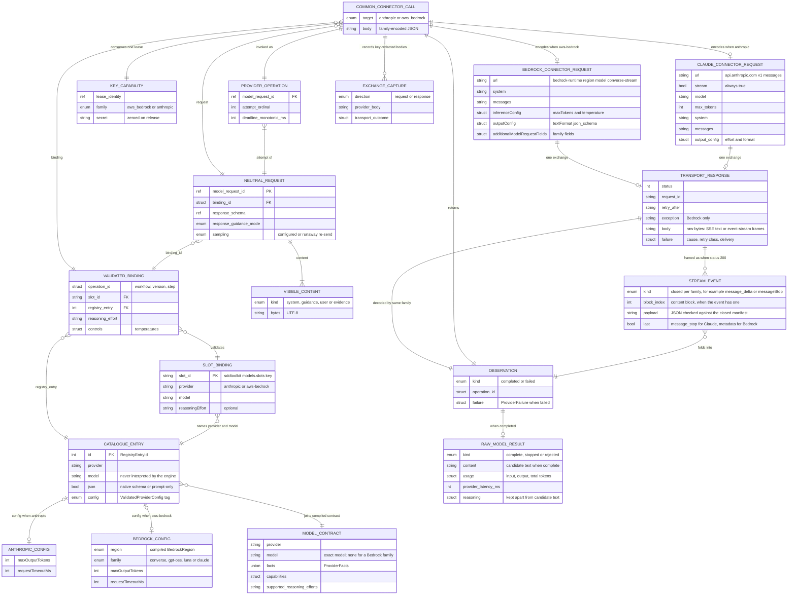

# Claude connector: common call interface and streaming

This file outlines the provider call path and the change that makes both connectors
use streaming. The engine makes every model call through one common connector. A
catalogue setting chooses whether the call goes on to the Claude connector or to the
Bedrock connector. Both connectors will request a streamed reply.

- **Status:** the common call interface is implemented
  ([ADR 0028](../design/decisions/0028-anthropic-messages-provider.md),
  [ADR 0029](../design/decisions/0029-bedrock-model-families.md),
  [ADR 0030](../design/decisions/0030-engine-owned-model-request.md)). **Streaming is
  proposed, not accepted.** ADR 0028 (`:179-184`) and ADR 0029 (`:139-142`) leave it
  undecided, and F0007 (`:178`) says none is added. Implementing it needs a new ADR that
  the user accepts. The user settled the four design decisions below on 8 November 2026;
  the ADR is not written yet. This file grants no approval and records no live evidence.
- **Names used here:**
  - The *common connector* is `src/adapters/provider/model_provider.zig` with the shared
    owners listed in ADR 0028.
  - The *Claude connector* is `anthropic_{endpoint,request,response}.zig`.
  - The *Bedrock connector* is `bedrock_{endpoint,request,response}.zig`.
  - Claude reached through Bedrock would use the Bedrock connector's `claude` family.
    **No Claude model is called through Bedrock initially** (user direction,
    8 November 2026). `claude-haiku-5-5` is called only through the Claude connector.
- **Fact states:** streaming facts come from documentation read on 8 November 2026:
  - Anthropic's API reference and guides;
  - AWS's Bedrock API reference and user guide;
  - the botocore `bedrock-runtime` service model;
  - the Smithy Amazon Event Stream specification.

  A dagger (†) marks a fact still open. "Stream research" lists the open facts and
  sources.

## Common call interface

There is one port, `src/ports/llm_provider_interface.zig:9-38`:

```zig
invoke(
    *const ValidatedProviderModelBinding,          // slot -> catalogue entry
    *const IdentifiedProviderNeutralModelRequest,  // provider-neutral content and schema
    *const ValidatedProviderAuthorizationLeaseRef, // single-use key lease
    *const InvokedProviderOperation,               // attempt ID and deadline
) Error!ProviderInvocationObservation              // completed(raw result) | failed(cause)
```

- **Caller:** only one, the `invoke-model` action (`src/actions/model/invoke_model.zig:6-28`).
  It never names a provider.
- **Production implementation:** only one, `model_provider.Provider`. The composition
  root binds it in `src/composition/model_provider_runtime.zig:26-52`.
- **Test implementation:** `fake_llm_provider.zig`.
- **Streaming does not change this interface.** The stream is read and folded inside the
  connector. The caller still receives one complete `ProviderInvocationObservation`, so
  the port, the action, the lease and the deadline owner stay as they are.

## Selection by settings

1. `.sddtoolkit.json` `models.slots.<slot>` names a `provider` and a `model`, and may
   name a `reasoningEffort`.
2. `.sddproviders.json` holds the catalogue entry for that provider and model. Its
   `config` parses into `ValidatedProviderConfig`
   (`src/domain/llm_provider_contracts.zig:138-149`), which is tagged `anthropic` or
   `aws_bedrock`.
3. That tag is the only thing that selects a connector. The exhaustive switches in
   `Provider.prepare` (`model_provider.zig:33-46`) and `Provider.invoke` (`:114-129`)
   branch on it.

```json
"spec_generation": { "provider": "anthropic", "model": "claude-haiku-5-5", "reasoningEffort": "low" }
```

- **Settings, not code:** each slot is bound separately, so one workflow can use both
  connectors.
- **No switching mid-call:** retries and protocol corrections keep the slot's binding.
  Nothing falls back to the other connector, and no rule branches on the model name
  (ADR 0028 "Peer providers").
- **No streaming setting:** streaming is a property of each connector, not of the
  catalogue entry. There is no new field and no per-entry on/off switch.
- **Credentials:** the engine reads a key only for a family that a selected slot binds.
  The variable is `AWS_BEARER_TOKEN_BEDROCK` or `ANTHROPIC_API_KEY`
  (`src/adapters/system/provider_api_key_source.zig:7-8`). A missing key fails that
  family's first authorization, not startup.

## Streaming change

### Outcome and non-goals

- **Outcome:** each connector sends its streaming request, and the engine reads the
  stream to its end under the same single deadline, then folds the events into the same
  result a non-streaming reply gives today. Published output must not change.
- **Non-goals:**
  - No use of events while they arrive: no early stop, no progress and no partial
    candidate. Only a complete, validated message is a candidate.
  - No tools, citations or other stream content. The closed decoders accept only text and
    reasoning.
  - No change to retries, token budget, reasoning handling or who owns the deadline.

### Defect class and evidence

- **Defect class:** runs lost to a timeout or a dropped connection while a long
  generation is in flight (successful completion).
- **Evidence today:** none attributes a failure to non-streaming. ADR 0030 (`:261-263`)
  traces the 21 October timeouts to a 60-second deadline set too low. The slowest
  observed call took 74.1 s (`:250-252`), and no Claude call has been made. The benefit is
  precautionary and unmeasured.
- **What streaming does not do:** it does not shorten generation. `requestTimeoutMs`
  still bounds the whole exchange, so a 128,000-token Claude reply that needs longer than
  180,000 ms still times out. FIX06 H5 (`FIX06.md:915-919`) still needs to measure that.
- **How it is judged:** AGENTS.md requires repeated runs of both development cases on one
  committed build, compared with the previous build, and no change in the published
  specifications.

### Where streaming lives

| Layer | Change |
| --- | --- |
| Port, `invoke-model` action, lease, binding | None |
| `anthropic_request.zig` | Adds `"stream": true` to the body |
| `bedrock_endpoint.zig` | Path ends `/converse-stream` instead of `/converse`; `bedrock_request.zig` sends the same body |
| `model_http_exchange.zig`, `model_http_transport.zig` | None. The body is already read to its end under one deadline (`model_http_exchange.zig:148-167`, `:62-81`). The response content type is not checked |
| Decoders | New `anthropic_stream.zig` and `bedrock_stream.zig`: a frame reader and a closed event decoder for each family |
| `provider_response_assembly.zig` | `Decode` takes the body bytes. The accumulator, observation builder and non-200 classifier are reused |
| Non-streaming decoders | `anthropic_response.decodeMessages` and `bedrock_response.decodeConverse` are deleted once their callers move |

### Wire contract of each connector

| Concern | Claude connector (Messages API, SSE) | Bedrock connector (ConverseStream) |
| --- | --- | --- |
| Enable | `"stream": true` in the body | `POST /model/{modelId}/converse-stream`; the request members the engine sends today (`system`, `messages`, `inferenceConfig`, `outputConfig`, `additionalModelRequestFields`) are all accepted |
| Framing | Server-sent events: an `event:` line, a `data:` JSON line, a blank line | AWS event-stream binary frames; see "Bedrock frame layout" |
| Events | `message_start`; per block `content_block_start`, `content_block_delta`…, `content_block_stop`; one or more `message_delta`; `message_stop`; `ping` any number of times; `error` | `messageStart`; per block `contentBlockDelta`… then `contentBlockStop`; `messageStop`; `metadata`. `contentBlockStart` exists only for tool use, so none is expected |
| Text | `text_delta.text` | `delta.text` |
| Reasoning | `thinking_delta.thinking`…, then one `signature_delta.signature` just before the block stops. With thinking display omitted, Claude Haiku 5.5's default, there is one empty `thinking_delta`, then the signature. `redacted_thinking` arrives whole in `content_block_start`, since no delta type carries its `data` | `delta.reasoningContent`, with one member per delta: `text`, `signature` or `redactedContent` (base64) |
| Stop | `message_delta.delta`: `stop_reason`, `stop_sequence`, `stop_details`, `container`; the ADR 0028 stop table applies | `messageStop.stopReason` (required), the same nine values the Converse decoder maps (`bedrock_response.zig:102-111`); optional `additionalModelResponseFields` |
| Usage | Each counter takes its last reported value. First `message_start.message.usage` (the full `Usage` type†), then each `message_delta.usage` (`MessageDeltaUsage`: six cumulative fields). `cache_creation`, `inference_geo`, `service_tier` and `speed` come only from `message_start`. `output_tokens_details` arrives on the final `message_delta` | `metadata.usage`: `inputTokens`, `outputTokens` and `totalTokens` are required; `cacheReadInputTokens`, `cacheWriteInputTokens` and `cacheDetails` are optional. `metadata.metrics.latencyMs` is required |
| Last event | `message_stop` | `metadata`, once per response, after `messageStop` |
| Errors before the stream | Ordinary HTTP error with a JSON body; today's classifier (`anthropic_response.zig:169-213`) is unchanged | The same, with `x-amzn-errortype`; today's classifier (`bedrock_response.zig:174-227`) is unchanged |
| Errors inside the stream | `event: error` with `{"type":"error","error":{"type":…,"message":…}}`, after a 200 status | Exception frames naming `internalServerException` (500), `modelStreamErrorException` (424; `message`, `originalStatusCode`, `originalMessage`), `serviceUnavailableException` (503), `throttlingException` (429) or `validationException` (400). Unmodeled error frames carry `:error-code` and `:error-message` |
| Keep-alive | `ping` events, skipped wherever they appear | None documented |

### Bedrock frame layout

This layout comes from the Smithy Amazon Event Stream specification and AWS's Lex V2
event-stream encoding page. Integers are big-endian.

| Part | Size | Content |
| --- | --- | --- |
| Total length | 4 bytes | The whole message, including this field |
| Headers length | 4 bytes | The headers section only |
| Prelude CRC | 4 bytes | CRC-32 of the 8 bytes before it |
| Headers | Headers length | Repeated: 1-byte name length, UTF-8 name, 1-byte value type, value |
| Payload | Total − headers − 16 | JSON for an event or exception |
| Message CRC | 4 bytes | CRC-32 of everything before it |

- **CRC:** AWS names it "CRC32 (often referred to as GZIP CRC32)", the CRC of RFC 1952.
  The standard library provides it.
- **Checksums are mandatory:** "Both clients and servers MUST validate these checksums. If
  either checksum is invalid, the stream MUST be terminated." An invalid checksum is
  `response_invalid`.
- **Header values:** types 0 to 9 are boolean true, boolean false, byte, short, int,
  long, byte array, string, timestamp and UUID. A string (type 7) has a 2-byte length
  prefix. Each header name appears once, and header order carries no meaning.
- **Reserved headers:**
  - `:message-type` is `event`, `exception` or `error`.
  - An event carries `:event-type`, the `ConverseStreamOutput` member name, for example
    `contentBlockDelta`.
  - An exception carries `:exception-type`, for example `throttlingException`.
  - `:content-type` names the payload media type.
  - An unmodeled `error` carries `:error-code` and `:error-message`.
- **Size limits:** the specification caps a payload at 24 MB and headers at 128 kB, but
  says "Clients MUST NOT validate them". The decoder doesn't.

### Folding events into the result

- **Reuse:** the decoders feed the existing `assembly.Accumulator`
  (`provider_response_assembly.zig:30-68`). Text is joined exactly, in order, adding
  nothing. Reasoning stays apart from candidate text. The observation builder and the
  usage invariants are unchanged: thinking tokens never exceed output tokens, and the
  cache-write breakdown equals the cache-write counter.
- **Same content rules as today:** content the decoders don't accept marks the content
  invalid, as the non-streaming decoders do. That covers tool use, images, citations and
  input JSON. The stop reason still decides a typed stop.
- **Closed manifests:** each family has a dated, closed list of events and fields.
  - These are `response_invalid`:
    - an unknown event type, an unknown envelope field or an out-of-order event;
    - a missing or repeated last event, or any event after it.
  - These must hold:
    - `messageStart.role` must be `assistant`;
    - the Claude `model` in `message_start` must equal the selected model.
  - Only `ping` is skipped.
- **Usage field presence:** the non-streaming decoder requires every `Usage` field.
  Whether the stream carries them all is open (item 5), so the stream decoder's presence
  rule is set from the probe receipt.
- **Parity test:** a stream fixture and a non-streaming fixture of the same message must
  decode to equal `Inference` values. This proves the fold changes no published output.

### Failure outcomes

| Situation | Outcome |
| --- | --- |
| HTTP status other than 200 | Today's classifier and tables, unchanged |
| Error event or exception frame inside the stream | Classified by its type alone, using each family's closed table (below), delivery `response_received` |
| Connection cut, or HTTP framing incomplete | Existing `transport_failed` with `premature_eof` and delivery `accepted_or_unknown` (`model_http_exchange.zig:163-166`, `:215`); the partial bytes are captured as `partial_provider_body` |
| Deadline passes mid-stream | Existing timeout (`model_http_exchange.zig:74-78`) with the partial bytes captured |
| Body complete but stream malformed, including a bad checksum | `response_invalid`, delivery `response_received` |
| Stop reason other than a normal end | The same typed stops as today (`output_limit`, `content_filtered` and the rest) |

- A failed stream carries no usage, as a failed exchange carries none today.
- In-stream error types map to the same causes as the non-streaming tables:
  - Claude: `overloaded_error` and `api_error` map to `service_unavailable`, and
    `rate_limit_error` to `throttled`. The spend cap (`details.error_code`
    `enforced_spend_limit_reached`) stays `authorization_denied`. Message text never
    classifies.
  - Bedrock: `throttlingException` maps to `throttled`, `validationException` to
    `request_rejected`, and `internalServerException` and `serviceUnavailableException`
    to `service_unavailable`.
  - `modelStreamErrorException` maps its `originalStatusCode` through the
    `ModelErrorException` table (`bedrock_response.zig:200-209`). Without that field it
    is `response_invalid`.
  - An unmodeled `error` frame has no documented error codes, so it is `response_invalid`.
  - Any other type is `response_invalid`.

### Capture, replay and harness

- **Capture:** the raw stream bytes are captured as received. The capture already picks
  `utf8` or `base64` for each body (`src/application/model_exchange_capture.zig:104-113`;
  `request_debugger_archive.zig:75`), so Bedrock's binary frames need no new body kind.
- **Replay:** `request_replay.zig:49-58` encodes and `:146-148` decodes; it moves to the
  stream decoders.
- **Standalone evaluator:** `test/harness/bedrock.zig:8-9`, `:89` uses the Bedrock encoder
  and `decodeConverse`. It moves with the connector (Decision 1). The same decoder
  references appear in `test/harness/baseline/feasibility.zig` and
  `test/harness/exact_value/cli.zig`.

### Security and packaging

- **Authorization:** ConverseStream needs the `bedrock:InvokeModelWithResponseStream`
  action. Whether a bearer API key is accepted for it is item 3, which the user set
  aside†.
- **Unchanged:** the endpoint host, path prefix, Region list and API version stay compiled
  constants. No project value reaches the URL, and there is no new header, credential
  variable or dependency. Redirects, encodings and connection reuse stay rejected.

## Call path

Each step is in `model_provider.zig` unless another file is named.

1. Consume the single-use authorization lease (`:49-57`).
2. Validate the request against the binding, its operation and the supported reasoning
   efforts (`:58-61`).
3. Take the key for the entry's family. A capability that belongs to another family
   never yields a key (`:59`, `:63`).
4. Encode the body with the family's encoder and pick the transport target (`:64-70`).
   - Claude connector: `anthropic_request.encode` with `"stream": true`, target
     `.anthropic`.
   - Bedrock connector: `bedrock_request.encode`, target `.aws_bedrock{region, model}`,
     whose URL ends `/converse-stream`.
5. Capture the request body with the key redacted (`:73`).
6. Run exactly one HTTPS exchange through the shared transport (`:75-87`). It reads the
   stream to its end under the single deadline.
7. Capture the response bytes or the transport failure (`:88-98`).
8. A status other than 200 goes through the family's existing error classifier. A 200
   goes through the family's stream decoder, which folds the events into a
   `ProviderInvocationObservation` (`:120-128`). Usage accounting, failure classification
   and normalized-result construction are shared.

Failures before the request is sent do not reach a connector. They become a `failed`
observation with delivery `not_sent` (`:102-108`).

## What is shared and what each connector owns

| Concern | Common connector | Claude connector | Bedrock connector |
| --- | --- | --- | --- |
| Model-visible text | `model_text_request.zig`: system and guidance text, schema guidance, user and evidence text | `system` text blocks, one `user` message | `system` text blocks, one `user` message |
| Output ceiling | Catalogue `maxOutputTokens` | `max_tokens` | `inferenceConfig.maxTokens` |
| Native schema | `model_schema_projection.zig` | `output_config.format` (`json_schema`); the JSON streams as text deltas | `outputConfig.textFormat` (`json_schema`) |
| Reasoning effort | Checked against the contract's supported efforts | `output_config.effort` | Depends on the family's `additionalModelRequestFields` (ADR 0029) |
| Temperature | `model_controls.zig` | Never sent | `gpt-oss` family only (ADR 0039) |
| Endpoint | `model_http_exchange.zig` (one transport) | `https://api.anthropic.com/v1/messages`; headers `x-api-key` and `anthropic-version` | `https://bedrock-runtime.<region>.amazonaws.com/model/<model>/converse-stream`; `Bearer` authorization |
| Stream enablement | Reads the body to its end under one deadline | `"stream": true` in the body | The `/converse-stream` path |
| Stream reading | Folds events into `assembly.Accumulator` | SSE reader, `anthropic_stream.zig` | Event-stream frame reader with CRC checks, `bedrock_stream.zig` |
| Response | `provider_response_support.zig`, `provider_response_assembly.zig` | Closed event manifest (stop table in ADR 0028) | Closed event manifest |
| Failure retry class | `domain/provider_failure.zig` | HTTP status plus `error.type`; inside a stream, `error.type` alone | HTTP status plus `x-amzn-errortype`; inside a stream, the exception type alone |

## Data model (ERD)

The diagram follows the data from the engine's model call, through the common
connector, to the Claude or Bedrock connector, and back. For any one call, exactly one
of the paths marked "when anthropic" or "when aws-bedrock" exists. A reply with a status
other than 200 has no stream events.



## Impact and tests

- **Expected files:**
  - Request and endpoint: `anthropic_request.zig`, `bedrock_endpoint.zig`.
  - Stream decoding: new `anthropic_stream.zig` and `bedrock_stream.zig`;
    `provider_response_assembly.zig`; `model_provider.zig` (dispatch only);
    `request_replay.zig`.
  - Deleted: `anthropic_response.decodeMessages` and `bedrock_response.decodeConverse`.
  - Harness: `test/harness/bedrock.zig` and the harness files named above.
  - Tests and fixtures: `anthropic_provider_test.zig`, `provider_conformance_test.zig`,
    `model_http_test.zig`, `request_debugger_test.zig`, `model_request_workflow_test.zig`
    and `src/test_fixtures/`.
  - Design: a new ADR amending the "out of scope" and "not decided" text in ADR 0028 and
    ADR 0029, and F0007.
  - Whether the harness call-evidence readers need a version change when they hold stream
    bytes is to be inspected.
- **Accepted fixtures:**
  - text only;
  - Claude thinking with a signature, including the empty omitted-display block;
  - Bedrock reasoning `text` and `signature` deltas, and `redactedContent`;
  - a refusal and `max_tokens`;
  - the parity pair against the non-streaming fixture.
- **Rejected fixtures:**
  - unknown or misplaced events: an unknown event or `:event-type`, an unknown field, an
    out-of-order event, a missing or repeated last event, an event after the last one;
  - envelope mismatches: a wrong model, inconsistent usage;
  - framing faults: a bad prelude or message CRC, a duplicate header name, a truncated
    frame;
  - in-stream errors of each mapped and unmapped type, including an unmodeled `error`
    frame.
- **Faults:** the connection cut mid-stream and the deadline passing mid-stream, each
  checking the outcome, the delivery and the partial capture.
- **Validation:** `git diff --check`, targeted `zig build test-<area>`, `zig build lint`,
  `zig build test-architecture`, then `zig build verify`.

## Decisions

The user answered yes to all four on 8 November 2026. They are design decisions for the
new ADR, which does not exist yet.

1. **Streaming replaces non-streaming outright, including the standalone evaluator.**
   After the change no code sends `POST …/converse`, and `test/harness/bedrock.zig` reads
   a ConverseStream reply too. AGENTS.md allows no dual paths.
2. **The engine waits for the whole stream before decoding.** A call that runs away to
   128,000 tokens is read to the end and cut by `max_tokens`, as today. The engine does
   not stop it early. Early stop would be a separate change.
3. **An error inside a stream classifies by its type alone.** An `event: error` with
   `overloaded_error` becomes `service_unavailable` and is retried under policy. Today
   the same type must also arrive with HTTP 529, but a stream already sent 200.
4. **An unknown stream event type fails the call.** If Anthropic adds an event the
   decoder does not list, every Claude call fails as `response_invalid` until the
   manifest is updated. Anthropic's documentation asks clients to ignore unknown types,
   but closed decoding requires rejection. `ping` is the only skipped event.

## Stream research

The research was done on 8 November 2026. Items 4 and part of 5 still need a live probe,
which is billed and needs approval for each model. The probe models are GPT-OSS-20B
through Bedrock and `claude-haiku-5-5` through the Claude connector.

1. **AWS event-stream framing: resolved.** The result is the frame layout above.
   - Sources: the Smithy Amazon Event Stream specification
     (`smithy.io/2.0/aws/amazon-eventstream.html`), AWS's Lex V2 encoding page
     (`docs.aws.amazon.com/lexv2/latest/dg/event-stream-encoding.html`) and the
     `awslabs/aws-c-event-stream` README.
   - AWS's Transcribe and S3 pages returned no text.
   - No page states the CRC polynomial. The Lex V2 page names RFC 1952's CRC-32.
2. **Bedrock event details: resolved.**
   - `ContentBlockStart` is a union of `image`, `toolResult` and `toolUse`, with no text
     or reasoning member. The user guide calls it "Tool use only", and its example text
     stream has none.
   - `ReasoningContentBlockDelta` is a union of `text`, `redactedContent` and `signature`.
   - `ModelStreamErrorException` has `message`, `originalStatusCode` (100 to 599) and
     `originalMessage`, none required, HTTP 424.
   - The user guide's diagram and example place `metadata` once, after `messageStop`, but
     no page says "last" in words.
   - No page names ConverseStream's response content type. The transport doesn't check
     it.
   - Sources: the Bedrock API reference pages for each shape; the botocore service model
     (`bedrock-runtime/2023-09-30/service-2.json`: `rest-json`, `"eventstream": true`);
     the user guide (`bedrock/latest/userguide/conversation-inference.html`).
3. **Bedrock authorization: not researched** (user direction, 8 November 2026).
4. **Model support: open.** Nothing yet confirms that GPT-OSS-20B streams through
   ConverseStream. No Claude model is called through Bedrock initially.
5. **Claude stream details: resolved, except usage field presence.**
   - **Resolved:**
     - `stop_details` arrives in `message_delta.delta`.
     - `redacted_thinking` arrives whole in `content_block_start`. The five delta types
       (text, input JSON, citations, thinking, signature) carry no redacted `data`. No
       page shows a streamed example.
     - Structured outputs stream "like normal responses", with the JSON in the text
       block.
     - With thinking display omitted, a single empty `thinking_delta` arrives, then one
       `signature_delta`.
     - `output_tokens_details` arrives "only on the final `message_delta` event".
   - **Open†:** the types say `message_start` carries the full `Usage` object and
     `message_delta` the six `MessageDeltaUsage` fields. But every streamed example shows
     a subset, and the thinking example's `message_delta` has no usage at all. The probe
     receipt sets which fields the decoder requires.
   - **Conflict in the documentation:** the API reference's example shows a non-null
     `stop_details` with `end_turn`, while the refusals page says it is null for every
     other stop reason. The decoder keeps ADR 0028's rule: null unless refusal.
   - Sources: `streaming.md`, `api/messages/create.md`, `structured-outputs.md`,
     `thinking.md`, `extended-thinking.md` and `refusals-and-fallback.md` on
     `platform.claude.com/docs`.
6. **Claude envelope: resolved.**
   - The models overview says "Every Claude model ID is a pinned snapshot, including the
     dateless IDs used from the 4.6 generation on" and "Dateless IDs are their own pinned
     snapshot; the alias row repeats them".
   - So `claude-haiku-5-5` resolves to no other ID, and every example echoes the
     requested model.
   - The only documented case of a different `model` is a server-side fallback, which the
     engine never requests.

## Open items

- **FIX06 H5:** if the user selects Claude, measure its maximum-output time to replace the
  interim 180,000 ms `requestTimeoutMs`, and settle its response mode (the catalogue
  `json` flag). Streaming does not remove this need.
- **FIX06 "Live-test cost policy":** `test/harness/model_cost_policy.zig` allows
  `anthropic` / `claude-haiku-5-5` for generation, but no ADR records that. No live
  Claude connector call has been made. A live call needs that decision and its own
  approval.
- **Token budget on a failed stream:** a failed stream reports no usage, so tokens the
  provider spent before the failure are not counted. Whether ADR 0037 should count the
  input tokens that Claude reports in `message_start` is not decided.
- **Not decided (ADR 0028):** prompt caching, tools, batches and inference geography.
