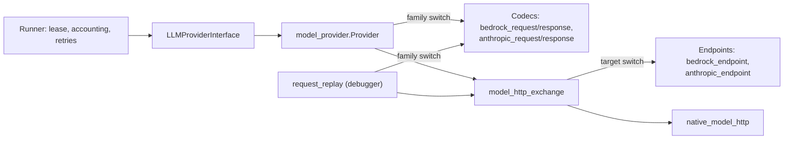

# Claude connector and the multi-connector facade

**Prepared:** 16 October 2026, Australia/Melbourne. **Revised:** 18 October 2026.
**Rewritten:** 30 October 2026, after
[ADR 0028](../design/decisions/0028-anthropic-messages-provider.md) was implemented.
This version researches switching the live development cases from Bedrock to the
Anthropic Messages API. It also sets out the common connector facade the user wants
long term.

**Status:** research and proposal, not authority. ADR 0028 (accepted 21 October 2026)
and its amendments govern the connector that exists. This document grants no approval.
It authorizes no live call, E2E run, model change, cost-policy change or code change.
It isn't active work: [FIX06](FIX06.md) is the sole active fix record, and its
[H5](FIX06.md#h5-model-choice-r7) already holds the measurements a switch needs.
Anything accepted from here moves into an ADR and FIX06. The governing
[design](../design/design.md) remains **Proposed design**.

**Evidence:**

- source at commit `8444312`;
- the six retained E2E runs of 29 October 2026, 20:44 to 20:53 UTC, under
  `zig-out/e2e-spec/`;
- 37 Anthropic documentation pages read on 30 October 2026 (§7);
- the governing ADRs, contracts and features cited throughout.

No live call was made.

**Earlier text:** ADR 0028 cites this file as the proposal the user accepted. That
18 October text proposed the connector before it existed; read it with
`git show 8444312:fixes/claude_connector.md`. §6 records what became of each of its
findings and decisions.

A *connector* here is one provider family's compiled wire projection, which ADR 0028
calls a family: today `aws_bedrock` and `anthropic`.

## 0. Summary

- **The Claude connector exists but has never run.** ADR 0028's shared owners are in
  place, and `anthropic / claude-haiku-5-5` is in the E2E provider catalogue. The
  live-test cost policy permits it for generation in code, but no ADR or harness
  document records that permission (§2.1). No call has gone through the connector.
- **A switch needs the user's decision first.** ADR 0029's 24 October amendment keeps
  the E2E slots on GPT-OSS-20B. FIX06 reserves model changes to the user (H5), and its
  guardrails say "No model change or comparison (H5)" (§2.1). Mechanically, the switch
  is a one-file change (§2.2). Five things stand between it and a useful first run
  (§2.4):
  1. `provider-compatibility` can't probe Claude, and ADR 0028 requires a probe for
     each model before live use.
  2. The decoder requires every documented response field to be present. The
     documentation doesn't say whether they always are. It also lets Anthropic add
     output fields without a new API version, and the closed decoder rejects those.
  3. A runaway would most likely end as a 180-second timeout rather than
     `output_limit`. A deadline is terminal: there's no ADR 0039 re-send, the usage
     becomes unknown, and every later model call is refused.
  4. Loan-renewal already runs close to its 125,000-token budget on GPT-OSS-20B, and
     Claude's thinking counts as output.
  5. The switch also changes the response mode, from native (GPT-OSS-20B) to
     prompt-only (Claude's entry). A comparison mixes the two factors unless one side
     is paired like for like. Native mode for Claude is unqualified: 6 of the 13
     request steps send a root-level `anyOf`, which the documentation doesn't address.
- **The facade exists.** One provider port has one implementation,
  [model_provider.zig](../src/adapters/provider/model_provider.zig), as ADR 0028's
  "one common layer" requirement asks. What's missing is a single connector contract.
  Connector identity is declared in four places and dispatched at seven `switch` sites
  in three files. Several harness tools still read only Bedrock, and F0006 still
  describes an older shape (§3).

## 1. Current state

### 1.1 Call path



`model_provider.Provider` consumes one lease and validates the invocation, binding and
effort. It takes the key only for the binding's family. It then encodes, captures,
sends once and decodes into an owned observation
([model_provider.zig:50-127](../src/adapters/provider/model_provider.zig#L50-L127)).
Codecs never consume leases, capture or send.

### 1.2 What the Anthropic connector does

| Concern | Owner | Behaviour |
| --- | --- | --- |
| Registration | [provider_model_contracts.zig:57-80](../src/composition/provider_model_contracts.zig#L57-L80) | Haiku, Sonnet and Opus 5.5. Efforts `low` to `max`. Native schema capable. No temperature. |
| Catalogue configuration | [llm_provider_config_schema.zig](../src/domain/llm_provider_config_schema.zig) | Exactly `maxOutputTokens` and `requestTimeoutMs`, both positive. |
| Credential | [provider_api_key_source.zig:5-10](../src/adapters/system/provider_api_key_source.zig#L5-L10) | `ANTHROPIC_API_KEY`, read only when the selected workflow binds the family ([model_provider_runtime.zig:40-43](../src/composition/model_provider_runtime.zig#L40-L43)). |
| Endpoint | [anthropic_endpoint.zig](../src/adapters/provider/anthropic_endpoint.zig) | `POST https://api.anthropic.com/v1/messages` with `x-api-key` and `anthropic-version: 2023-06-01`. Keeps `request-id` and `retry-after`. |
| Request | [anthropic_request.zig](../src/adapters/provider/anthropic_request.zig) | `model`, `max_tokens`, `system` text blocks, one `user` message and `output_config.effort`; in native mode, also `output_config.format`. Never temperature, thinking, tools, caching, `inference_geo` or `speed`. |
| Response | [anthropic_response.zig](../src/adapters/provider/anthropic_response.zig) | Closed envelope, exact text join, thinking kept as reasoning, inclusive usage, and ADR 0028's stop and error tables. |
| Tests | [anthropic_provider_test.zig](../src/anthropic_provider_test.zig) | Ten offline tests: decoding, stops, defects, errors, one send through the shared adapter, foreign keys, typed failures and temperature denial. |

### 1.3 What hasn't happened

- No call has gone through the direct API
  ([known work](../.claude/known-work.md#L165-L166)).
- From 23 to 24 October every E2E slot used Claude Haiku 5.5 through Bedrock's AU
  profile, ADR 0029's `claude` family rather than this connector. All eleven attempts
  ended `authorization_denied` because the account lacked model access. The slots
  went back to GPT-OSS-20B (`8a600d7`).
- The F0009 feature document and contract §12.3.2 that ADR 0028 names don't exist.
  ADR 0028 classifies errors against "the table in F0009", so that table and the wire
  manifest have no design home. The FIX06 backlog tracks this under "Provider docs".

## 2. Switching the development cases

### 2.1 Authority

A switch is a model change, and that's the user's call
([FIX06 H5](FIX06.md#h5-model-choice-r7)). This section sets out what a switch needs;
it doesn't recommend one.

- **The recorded decision keeps GPT-OSS-20B.** ADR 0029's 24 October amendment
  ("switch to openai.gpt-oss-20b") returned the shipped E2E slots to GPT-OSS-20B
  ([0029:45-50](../design/decisions/0029-bedrock-model-families.md#L45-L50)). FIX06's
  guardrails say "No model change or comparison (H5)"
  ([FIX06.md:1153](FIX06.md#L1153)). A switch needs a user decision that supersedes that
  amendment for the slots. The decision should also say whether two things restart on
  the new model:
  - FIX06's comparison point, which Q1b set, and all of whose evidence is GPT-OSS-20B
    ([rule 9](FIX06.md#L180-L182));
  - ADR 0034's gate evidence.

  Decision D1.
- **The cost-policy entry has no recorded authority.** The code permits
  `anthropic / claude-haiku-5-5` for generation, citing a user direction of
  22 October 2026 in a comment
  ([model_cost_policy.zig:23-25](../test/harness/model_cost_policy.zig#L23-L25)). No
  ADR or harness document records it:
  - ADR 0028's "Live use" says only GPT-OSS-20B is permitted
    ([0028:177-179](../design/decisions/0028-anthropic-messages-provider.md#L177-L179));
  - ADR 0029's table lists two entries, both on Bedrock
    ([0029:118-126](../design/decisions/0029-bedrock-model-families.md#L118-L126)).

  Decision D2.

### 2.2 The configuration change

Both cases read
[test/e2e/wf-001-hello-world/.sddtoolkit.json](../test/e2e/wf-001-hello-world/.sddtoolkit.json).
[Loan-renewal's workflow case](../test/e2e/wf-002-loan-renewal/workflow.case.json#L8)
points to the same file. The switch replaces each slot's
`"provider": "aws-bedrock", "model": "openai.gpt-oss-20b-1:0"` with
`"provider": "anthropic", "model": "claude-haiku-5-5"`. It keeps
`"reasoningEffort": "low"` on `spec_generation` and `repair`, the two slots the Spec
workflow binds.

Already in the code:

- the catalogue entry
  ([.sddproviders.json:3-15](../test/e2e/config/.sddproviders.json#L3-L15)):
  `json: false` (prompt-only), `maxOutputTokens: 128000` and
  `requestTimeoutMs: 180000`;
- the cost-policy entry
  ([model_cost_policy.zig:23-25](../test/harness/model_cost_policy.zig#L23-L25)),
  whose authority is open (§2.1);
- the test credential: `e2e-spec` reads `TEST_ANTHROPIC_API_KEY` for an `anthropic`
  slot ([environment.zig:63-79](../test/harness/environment.zig#L63-L79));
- `temperature` and `temperatureRunawayRetry`, which stay as required root members
  (ADR 0039). Claude receives neither.

If only the two Spec slots change, `e2e-spec` still needs both test keys. It reads a
key for every configured slot's family
([environment.zig:63](../test/harness/environment.zig#L63)). Production reads keys
only for the slots the selected workflow binds
([model_provider_runtime.zig:40-43](../src/composition/model_provider_runtime.zig#L40-L43)).

### 2.3 How each request changes

| Part | Bedrock GPT-OSS-20B now | Anthropic Claude Haiku 5.5 |
| --- | --- | --- |
| Endpoint and key | Converse in `ap-southeast-2`, `Bearer` key | Messages API, `x-api-key` and `anthropic-version` |
| Output ceiling | `inferenceConfig.maxTokens` 16,384 | `max_tokens` 128,000 |
| Sampling | Temperature 0.1, or 1 on a runaway re-send | None. A re-send is the identical request. |
| Reasoning | `reasoning_effort: "low"` | `output_config.effort: "low"`. Adaptive thinking is on by default, and the engine never turns it off. |
| Schema | Native (`json: true`), in Converse `outputConfig.textFormat` | Prompt-only (`json: false`): the schema goes in system guidance, with no `format` |
| Deadline | 180 s | 180 s, from the catalogue's `requestTimeoutMs` |
| Response | Converse envelope | Messages envelope. Thinking blocks arrive with an empty `thinking` string and a `signature`, Haiku 5.5's default display. |

Prompts don't change. The shared text layout is provider-neutral
([model_text_request.zig](../src/adapters/provider/model_text_request.zig)), and
AGENTS.md forbids model-specific prompt wording.

### 2.4 Risks before the first live run

These are ordered by how early each would stop a run.

**A. No compatibility probe.** ADR 0028 requires each Claude model's own approved
compatibility probe before live use
([0028:98-99](../design/decisions/0028-anthropic-messages-provider.md#L98-L99)).
`provider-compatibility` can't send one:

- its preflight requires the frozen semantic-simplicity GPT-OSS binding
  ([compatibility/cli.zig:18](../test/harness/compatibility/cli.zig#L18));
- it reads only the Bedrock test key
  ([compatibility/cli.zig:75](../test/harness/compatibility/cli.zig#L75) and
  [:84](../test/harness/compatibility/cli.zig#L84));
- its one-send gate rejects every Anthropic target
  ([trace.zig:512-522](../test/harness/e2e/trace.zig#L512-L522) and
  [frozen_binding.zig:29-34](../test/harness/frozen_binding.zig#L29-L34)).

Nothing records what would satisfy ADR 0028's probe for an Anthropic model.
`e2e-spec` isn't affected, because whole-workflow runs skip that gate
([trace.zig:513](../test/harness/e2e/trace.zig#L513)). Decision D3.

**B. Response fields.** The decoder requires all 11 top-level fields and all 10
`usage` fields the API reference lists, null when unused
([anthropic_response.zig:18-19](../src/adapters/provider/anthropic_response.zig#L18-L19),
[:41](../src/adapters/provider/anthropic_response.zig#L41) and
[:63](../src/adapters/provider/anthropic_response.zig#L63)). Its tests reject a
response without `diagnostics` and a usage without `speed`
([anthropic_provider_test.zig:149](../src/anthropic_provider_test.zig#L149) and
[:158](../src/anthropic_provider_test.zig#L158)). The field lists match the reference
exactly.

A rejected envelope or `usage` object fails the whole response before its usage is
read. The usage then counts as unknown, and the budget check refuses every later model
call ([workflow_token_accounting.zig:93](../src/domain/workflow_token_accounting.zig#L93)
and [:116](../src/domain/workflow_token_accounting.zig#L116)). Two things are
unsettled:

- **Presence.** The reference marks request members `optional` but marks no response
  member that way. It never states that response fields are always present. Its example
  response is internally inconsistent: it shows an `end_turn` stop with refusal details.
  So it settles nothing, and no live response has been captured. If the API omits a
  field, the first Claude call stops the run. The first probe answers this. Decision D4
  covers what to do if a field turns out to be absent.
- **Additions.** The versioning policy lets Anthropic "add additional values to the
  output" and new enum-like variants without a new version
  ([versioning](https://platform.claude.com/docs/en/api/versioning)). The closed
  decoder handles additions in two ways:
  - a new envelope or `usage` field rejects the whole response, as above;
  - a new stop reason or content block type rejects only the candidate. Its usage is
    kept, and the request fails as `response_invalid`, which never retries
    ([provider_invocation_validation.zig:176-181](../src/domain/provider_invocation_validation.zig#L176-L181)).

  Production decoding records no field path
  ([provider_response_assembly.zig:127](../src/adapters/provider/provider_response_assembly.zig#L127)).
  Only the debugger's replay inspection does, so the captured raw response is the
  evidence. Closed parsing is an AGENTS.md rule. Plan for additions as a maintenance
  cost, a dated decoder update with fixtures each time; don't relax the rule.

**C. Runaways end as timeouts.** ADR 0039 defines a runaway as a response the provider
stopped with `output_limit`
([0039:96](../design/decisions/0039-configured-temperatures-and-runaway-resend.md#L96)).
GPT-OSS-20B's 16,384-token runaway took 74.1 seconds
([0030:325-326](../design/decisions/0030-engine-owned-model-request.md#L325-L326)).
Haiku's 128,000-token ceiling fits in 180 seconds only above about 711 output tokens
per second, and Anthropic publishes no throughput figure. A Claude runaway would
therefore most likely end as a provider `timeout`:

- ADR 0039's single re-send doesn't apply.
- A deadline is terminal
  ([ADR 0023:127-129](../design/decisions/0023-advisory-post-generation-review.md#L127-L129)).
  In source review, `timeout` isn't an incomplete-advice reason
  ([advisory_completion.zig:32](../src/domain/advisory_completion.zig#L32)), so the
  review fails rather than ending incomplete.
- The request was sent, so its usage is unknown, not zero
  ([workflow_model_invocation.zig:46-51](../src/application/workflow_model_invocation.zig#L46-L51)).
  The budget check then refuses every later model call. Unknown usage is never
  estimated
  ([ADR 0023:100-102](../design/decisions/0023-advisory-post-generation-review.md#L100-L102)
  and [workflow_token_accounting.zig:116](../src/domain/workflow_token_accounting.zig#L116)).

The same happens when the deadline timer wins a race against a response that has
already arrived complete (R11, §6). Claude responses that end near 180 seconds make
that race more likely.

ADR 0030 starts both Haiku entries at 180,000 ms. It leaves their measured replacement
open ([0030:326-328](../design/decisions/0030-engine-owned-model-request.md#L326-L328)
and [:623](../design/decisions/0030-engine-owned-model-request.md#L623);
[FIX06 H5](FIX06.md#h5-model-choice-r7)). That measurement is the route. A smaller
output ceiling isn't (ADR 0011).

**D. Budget headroom.** The six most recent runs, all on GPT-OSS-20B with a
125,000-token budget:

| Run (29 Oct, UTC) | Case | Calls | Tokens | Outcome |
| --- | --- | ---: | ---: | --- |
| 20:44:34 | hello-world | 24 | 65,025 | Published |
| 20:45:17 | loan-renewal | 28 | 121,593 | Published |
| 20:47:23 | hello-world | 25 | 63,376 | Published |
| 20:49:48 | loan-renewal | 29 | 125,687 | `WorkflowTokenBudgetExceeded` in source review |
| 20:52:31 | hello-world | 24 | 60,361 | Published |
| 20:53:48 | loan-renewal | 26 | 95,077 | Published |

Claude's thinking is billed as output and counts toward `max_tokens`
([thinking](https://platform.claude.com/docs/en/build-with-claude/thinking)). Effort
is "a behavioral signal, not a strict token budget"
([effort](https://platform.claude.com/docs/en/build-with-claude/effort)). How many
tokens Haiku 5.5 uses per call at `low` is unmeasured. Its tokenizer differs from
GPT-OSS-20B's, so the counts above don't transfer. A budget-stopped run still counts
as an attempted workload (AGENTS.md).

**E. Native schema mode is unqualified.** The catalogue keeps Claude prompt-only. To
see what native mode would send, the schemas in the six runs above were counted
offline. They use the same `native` projection
([model_schema_projection.zig:5-9](../src/domain/model_schema_projection.zig#L5-L9))
that Anthropic would receive. Across 13 request steps:

- schemas reach 4,406 bytes and a nesting depth of 9;
- record generation has the most `anyOf` nodes, 14, of which 13 are on properties;
- no schema has optional properties or any keyword outside the documented subset;
- 6 steps have a root-level `anyOf`: content extraction, brief, story, records,
  entities and repair-input validation.

The documented limits are per request: 16 union-typed parameters and 24 optional
parameters. Beyond them, a 400 says "Schema is too complex for compilation", and
compilation times out at 180 seconds
([structured outputs](https://platform.claude.com/docs/en/build-with-claude/structured-outputs)).
The schemas fit the published counts. The documentation doesn't say whether the root
may be an `anyOf`; every example uses a root object. Published counts don't guarantee
compilation either, so only a native probe of each root-union step settles it.

The 18 October figures of 32 and 16 `anyOf` nodes no longer apply. §9 also says
"Both maintained catalogues enable it"
([09-configuration.md:55](../design/contracts/09-configuration.md#L55)), but the E2E
Anthropic entry has `json: false`. Decision D5.

**F. Residency and retention.** `inference_geo` has two values: `global`, the default,
and `us`, at 1.1 times the price. There's no Australian option
([data residency](https://platform.claude.com/docs/en/manage-claude/data-residency)).
The connector sends no `inference_geo`, so the workspace default applies. GPT-OSS-20B
on Bedrock runs in `ap-southeast-2`, so a switch sends the case stories and principles
outside Australia.

Prompts and outputs aren't retained by default for Haiku 5.5, which isn't a Covered
Model
([retention](https://platform.claude.com/docs/en/manage-claude/api-and-data-retention)).
In native mode, Anthropic caches the schema for up to 24 hours. Decision D8.

**G. API version.** The endpoint pins `anthropic-version: 2023-06-01`
([anthropic_endpoint.zig:8](../src/adapters/provider/anthropic_endpoint.zig#L8)).
`2026-10-21` is current. For the Messages API it removes `temperature`, `top_p` and
`top_k`. It also rejects documents in assistant messages and citations in user messages
([migration guide](https://platform.claude.com/docs/en/api/migration-2026-10-21)).
The connector sends none of these. No sunset is published for `2023-06-01`, and
Anthropic "recommends using the latest API version whenever possible". Decision D7.

**H. Rate and spend limits.** These are a low risk for sequential calls. On the Start
tier, Haiku 5.5 allows 1,000 requests, 2,000,000 input tokens and 400,000 output
tokens per minute, and `max_tokens` doesn't count against output limits
([rate limits](https://platform.claude.com/docs/en/api/rate-limits)). A tier's monthly
spend cap, $500 on Start, pauses the account until the next month. The decoder maps
that 429, and `402 billing_error`, to `authorization_denied`, which never retries
([anthropic_response.zig:195-206](../src/adapters/provider/anthropic_response.zig#L195-L206)).

**I. Refusals.** A refusal is HTTP 200 with `stop_reason: "refusal"`, and its text may
break the schema. Haiku 5.5 has no server-side fallback
([refusals](https://platform.claude.com/docs/en/build-with-claude/refusals-and-fallback)).
The connector requests none, and maps a refusal to `content_filtered` (ADR 0028).

**J. Cost.** Haiku 5.5 costs $0.10 per million input tokens and $0.50 per million
output tokens for prompts up to 100,000 tokens
([pricing](https://platform.claude.com/docs/en/about-claude/pricing)). At those rates,
125,000 tokens cost about US$0.06 even if every token were output. The last call can
take a run past its budget before the check stops it, as the 20:49 run shows.

### 2.5 Corrections a switch needs

Tools and skills:

| Location | Now | Correction |
| --- | --- | --- |
| [compatibility/cli.zig:14-24, 34, 75 and 84](../test/harness/compatibility/cli.zig#L14-L24) | Frozen GPT-OSS binding and the Bedrock key. | Decision D3. |
| [compatibility/inspection.zig:159](../test/harness/compatibility/inspection.zig#L159) | The probe's inspection reads only a Converse `stopReason`. | Part of D3. |
| [call/cli.zig:22-23 and 42-46](../test/harness/call/cli.zig#L42-L46), [diagnostic_binding.zig:27](../test/harness/diagnostic_binding.zig#L27) | `e2e-call` reads only the Bedrock key and rejects non-Bedrock captures. | Decision D6. |
| [attribution/scoring.zig:100-104](../test/harness/attribution/scoring.zig#L100-L104) | Decodes only Converse, so a Messages replay would score as `invalid_provider`. | With D6. |
| [exact_value/cli.zig:276-278](../test/harness/exact_value/cli.zig#L276-L278) | Reports a Messages body as `unsupported_provider_format`. | With D6. |
| [e2e/cli.zig:26](../test/harness/e2e/cli.zig#L26) | The help names only Bedrock models and the Bedrock key. | Name the policy's entries and both keys. |
| [live-e2e skill:3, 19-20](../.claude/skills/live-e2e/SKILL.md) | Requires every slot to be Bedrock GPT-OSS-20B. | Accept any cost-policy generation entry. |

Documents that are wrong today, whatever is decided. FIX06's backlog tracks only
F0009, §12.3.2 and ADR 0028's live-use text, so the rest belong there too:

| Location | Now | Correction |
| --- | --- | --- |
| [harness/README.md:42](../design/harness/README.md#L42) | "shipped cases are rejected" by the probe. | This contradicts [e2e.md:198-199](../design/harness/e2e.md#L198-L199) and [ADR 0029:129-131](../design/decisions/0029-bedrock-model-families.md#L129-L131). Check against the current probe. |
| [e2e.md:250-256](../design/harness/e2e.md#L250-L256) | `TEST_ANTHROPIC_API_KEY`, which `e2e-spec` already reads, appears in no harness document. | Document one test key for each configured family. |
| [09-configuration.md:55](../design/contracts/09-configuration.md#L55) | "Both maintained catalogues enable it" (native mode), but the E2E Anthropic entry is `json: false`. | Record the actual setting. D5 decides its value. |
| [known-work.md:8-14](../.claude/known-work.md#L8-L14) | Names only the Bedrock AU-profile route to Claude. | Also name the direct-API entry. |
| F0006, F0007, §12.3.1, invariant 32 and §31.12 | Older provider shapes and Bedrock-only wording (§3.4, item 7). | Bring them to ADR 0028's shape. |
| F0009 and §12.3.2 | Missing. | Already in FIX06's backlog. |

Documents that change with a decision:

| Location | Now | Correction |
| --- | --- | --- |
| [ADR 0028:177-179](../design/decisions/0028-anthropic-messages-provider.md#L177-L179), [ADR 0029:118-126](../design/decisions/0029-bedrock-model-families.md#L118-L126) | Only Bedrock entries are permitted. | Decision D2. |
| [e2e.md:42-46](../design/harness/e2e.md#L42-L46), [harness/README.md:26-28](../design/harness/README.md#L26-L28) | The cost policy "permits only `aws-bedrock` / `openai.gpt-oss-20b-1:0`". The code already disagrees. | List the permitted entries and their uses after D2. |
| [e2e.md:8-10](../design/harness/e2e.md#L8-L10) | "Review the case's explicit Bedrock `openai.gpt-oss-20b-1:0` generation selection" | With D1: describe the case's configured selection. |
| [e2e.md:98-99 and 112-117](../design/harness/e2e.md#L98-L117) | `e2e-call` uses the Bedrock key and GPT-OSS-20B captures only. | With D6. |
| [e2e.md:184-199](../design/harness/e2e.md#L184-L199) | The probe needs only the Bedrock key and is limited by "the shared GPT-OSS-20B-only cost policy". | With D3. The frozen binding sets the limit. |
| [e2e.md:288-294](../design/harness/e2e.md#L288-L294) | The catalogue "must declare `openai.gpt-oss-20b-1:0` with `json: true`", and "the current production provider is Bedrock". | With D1: describe both families. |
| [e2e.md:310-317](../design/harness/e2e.md#L310-L317) | Only GPT-OSS-20B's maximum and the Converse codec. | With D1: each family's maximum and codec. |

The [evaluator](../design/harness/evaluator.md#L65-L69) and the
[semantic-simplicity protocol](../test/calibration/semantic-simplicity/README.md) also
say the policy permits only GPT-OSS-20B. Both statements stay true for judging and for
the frozen protocol. Scoping them that way is enough.

### 2.6 Evidence rules for a switch

- Decide on both development cases, with repeated runs on one committed build. A single
  run decides nothing (AGENTS.md).
- A model change brings in FIX06's cross-model row: paired repeated trials in unrelated
  domains, recording all declared outcomes and costs ([FIX06.md:234](FIX06.md#L234)).
- Change one factor at a time
  ([28-testing.md:533-535](../design/contracts/28-testing.md#L533-L535)). The switch
  changes two: the model, and the response mode from native to prompt-only. Every
  family supports both modes
  ([ADR 0029:73-74](../design/decisions/0029-bedrock-model-families.md#L73-L74)), so
  pair like with like: GPT-OSS-20B with `json: false`, or Claude in native mode after
  D5. Report model and mode as separate factors.
- Measure on a committed, unmodified build ([FIX06 rule 3](FIX06.md#L112-L120)).
- Claude runs are their own cohort. Don't aggregate them with GPT-OSS-20B runs
  ([e2e.md:652](../design/harness/e2e.md#L652)).
- Report runaways, re-sends, timeouts and normalizations separately. Count
  budget-stopped, malformed and exhausted runs as attempted workloads.
- Acceptance comes only from a human `human-spec-adjudication/v2` record. Claude is
  permitted for generation only. The standalone evaluator stays on Bedrock
  GPT-OSS-20B.
- Never tune on the sixteen reserved qualification features (ADR 0034).

### 2.7 Proposed order

1. **Decisions:** D1 and D2, which only the user can make.
2. **Offline:** settle D3, D6 and D7, and make the §2.5 corrections.
3. **Probe, with approval:** one Claude request for each development case through
   `provider-compatibility`. Record field presence (D4), latency, usage and thinking
   tokens.
4. **E2E runs, with approval for each:** repeated runs of both cases on one committed
   build (FIX06 rule 3).
   Record budget use, runaways and timeouts. Measure Haiku's maximum-output time for
   `requestTimeoutMs` (FIX06 H5).
5. **Native mode:** only after D5, with a probe of each root-union step.

## 3. The multi-connector facade

### 3.1 Goal

The engine reaches every model through one facade. A connector supplies only what
differs between provider APIs, and configuration chooses the connector for each slot.
Adding a connector should mean writing that connector and registering it in one place
the compiler checks, without touching the facade.

This is already a recorded user requirement. ADR 0028 requires "one common layer that
both connectors use"
([0028:8-9](../design/decisions/0028-anthropic-messages-provider.md#L8-L9)). It also
says "a future provider adds a contract entry, a configuration schema and its own
endpoint, encoder and decoder projections. It reuses everything else"
([0028:198-199](../design/decisions/0028-anthropic-messages-provider.md#L198-L199)).
This section proposes how to make that last sentence true.

### 3.2 Constraints

- `LLMProviderInterface` is "the sole provider-neutral architectural port. There is no
  alias or parallel gateway"
  ([F0006:60-61](../design/features/F0006-LLMProviderInterface.md#L60-L61)).
- Infrastructure-private dispatch is "an exhaustive closed tagged union, not
  `anyopaque`, a service locator, callback map, or project-extensible factory"
  ([F0006:374-375](../design/features/F0006-LLMProviderInterface.md#L374-L375)).
- The engine is one executable with a closed, compiled set of connectors. Projects
  can't add code, load a provider or create a capability
  ([F0006:82-83](../design/features/F0006-LLMProviderInterface.md#L82-L83) and
  [ADR 0003](../design/decisions/0003-generic-workflow-engine.md#L130-L131)).
- Network access stays in adapters, and native connections go only through
  `native_model_http`
  ([architecture_test.zig:92-132](../src/architecture_test.zig#L92-L132)).
- Each mechanism has one implementation. Connector modules never import a sibling
  ([architecture_test.zig:105-117](../src/architecture_test.zig#L105-L117)).
- Each call keeps its slot's binding, including its retries and protocol corrections.
  There's no cross-provider fallback within a call, no model-name branching and no
  engine choice between providers, though one workflow may use both
  ([0028:64-68](../design/decisions/0028-anthropic-messages-provider.md#L64-L68)).
- Every response is untrusted and parsed through a closed contract.
- Superseded code is deleted in the same change, with no aliases.

### 3.3 What a connector is today

| Piece | `aws_bedrock` | `anthropic` |
| --- | --- | --- |
| Family tag | `ProviderConfigSchema.aws_bedrock` | `ProviderConfigSchema.anthropic` |
| Closed configuration | Region, family, `maxOutputTokens`, `requestTimeoutMs` | `maxOutputTokens`, `requestTimeoutMs` |
| Compiled facts | `BedrockFamily` | None |
| Transport target | Region and model | None; the model is in the body |
| Endpoint projection | [bedrock_endpoint.zig](../src/adapters/provider/bedrock_endpoint.zig) | [anthropic_endpoint.zig](../src/adapters/provider/anthropic_endpoint.zig) |
| Encoder | `bedrock_request.encode` and `encodeText` | `anthropic_request.encode` and `encodeText` |
| Decoder | `bedrock_response.inference`, `decodeConverse` and `classifyResponse` | `anthropic_response.inference`, `decodeMessages` and `classifyResponse` |
| Credential | `AWS_BEARER_TOKEN_BEDROCK`; test variable `TEST_AWS_BEARER_TOKEN_BEDROCK` | `ANTHROPIC_API_KEY`; test variable `TEST_ANTHROPIC_API_KEY` |
| Registry entries | Four family contracts | Three exact models |

The facade owns everything else:

- lease consumption;
- invocation and binding validation, including the effort check;
- capture and redaction;
- the single exchange and its deadline;
- usage validation;
- retry classification ([provider_failure.zig](../src/domain/provider_failure.zig));
- the runaway re-send;
- accounting and candidate admission.

### 3.4 Where the contract is scattered

1. **Identity is declared four times.** The domain `ProviderConfigSchema`
   ([llm_provider_contracts.zig:24](../src/domain/llm_provider_contracts.zig#L24)),
   the transport `Target`
   ([model_http_transport.zig:13](../src/adapters/provider/model_http_transport.zig#L13)),
   the key `Family`
   ([provider_api_key.zig:5](../src/adapters/provider/provider_api_key.zig#L5)) and
   the variable switch
   ([provider_api_key_source.zig:5-10](../src/adapters/system/provider_api_key_source.zig#L5-L10)).
   The harness adds a fifth, `generationKeyName`
   ([environment.zig:54](../test/harness/environment.zig#L54)).
2. **One check isn't exhaustive.** `Registry.validate` lists the production families
   by hand
   ([llm_provider_contracts.zig:208](../src/domain/llm_provider_contracts.zig#L208)).
   Leave a new family out of that list and the test-only `deadline_only` family could
   claim its provider ID, with no compile error.
3. **Dispatch happens at seven sites in three files:**
   - [model_provider.zig:35](../src/adapters/provider/model_provider.zig#L35) and
     [:120](../src/adapters/provider/model_provider.zig#L120);
   - [model_http_exchange.zig:96](../src/adapters/provider/model_http_exchange.zig#L96)
     and [:142](../src/adapters/provider/model_http_exchange.zig#L142);
   - [request_replay.zig:48](../src/adapters/provider/request_replay.zig#L48),
     [:101](../src/adapters/provider/request_replay.zig#L101) and
     [:146](../src/adapters/provider/request_replay.zig#L146).

   Replay also has its own Bedrock-only check
   ([request_replay.zig:47](../src/adapters/provider/request_replay.zig#L47)). The
   mapping from configuration to transport target is written twice, at
   [model_provider.zig:35-46](../src/adapters/provider/model_provider.zig#L35-L46) and
   [request_replay.zig:101-108](../src/adapters/provider/request_replay.zig#L101-L108).
4. **Each codec has two entry points in each direction.** One starts from the neutral
   request, the other from the debugger description, and their signatures differ by
   family.
5. **Harness tools assume Bedrock.** `provider-compatibility` (§2.4 A) and `e2e-call`
   ([call/cli.zig:42-46](../test/harness/call/cli.zig#L42-L46) and
   [diagnostic_binding.zig:27](../test/harness/diagnostic_binding.zig#L27)) do so
   without needing to. So do the attribution scorer and the exact-value report, which
   decode only Converse
   ([attribution/scoring.zig:100-104](../test/harness/attribution/scoring.zig#L100-L104)
   and [exact_value/cli.zig:276-278](../test/harness/exact_value/cli.zig#L276-L278)).
   `baseline` does by design
   ([acquisition.zig:128](../test/harness/baseline/acquisition.zig#L128)).
6. **The standalone evaluator has its own provider port**
   ([provider.zig](../test/harness/provider.zig)). Its Bedrock path reuses the
   production codecs ([bedrock.zig:8-9](../test/harness/bedrock.zig#L8-L9)). Its OpenAI
   path has separate HTTP code ([http.zig](../test/harness/http.zig) and
   [openai.zig](../test/harness/openai.zig)). The harnesses stay separate by rule
   (AGENTS.md), so this isn't a conflict.
7. **The documents describe two different shapes.**
   - F0006 still has one adapter per dispatch-union variant, "a concrete adapter,
     exhaustive dispatch branch, composition-root binding" for each provider
     ([F0006:78-81](../design/features/F0006-LLMProviderInterface.md#L78-L81),
     [:378-381](../design/features/F0006-LLMProviderInterface.md#L378-L381) and
     [:419-421](../design/features/F0006-LLMProviderInterface.md#L419-L421)). ADR 0028
     replaced that with one port implementation and per-family projections. The ADR
     governs, but F0006 is unamended.
   - F0006 says the live-test policy "selects only that exact Bedrock Luna tuple"
     ([F0006:416-417](../design/features/F0006-LLMProviderInterface.md#L416-L417)).
     F0007's owner table still names deleted modules
     ([F0007:23-35](../design/features/F0007-AWSBedrockProvider.md#L23-L35)).
   - §12.3.1 lists only the GPT-OSS and Luna control policies
     ([12-model-boundary.md:236-241](../design/contracts/12-model-boundary.md#L236-L241)).
     Invariant 32 and §31.12 still say "Bedrock" for the maximum output, which
     ADR 0028 extends to every provider
     ([design.md:222-224](../design/design.md#L222-L224) and
     [:915-916](../design/design.md#L915-L916)).
   - No document lists which failure causes are retry-eligible
     ([provider_failure.zig:14-22](../src/domain/provider_failure.zig#L14-L22)).
   - F0009 and §12.3.2 are missing.

Adding a third connector today touches about 13 production files and 8 harness files,
plus three new codec files.

### 3.5 Proposed connector contract

**One family list.** `ProviderConfigSchema` stays the only declaration of families.
Everything else derives from it:

- `ValidatedProviderConfig` and `ProviderFacts` stay unions tagged by it.
- The key `Family` and the transport `Target` are derived from it at compile time,
  for example as the families with a provider ID, rather than declared again.
- `Registry.validate` takes the production families from `providerId() != null`,
  instead of a hand-written list.

**One dispatch owner.** A new `adapters/provider/connectors.zig` becomes the only
module that maps a family to its connector. It's infrastructure-private dispatch
inside the one port implementation, not a second port, so it keeps F0006's
"no alias or parallel gateway". The facade, the HTTP exchange and replay call it and
contain no family `switch`. Each connector exposes the same declarations with the same
signatures:

| Declaration | Purpose |
| --- | --- |
| `Config` | The connector's variant of `ValidatedProviderConfig`. |
| `target(config, model)` | The closed transport target. Written once and used by production and replay. |
| `project(allocator, target, key)` | URL and authentication headers. |
| `retained(header_name)` | The response headers the exchange keeps. |
| `encode(allocator, prepared, model, config)` | One encoder for production and replay, from one shared prepared-request type. |
| `decode(allocator, json, model, diagnostic)` | One closed decoder for production and replay. |
| `classify(allocator, response)` | Maps status and error body to typed causes. |

`connectors.zig` dispatches with an exhaustive `switch`. Its `inline` prongs pass each
connector its own typed configuration. A compile-time check rejects any connector that
lacks a declaration or has the wrong signature. Nothing is registered at run time, and
there are no function-pointer tables or callback maps. An illustrative shape, not code
to copy:

```zig
pub fn encode(a: std.mem.Allocator, prepared: Prepared, model: ModelId, config: ValidatedProviderConfig) Error![]const u8 {
    return switch (config) {
        inline .aws_bedrock, .anthropic => |typed, family| module(family).encode(a, prepared, model, typed),
        .deadline_only => error.InvalidRequest,
    };
}
```

**What stays out of connectors.** Lease use, validation, capture, redaction, the
exchange, deadlines, usage arithmetic through `ProviderUsage`, retry classification,
runaway handling, accounting and admission all stay where they are now.

**Adding a connector afterwards** takes:

1. a family tag, with configuration and facts variants;
2. its closed configuration decoder;
3. its connector module or modules;
4. one arm in `connectors.zig`;
5. its production and test credential variable names;
6. its registry entries, plus cost-policy entries where the user approves them;
7. its ADR, feature document and §12.3 contract section;
8. a pass of the shared conformance suite (§3.6).

The compiler reports every missing arm, and the contract check reports every missing
declaration. The contract's ADR would amend F0006's per-variant text (§3.4, item 7).
It would carry over F0006's demand for positive and negative conformance tests through
the shared suite.

**Limits of this contract.** It assumes:

- one static key per family, sent in a header;
- JSON over HTTPS to a compiled endpoint;
- one non-streaming request per call.

Some connectors fall outside that. Signing requests (AWS SigV4), exchanging tokens
(OAuth or Google ADC), streaming, or calling a configurable endpoint such as a local
model server each needs its own decision first. Provider features such as prompt
caching would be typed capabilities that each connector declares, and each needs its
own decision. Under ADR 0011's inclusive accounting, caching lowers cost, not budget
use.

### 3.6 Shared conformance suite

Today each family has its own facade tests, for example
[anthropic_provider_test.zig:302-371](../src/anthropic_provider_test.zig#L302-L371).
The proposal parameterizes the provider-neutral cases over every family:

- one send per lease;
- a foreign family's key is refused;
- temperature is denied before send where the registry declares none;
- typed failures keep their cause and retry class;
- usage is counted once;
- every selected key is redacted from captures;
- replay rebuilds the production bytes.

Each connector keeps its own wire fixtures. A new connector passes the suite before
it's registered. An architecture rule enforces the shape: only `connectors.zig`
imports connector modules, and no other provider adapter switches on the family.

### 3.7 Harness

- **`provider-compatibility`** probes any cost-policy generation entry. The frozen
  cohort check stays with `baseline` experiments, where it belongs (D3).
- **`e2e-call`** selects the key by the captured family and accepts a capture from any
  registered family. The same-provider rebinding rule stays (D6).
- **`e2e-spec`** reads keys only for the families the selected workflow binds, as
  production does.
- **The standalone evaluator** stays separate. Routing it through the connectors is a
  decision of its own: it has no workflow authority and a separate cost policy, and
  ADR 0028 rules out an Anthropic grader.

### 3.8 Rejected alternatives

| Alternative | Why not |
| --- | --- |
| A run-time connector registry or dynamic loading | The engine's connector set is closed and packaged, and this would be a service locator (F0006). |
| One adapter per connector, each implementing the port | That's F0006's older shape, which ADR 0028 replaced. It duplicates the lease, capture and exchange lifecycle per connector. |
| One generic "OpenAI-compatible" connector | It erases each API's closed envelope, stop and error contract. |
| Vendor SDKs | None exists for Zig, and a production dependency needs an accepted ADR. |
| Cross-provider fallback inside the facade | ADR 0028 forbids it; output must come from the selected slot. |
| Server-side refusal fallbacks (`fallbacks`) | Output would come from a model the slot didn't select. |
| Streaming to beat the deadline | Streaming changes delivery, not duration. |

### 3.9 Proposed sequence

Each step is its own reviewable change, and Bedrock and Anthropic request bytes stay
unchanged:

1. One family list, with `Registry.validate` derived from it.
2. `connectors.zig`. The facade, exchange and replay are routed through it, and their
   switches and the duplicate target mapping are deleted.
3. One encoder and one decoder entry point per connector.
4. The parameterized conformance suite and the architecture rule.
5. A generic `e2e-call`, then `provider-compatibility` after D3.
6. F0009, §12.3.2, the F0006 amendment and the stale texts in §3.4, item 7.

This is engine-track work under [FIX06 rule 11](FIX06.md#L188-L199). It changes no
model input, so it's proved offline on the scripted integration matrix, with every
accounted request's T5 projection byte-identical. It needs one live run of each case
and lands only between measurement sets. Each change also runs the AGENTS.md
validation ladder. If D9 is accepted, the work goes into FIX06.

## 4. Anthropic API facts checked on 30 October 2026

### 4.1 Request

| Fact | Connector | Status |
| --- | --- | --- |
| Valid versions are `2026-10-21`, `2023-06-01` and `2023-01-01`. For the Messages API, `2026-10-21` changes only sampling fields, documents in assistant turns and citations in user turns. | Sends `2023-06-01` and none of those. | Works on either version (D7). |
| The API accepts the key in `x-api-key` or `Authorization: Bearer`. | `x-api-key`. | Matches. |
| Haiku, Sonnet and Opus 5.5 have a 1M-token context and 128K output. | `maxOutputTokens: 128000`. | Matches. The docs don't state the exact integer; their examples use 128000. |
| Effort runs `low` to `max` with no beta header. Haiku 5.5 defaults to `medium`. | Registry `low` to `max`. The Spec slots send `low`. | Matches. |
| With `thinking` omitted, Haiku and Sonnet 5.5 run adaptive thinking by default and Opus 5.5 always does. Thinking is billed as output and counts toward `max_tokens`. | Never sends `thinking`. | Matches. Cost unmeasured (§2.4 D). |
| Haiku 5.5 rejects non-default `temperature`, `top_p` and `top_k`. From `2026-10-21`, every model rejects them. | No temperature registered. The encoder rejects one before send. | Matches. |
| Structured outputs are GA in `output_config.format`. The subset covers basic types, `enum`, `const`, `anyOf`, `allOf`, local `$ref`, `required`, `additionalProperties: false`, `minItems` 0 or 1, and some formats and patterns. | The `native` projection emits only `type`, `properties`, `required`, `additionalProperties: false`, `enum`, `const`, `anyOf`, `items` and `minItems: 1`. | Keywords match. A root `anyOf` is undocumented (§2.4 E). |
| Each request allows 16 union-typed parameters and 24 optional parameters, with a 180-second compile timeout. | At most 14 `anyOf` nodes and no optional properties. | Within the published counts. Acceptance unverified. |
| Prefill and citations are incompatible with `format`. | Sends neither. | Matches. |
| `inference_geo` is `global` (the default) or `us`. | Not sent. | The workspace default applies (D8). |

### 4.2 Response

| Fact | Connector | Status |
| --- | --- | --- |
| The 11 top-level fields are `id`, `type`, `role`, `model`, `content`, `stop_reason`, `stop_sequence`, `stop_details`, `usage`, `container` and `diagnostics`. | The same list, all required. | Lists match. Presence unconfirmed (§2.4 B). |
| `usage` has 10 fields, including `output_tokens_details.thinking_tokens`, which isn't beta. | The same list, all required. | Lists match. Presence unconfirmed. |
| `output_tokens` is "the inclusive, authoritative total used for billing". | Thinking is checked against it and never added ([anthropic_response.zig:78](../src/adapters/provider/anthropic_response.zig#L78)). | Matches. |
| `stop_reason` is always non-null when not streaming, with 7 values. | A 7-value enum. | Matches. |
| `stop_details` is null except on a refusal. Refusal details carry `type`, `category` and `explanation`, plus `recommended_model` only when `fallbacks` is set. | Requires exactly those three fields on a refusal. | Matches, because the connector never sets `fallbacks`. |
| Without tools, the documented blocks are `text`, `thinking` and `redacted_thinking`. | Accepts those three. Any other block invalidates the candidate. | Matches. |
| Haiku 5.5 thinking display defaults to `omitted`: an empty `thinking` string with a `signature`. | Keeps the blocks as provider reasoning. | Matches. |
| A text block's `citations` is an array or null. | Requires the member and rejects a non-null value. | Presence unconfirmed. |
| Output values and enum variants may be added without a version change. | Closed decoding rejects them. | A known cost (§2.4 B). |

### 4.3 Errors and limits

| Fact | Connector | Status |
| --- | --- | --- |
| The error body is `{type: "error", error: {type, message}, request_id}`. `details.error_code: "enforced_spend_limit_reached"` is documented only on the spend-cap 429. | Accepts exactly that shape. | Matches. |
| The statuses are 400, 401, 402, 403, 404, 409, 413, 429, 500, 504 and 529, each with its `error.type`. | Maps all but 409, which becomes `response_invalid`. | Matches. 409 concerns resource APIs the engine doesn't call. |
| A spend limit you set yourself returns 400 `invalid_request_error`. | `request_rejected`. | Matches. |
| Every response has a `request-id` header. `retry-after` is in seconds and never on the spend-cap 429. | Keeps both as diagnostics. | Matches. |
| Long requests: stream or batch, "especially those over 10 minutes". Idle connections can drop. Only the SDKs check expected duration. | Non-streaming, with a 180-second deadline. | Within the guidance. |
| Haiku 5.5 on the Start tier allows 1,000 requests, 2,000,000 input tokens and 400,000 output tokens per minute. `max_tokens` doesn't count toward the output limit. | | Low risk. |

### 4.4 Account and data

| Fact | Status |
| --- | --- |
| There's no Australian inference option. US-only inference costs 1.1 times the standard price. | Decision D8. |
| Prompts and outputs aren't retained by default, except for Covered Models (Fable and Mythos). Structured-output schemas are cached for up to 24 hours. | Haiku 5.5 isn't a Covered Model. |
| Haiku 5.5 prices per million tokens: input $0.10 and output $0.50 for prompts up to 100,000 tokens, or $0.50 and $2.50 above that. Cache reads cost $0.01. | §2.4 J. |
| Prompt caching needs at least 512 tokens on Haiku 5.5 and lasts 5 minutes by default. Cache writes cost 1.25 times the input price and reads 0.1 times. | Not used. A possible later facade capability. |
| `GET /v1/models/{id}` returns `max_tokens`, `max_input_tokens` and `capabilities`. | Not used. The catalogue owns these values (user decision, 18 October 2026). |
| Haiku 5.5 retires no sooner than 7 October 2027. | No action needed. |

## 5. Decisions needed

For a switch:

- **D1. Should the development cases switch to `anthropic / claude-haiku-5-5`?**
  Example: the six slots in `.sddtoolkit.json` would move to Claude, superseding
  ADR 0029's 24 October slot amendment. FIX06's comparison point and ADR 0034's gate
  evidence would either restart on Claude or stay on GPT-OSS-20B. This is the user's
  call, so there's no recommendation.
- **D2. Should ADR 0028's "Live use" and ADR 0029's cost-policy table record
  `anthropic / claude-haiku-5-5` for generation?** Example: ADR 0029's table would list
  three entries, matching
  [model_cost_policy.zig:23-25](../test/harness/model_cost_policy.zig#L23-L25) and the
  22 October direction its comment cites. Recommended: yes, if that comment records
  your direction; otherwise, remove the entry from the code.
- **D3. Should `provider-compatibility` probe any cost-policy generation model, and keep
  the frozen GPT-OSS check only for `baseline` experiments?** Example: with the slots
  on `anthropic / claude-haiku-5-5`,
  `zig build provider-compatibility -- --case test/e2e/wf-001-hello-world/node-vitest/workflow.case.json --live`
  would send one Claude request instead of stopping at preflight with
  `FrozenBindingRejected`. That probe would then be what satisfies ADR 0028 for an
  Anthropic model. It amends ADR 0029's binding of the probe to the frozen protocol
  ([0029:129-131](../design/decisions/0029-bedrock-model-families.md#L129-L131)).
  Recommended: yes; nothing else can send the probe ADR 0028 requires.
- **D4. If the first probe's response omits a documented field, should F0009's wire
  manifest record that field as optional?** Decide field by field, with the probe as
  provenance. Unknown fields still reject, and token counters stay required, so an
  absent counter is never charged as zero. Example: a response with no `diagnostics`
  member would decode as if it carried `"diagnostics": null`, instead of stopping the
  run. This amends ADR 0028's "closed against the dated manifest"
  ([0028:126](../design/decisions/0028-anthropic-messages-provider.md#L126)).
  Recommended: decide from the probe. The reference's markings suggest the fields are
  present.
- **D5. Should Claude stay prompt-only until a native probe of each root-union step is
  compatible?** Example: record generation would keep its schema in system guidance,
  with no `output_config.format`, until a native probe of that step succeeds. §9 would
  then record `json: false` as an unmeasured test setting. Recommended: yes.
- **D6. Should `e2e-call` replay Claude captures?** Example: replaying call 7 of a
  Claude run would read `TEST_ANTHROPIC_API_KEY` and send one Claude request, instead
  of failing for a missing Bedrock key. Recommended: yes.
- **D7. Should the connector send `anthropic-version: 2026-10-21` before the first
  probe?** Example: `anthropic_endpoint.zig` would send `2026-10-21`, and the request
  bodies would stay byte-identical, because none of that version's changes touch what
  the engine sends. It amends ADR 0028's endpoint text, which fixes `2023-06-01` as a
  compiled constant
  ([0028:103-105](../design/decisions/0028-anthropic-messages-provider.md#L103-L105)).
  Recommended: yes. The first evidence then comes from the version that stays.
- **D8. Is inference outside Australia acceptable for the development cases' inputs?**
  Example: the hello-world and loan-renewal stories and principles would be processed
  under Anthropic's `global` routing instead of in Bedrock's `ap-southeast-2`. For
  Claude on Bedrock, the user accepted only the AU profile, which stays within
  `ap-southeast-2` and `ap-southeast-4`
  ([0029:34-44](../design/decisions/0029-bedrock-model-families.md#L34-L44)).
  Production use is a separate question.

For the facade:

- **D9. Should the connector contract in §3.5 become an ADR that amends F0006?**
  Example: a third connector would then be one new connector module, one arm in
  `connectors.zig` and its registrations. `model_provider.zig`,
  `model_http_exchange.zig` and `request_replay.zig` wouldn't change. Recommended: yes;
  it's how ADR 0028's "reuses everything else" becomes true.
Related:

- **D10. May a §12.5 YAML fallback operation bind a slot that selects a different
  model?** Example: after the records step exhausts its retries, the workflow would
  continue to a declared fallback step bound to another slot with a different model, on
  either provider. ADR 0028's "no cross-provider fallback" covers one call's retries
  and corrections
  ([0028:66-68](../design/decisions/0028-anthropic-messages-provider.md#L66-L68)).
  §12.5 and F0006 allow a visible YAML fallback step
  ([12-model-boundary.md:308](../design/contracts/12-model-boundary.md#L308) and
  [F0006:1049-1054](../design/features/F0006-LLMProviderInterface.md#L1049-L1054)).
  Recommended: no. AGENTS.md forbids working around a model limitation with "a second
  model", whichever provider serves it.

## 6. What became of the 18 October proposal

| Item | What happened | Status |
| --- | --- | --- |
| R0. `max_tokens` stored per Anthropic model | ADR 0011 was amended, and ADR 0028 adopted one catalogue field, `maxOutputTokens`: every model's documented maximum. Bedrock sends it as `inferenceConfig.maxTokens`, Anthropic as `max_tokens`. | Done |
| R1. Union and optional-parameter limits | Re-measured offline (§2.4 E): at most 14 `anyOf` nodes and no optional properties. | Open: D5 |
| R2. Latency within the deadline | ADR 0030 moved the deadline into each catalogue entry. Haiku has the interim 180,000 ms. | Open: FIX06 H5 |
| R3. Thinking tokens | Checked against `output_tokens` and never added. The budget is now configured (`workflowTokenBudget`: 125,000 for E2E). | Open: measure (§2.4 D) |
| R4. Shared owners | ADR 0028's owners exist. The Bedrock-named lifecycle, authorization, key and transport modules were deleted. | Done |
| R5. Authorization | One family-tagged mechanism ([api_key_authorization.zig](../src/adapters/provider/api_key_authorization.zig)). | Done |
| R6. `count_tokens` returns an estimate | ADR 0030 removed provider token counting for every provider. | Done |
| R7. Spend-cap 429 | Mapped, with `402 billing_error`, to `authorization_denied` (user decision). | Done |
| R8. Response-field presence | The decoder requires every field. The documentation doesn't settle presence (§2.4 B). | Open: D4 after the probe |
| R9. `inference_geo` | Not sent, so the workspace default applies. | Open: D8 |
| R10. `reasoning_extraction` refusals | A refusal is `content_filtered`. | Unmeasured |
| R11. Complete-receipt race | When the deadline timer wins after a response has arrived complete, the exchange still returns `timeout` and keeps the body only as failure evidence ([model_http_exchange.zig:37-50](../src/adapters/provider/model_http_exchange.zig#L37-L50) and [:77](../src/adapters/provider/model_http_exchange.zig#L77)). That usage is never read, so it counts as unknown and later calls are refused (§2.4 C). The 18 October text rated this High. ADR 0028 left it out of scope ([0028:189](../design/decisions/0028-anthropic-messages-provider.md#L189)), and neither FIX06 nor known work tracks it. | Open and untracked; belongs in FIX06 |
| R12. Persisted configuration readback | Every decoder parses `ModelMaximumOutput` and `RequestTimeout` as positive integers ([llm_provider_contracts.zig:93](../src/domain/llm_provider_contracts.zig#L93) and [:119](../src/domain/llm_provider_contracts.zig#L119)). | Done |
| R13. Implementation-ID aliasing | `Registry.validate` rejects aliasing across families ([llm_provider_contracts.zig:232-238](../src/domain/llm_provider_contracts.zig#L232-L238)). | Done |
| R14. No diagnostic path for Claude | `provider-compatibility` is still Bedrock-only (§2.4 A). | Open: D3 |
| R15. Diagnostic rebinding | `e2e-call` rejects Anthropic captures (§3.4). | Open: D6 |
| Decision 1. Registered models | Haiku, Sonnet and Opus 5.5 ("All three", ADR 0028). | Done |
| Decision 2. Mixed providers | Selected per slot, and one workflow may use both. | Done |
| Decision 2a. Response mode | The catalogue uses prompt-only. | Open: D5 and FIX06 H5 |
| Decision 3. Closed decoding against an evolving API | Additive changes stop Claude calls until the decoder is updated (§2.4 B). | Open |
| Decision 4. Refusal outcome | `content_filtered` (user decision, ADR 0028). | Done |
| Decision 5. Live-test cost policy | The code permits Haiku 5.5 for generation, citing a 22 October direction. No ADR or harness document records it. | Open: D2 |
| Decision 6. Billing and spend-cap errors | `authorization_denied` (user decision, ADR 0028). | Done |
| Decision 7. Workflow token budget | Configured per project. E2E uses 125,000. | Open: measure (§2.4 D) |
| Decision 8. Credential timing | A missing key fails at that family's first authorization (user decision, ADR 0028). | Done |
| Decision 9. Per-call deadline | Set per catalogue entry (ADR 0030). | Open: Haiku's value (FIX06 H5) |
| Decision 10. Residency and retention | Not configured. | Open: D8 |

## 7. Sources

Anthropic documentation, read on 30 October 2026:

- [Versioning](https://platform.claude.com/docs/en/api/versioning) and the
  [2026-10-21 migration guide](https://platform.claude.com/docs/en/api/migration-2026-10-21):
  versions, compatibility policy and the version's changes.
- [Messages reference](https://platform.claude.com/docs/en/api/messages) and
  [create](https://platform.claude.com/docs/en/api/messages/create): response and
  usage fields, nullability and request markings.
- [Errors](https://platform.claude.com/docs/en/api/errors) and
  [rate limits](https://platform.claude.com/docs/en/api/rate-limits): statuses, error
  body, `request-id`, `retry-after`, long requests, tiers, spend caps and output-limit
  accounting.
- [Structured outputs](https://platform.claude.com/docs/en/build-with-claude/structured-outputs):
  schema subset, complexity limits, grammar caching and invalid outputs.
- [Effort](https://platform.claude.com/docs/en/build-with-claude/effort),
  [thinking](https://platform.claude.com/docs/en/build-with-claude/thinking),
  [stop reasons](https://platform.claude.com/docs/en/build-with-claude/handling-stop-reasons)
  and [refusals](https://platform.claude.com/docs/en/build-with-claude/refusals-and-fallback).
- [Haiku 5.5 overview](https://platform.claude.com/docs/en/models/haiku-5-5/overview),
  [what's new](https://platform.claude.com/docs/en/models/haiku-5-5/whats-new-haiku-5-5)
  and [migration guide](https://platform.claude.com/docs/en/models/haiku-5-5/migration-guide).
- [Pricing](https://platform.claude.com/docs/en/about-claude/pricing) and
  [prompt caching](https://platform.claude.com/docs/en/build-with-claude/prompt-caching).
- [Data residency](https://platform.claude.com/docs/en/manage-claude/data-residency)
  and [retention](https://platform.claude.com/docs/en/manage-claude/api-and-data-retention).
- [Models API](https://platform.claude.com/docs/en/api/models/retrieve).

The documentation doesn't state the following:

- whether response fields may be omitted;
- whether a structured-output root may be an `anyOf`;
- a sunset for `2023-06-01`;
- output throughput;
- a server-side deadline for non-streaming requests.

Repository evidence comes from the source at `8444312` and the ADRs, contracts and
features linked throughout. Schema counts come from the `request.json` and
`context.json` of every generation call in the six runs listed in §2.4 D. For each
call, the native schema was parsed and these were counted: `anyOf` nodes, `anyOf`
nodes on properties, type arrays, properties missing from `required`, nesting depth,
`minItems` above 1, and keywords outside the documented subset. The maximum was then
taken for each request step.
